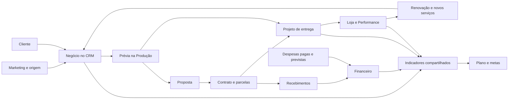

# Plano de evolução do sistema do estúdio

Revisão de 14/10/2026. Escopo: melhorar as abas existentes, integrar os processos e evoluir o design na linguagem do painel da vitrine/loja.

**Direção:** transformar o sistema em um lugar onde seja fácil saber o que fazer hoje, acompanhar cada cliente e entender o resultado do negócio. Cada informação deve ter uma origem clara; cada gráfico deve ajudar a tomar uma decisão e abrir os registros que explicam o número.

Este documento é um plano, sem alteração de telas, banco ou publicação. A referência de produção é o rework publicado no commit `877e52c5`. O AI Studio e os demais trabalhos locais ainda não publicados ficam fora da primeira entrega. A revisão considerou o código, as consultas e os scripts de banco do repositório; não é uma conciliação dos dados reais de produção nem uma confirmação das migrações instaladas.

## 1. O que já existe e merece ser aproveitado

O sistema já tem integrações úteis. O trabalho deve aperfeiçoar essa base, preservando os fluxos que funcionam.

| Área | Base atual | Evolução proposta |
| --- | --- | --- |
| Hoje | Fila comercial e informações do dia | Visão operacional do estúdio, com a fila comercial acessível em um clique |
| Funil e ficha | Etapas, interações, propostas, contratos e próximos passos | Histórico de etapas, cliente com vários negócios e ações conectadas à entrega e ao financeiro |
| Templates | Mensagens reutilizáveis | Uso contextual na ficha, na cobrança e no acompanhamento, com edição antes do envio |
| Produção | Oficina, produtos, imagens, revisão e prévias vinculadas a leads | Próxima tarefa, bloqueios e vínculo explícito com a entrega correspondente |
| Projetos | Checklist, entrega, contratos, pagamentos, prévia e Performance | Projeto por serviço contratado; situação financeira separada da situação de entrega |
| Performance | Lojas, eventos, acesso e relatórios | Saúde da loja, renovação e acompanhamento do cliente dentro do mesmo fluxo |
| Caixa | Recebimentos, parcelas, previsão e alertas de conciliação | Contas a receber e movimentos reais, com rastreabilidade e estornos por data |
| Financeiro | Recebimentos do Caixa e cadastro de custos | Despesas previstas e pagas separadas; resultado e projeção com dados verificáveis |
| Marketing | Calendário, produção, métricas dos posts e leitura dos resultados | Origem comercial conectada ao CRM; pendências de medição e comparação consistente |
| Métricas | Atividade, conversão aproximada, anúncios e ciclo de venda | Indicadores definidos uma vez, com histórico, filtros e detalhamento |
| Plano | Ciclo anual, iniciativas, metas, medições e revisão mensal | Metas alimentadas pelos indicadores do sistema e ligadas às próximas ações |

Já há recebimentos compartilhados entre Caixa, Financeiro e Plano; metas automáticas de recebimentos, fechamentos, contatos e posts; projetos que consultam contratos, pagamentos e lojas; e pagamento de Performance registrado também no Caixa. Manter essas conexões e eliminar divergências entre suas interpretações.

## 2. Problemas prioritários encontrados

| Prioridade | Evidência no código | Consequência | Tratamento |
| --- | --- | --- | --- |
| P0 | `resultadoDoMes` combina recebimentos com custos mensais equivalentes | Um custo anual rateado e uma despesa efetivamente paga aparecem na mesma interpretação de resultado | Nomear a visão atual como resultado estimado e criar movimentos de despesas pagas |
| P0 | Custos em USD usam cotação atual; sem cotação, a função usa zero | O passado muda com o câmbio e o resultado pode ficar superestimado | Guardar valor em reais realizado; previsão usa cotação identificada; ausência gera dado incompleto |
| P0 | Recebimento sem `valor_liquido` é tratado como taxa zero | Líquido e margem podem parecer conhecidos sem serem | Distinguir taxa zero confirmada de taxa desconhecida |
| P0 | Diversas consultas usam `data ?? []` sem apresentar o erro | Falha de leitura pode virar lista vazia ou meta com zero | Estados explícitos de carregamento, vazio, incompleto e erro |
| P0 | Estornos são excluídos pela marca atual nas consultas de receita | Um estorno posterior pode alterar a leitura de meses anteriores | Registrar devolução com data e valor próprios; definir comportamento de estorno parcial |
| P1 | Funil histórico é estimado pelo estágio atual dos leads criados no período | Perdidos, pausados e regressões distorcem a conversão | Registrar eventos de passagem; marcar a série antiga como aproximada |
| P1 | Perdas usam `updated_at`; valores fechados são espelhados no lead | Editar uma ficha pode deslocar a perda; contratos adicionais podem cair na data do primeiro fechamento | Data do evento de perda e data/valor por contratação |
| P1 | `crm_projetos` permite um projeto por dono e lead; a lista também deriva de pagamentos | Vários serviços do mesmo cliente podem se misturar | Separar cliente, negócio, contrato e entrega gradualmente |
| P1 | Caixa distingue vencimento e `cobrar_em`, mas a previsão pode usar a data de cobrança | Remarcar um lembrete pode mudar a leitura financeira | Vencimento contratual, agenda de cobrança e cenário de recuperação separados |
| P1 | Leituras de meses usam recortes de strings e alguns limites anuais terminam em 31/12 | Há risco de divergência de período, conforme o tipo da coluna e o horário | Uma regra de calendário em São Paulo, com início inclusivo e próximo período exclusivo para timestamps |
| P1 | Fechamento de contrato usa várias gravações e compensação quando parcelas falham | Falhas intermediárias podem deixar vínculos incompletos | Operações críticas transacionais e repetíveis sem duplicação |
| P2 | Estilos comuns convivem com módulos e camadas de overrides | Novas telas tendem a divergir e a manutenção fica difícil | Consolidar tokens e componentes comuns progressivamente |

P0 significa risco para a interpretação dos números; P1 melhora a integridade do fluxo; P2 melhora consistência e uso. Antes de migrar dados, confirmar cada situação no banco real. A proteção por identificador único do pagamento Mercado Pago já existe e deve ser preservada.

## 3. Como tudo deve se conectar

O diagrama mostra relações de dados, não uma obrigação de cobrar antes de toda produção. Prévia comercial, início de execução, entrega e liberação de acesso continuam sujeitos às regras do serviço.

### Ficha única do cliente

A ficha reúne contato, negócios, contratos, parcelas, recebimentos, entregas, lojas e histórico. Ela passa a ser o ponto de ligação entre as abas.

- Um cliente pode ter vários negócios e vários serviços, sem duplicar o cadastro do contato.
- Cada negócio tem sua proposta e resultado comercial; cada contrato tem seus valores, parcelas e vigência.
- Cada entrega tem seu escopo, prazo, checklist e vínculos. Mensalidade de Performance não cria automaticamente uma nova entrega.
- Origem, campanha e conteúdo podem ser vinculados quando conhecidos; manter “origem não identificada” quando faltar informação.
- A linha do tempo explica mudanças de etapa, contratação, pagamento, estorno e entrega, com data e origem.
- Links entre abas preservam o cliente e permitem voltar ao filtro anterior.

Evoluir a partir de `lead_id`, sem apagar a estrutura atual de uma vez. Introduzir vínculos novos, adaptar as leituras e migrar apenas os registros cuja associação for inequívoca. Casos ambíguos entram em uma lista de revisão, sem associação por nome ou Instagram presumida.

### Uma operação, reflexos consistentes

Registrar um recebimento deve atualizar o saldo da parcela, o total do cliente, o período financeiro e as metas correspondentes. O avanço da entrega ou a liberação de Performance depende de regra explícita do contrato. Cancelamento de contrato, perda comercial, estorno e suspensão de acesso são acontecimentos distintos.

O webhook de Performance já registra o pagamento no Caixa, mas faz operações separadas. Prever recuperação de falhas intermediárias: acesso concedido com registro financeiro pendente precisa aparecer para reconciliação e ser recuperável, sem cobrar ou liberar duas vezes.

## 4. Organização das telas e navegação

Manter as URLs atuais e a referência visual do painel da loja. A organização proposta é:

| Entrada principal | Conteúdo |
| --- | --- |
| Hoje | Resumo, prioridades e atalhos |
| Vendas | Funil, ficha do cliente/negócio e Templates |
| Entregas | Projetos, Produção e Performance |
| Financeiro | Visão geral, Caixa/Receber, Despesas e Previsão |
| Marketing | Calendário, Produção de conteúdo, Resultados e Referências |
| Indicadores | Vendas, operação e financeiro, com definições compartilhadas |
| Plano | Metas, iniciativas e revisão mensal |

“Produção de conteúdo” identifica o trabalho de Marketing; “Produção” identifica a oficina da vitrine. No Plano, chamar os projetos estratégicos de **Iniciativas**, distinguindo-os das entregas de clientes.

### Hoje: o trabalho que precisa de atenção

O topo terá até quatro resumos: recebido no mês, saldo vencido, entregas pendentes e andamento da meta principal. Cada resumo informa sua referência: “neste mês” ou “posição de hoje”.

Abaixo, uma fila de ações com motivo, cliente, prazo e botão correspondente: retornar contato, revisar proposta, vincular pagamento, cobrar parcela, pedir material, revisar prévia, concluir entrega ou acompanhar renovação. Prioridade por atraso, bloqueio e prazo; valores financeiros ajudam a decidir, sem esconder tarefas menores.

A fila comercial atual permanece acessível como modo de trabalho. A visão integrada não exige percorrer um painel longo antes de prospectar. “Sem pendências” e “não foi possível carregar pendências” são estados diferentes.

### Vendas e Templates

Cards do Funil mostram cliente, valor previsto, próxima ação, prazo e eventual bloqueio. A ficha oferece atalhos para proposta, contrato, produção e histórico financeiro. Mudar etapa registra um evento; voltar etapa não apaga o histórico da contratação.

Templates aparecem também no contexto da ação, com prévia e campos preenchidos. A preparação da mensagem não equivale ao seu envio: o usuário revisa e usa o canal disponível.

### Produção, Projetos e Performance

Lista de entregas com etapa, prazo, próxima tarefa e bloqueio. Na ficha, resumo compacto e seções de material, produção, financeiro e entrega; detalhes técnicos e histórico ficam em áreas secundárias. Checklists informam o que falta, sem transformar uma tela inteira em cartões grandes.

Performance mostra situação do acesso, último evento, disponibilidade do relatório e próxima renovação. Visitas, cliques e buscas descrevem uso da loja; não representam automaticamente pedidos ou vendas. Eventos ausentes precisam ser diferenciados de zero atividade.

## 5. Financeiro: previsto, recebido e pago

Unificar Caixa e Financeiro sob o mesmo grupo, com responsabilidades claras:

1. **Visão geral:** recebimentos brutos, taxas conhecidas, líquido conhecido, despesas pagas e saldo operacional do período. Resultado incompleto tem aviso junto ao número.
2. **Receber:** parcelas abertas, vencidas, pagamentos parciais e ações de cobrança. Abrir cliente e contrato diretamente.
3. **Despesas:** compromissos recorrentes/avulsos, vencimento, pagamento, categoria e comprovante opcional. O cadastro atual vira base de previsão; não vira pagamento retroativo automaticamente.
4. **Previsão:** entradas a vencer e saídas previstas por mês. Vencidos ficam separados dos valores contratualmente a vencer; recuperação de atrasos é um cenário identificado.
5. **Conciliação:** aproveitar os alertas atuais de recebimentos sem parcela e contratos sem distribuição. Adicionar vínculos incompletos e integrações pendentes na mesma lista de exceções.

### Regras para os números

| Indicador | Regra proposta |
| --- | --- |
| Vendido | Valor das contratações de projeto no período de fechamento, com cancelamentos identificados; separado de dinheiro recebido |
| Recebido bruto | Entradas efetivas pela data de recebimento; devoluções mostradas como movimentos próprios |
| Recebido líquido | Bruto menos taxas confirmadas; parte desconhecida aparece explicitamente |
| Saldo a receber | Valor exigível das parcelas menos pagamentos alocados, conforme cancelamentos e devoluções; pagamentos parciais incluídos |
| Despesa prevista | Compromissos e estimativas com referência de período; rateio anual identificado como equivalente mensal |
| Despesa paga | Saída efetivamente registrada, com data e valor em reais |
| Saldo operacional | Entradas líquidas menos devoluções e despesas pagas no período, conforme definição dos movimentos; não é saldo bancário nem lucro contábil |
| Saldo projetado | Entradas previstas menos saídas previstas; hipóteses visíveis e tratamento separado dos atrasos |
| Recorrência | Mensalidade contratada, valor esperado no período e valor recebido apresentados separadamente |

Impostos, aportes, retiradas e transferências precisam de categorias próprias quando aplicáveis. Para mostrar saldo disponível, será necessário saldo inicial e contas conciliadas. Uma DRE por competência pode vir depois, com regras próprias; a primeira etapa deve resolver o acompanhamento operacional.

Despesas em moeda estrangeira guardam moeda/valor original e valor realizado em reais. Para previsão, registrar cotação, data e fonte. Histórico sem comprovante de conversão permanece estimado. Falta de cotação nunca torna o custo zero. Taxa desconhecida nunca vira taxa zero.

## 6. Plano para os gráficos

Começar com poucos gráficos que respondem perguntas recorrentes. Cartões servem ao resumo; séries mostram evolução; tabelas explicam a composição e permitem agir.

| Pergunta | Visual proposto | Fonte e definição | Ação ao selecionar | Ordem |
| --- | --- | --- | --- | --- |
| Quanto entrou e saiu em cada mês? | Colunas agrupadas de entradas líquidas e despesas pagas; saldo em resumo separado | Movimentos efetivos, com devoluções identificadas | Extrato do mês | Primeira entrega, após dados confiáveis |
| O que está previsto para os próximos meses? | Colunas de entradas e saídas previstas, com marcação de previsão | Parcelas a vencer e compromissos; atrasados em grupo separado | Parcelas ou despesas daquele mês | Primeira entrega |
| Onde estão os atrasos? | Barras por faixa de atraso e lista de clientes | Saldo aberto por vencimento: 1–7, 8–30, 31–60 e mais de 60 dias | Lista de cobrança filtrada | Primeira entrega |
| Como está a meta do mês? | Realizado acumulado e alvo; barra de progresso para metas simples | Fonte automática ou medição manual identificada | Meta e iniciativas relacionadas | Primeira entrega |
| Onde o processo comercial perde negócios? | Barras horizontais por etapa, com quantidade e conversão | Coorte de negócios e eventos históricos; série antiga aproximada | Negócios da etapa/coorte | Segunda entrega, após histórico |
| Estou mantendo a atividade comercial? | Colunas semanais de contatos e referência da meta | Interações de saída, calendário comum | Contatos daquela semana | Segunda entrega |
| O que bloqueia as entregas? | Barras por etapa e tabela de prazo/bloqueio | Projetos de entrega e checklist | Projetos filtrados | Segunda entrega |
| Quais conteúdos geram resposta? | Ranking em barras e tabela com tamanho da amostra | Métricas medidas dos posts, mesma janela de observação | Conteúdo e suas medições | Segunda entrega |
| A vitrine está sendo usada? | Séries de visitas e cliques, em visões separadas ou até duas séries comparáveis | Eventos de Performance com cobertura e atualização | Loja e relatório do período | Segunda entrega |
| Qual origem traz negócios melhores? | Tabela por origem/campanha; gráfico opcional de comparação | Negócios atribuídos, fechamentos e valores vinculados | Negócios daquela origem | Depois de validar atribuição |

### Convenções comuns

- Título descreve a pergunta; subtítulo mostra período, unidade e se o dado é realizado, previsto ou aproximado.
- Cada número tem definição curta em “Como é calculado”, atualização e cobertura quando relevante.
- Barras de comparação partem de zero; valores negativos permanecem visíveis. Essa regra segue a orientação do [Carbon sobre eixos e rótulos](https://carbondesignsystem.com/data-visualization/axes-and-labels/).
- Evitar dois eixos com escalas diferentes. Usar até duas séries na visão inicial; detalhes podem ser abertos.
- Realizado e previsto usam também traço, padrão ou rótulo, além da cor. Verde acompanha realizado/ação; cinza, contexto; âmbar, atenção; vermelho, atraso ou perda. Categorias usam cores estáveis.
- Zero confirmado, ausência de medição e falha de leitura têm representações distintas. Percentual com denominador zero fica indisponível, com explicação.
- Comparar mês parcial com igual quantidade de dias do mês anterior, ou selecionar meses completos. Informar qual comparação está ativa.
- Selecionar um mês, barra ou etapa abre os registros com o mesmo filtro e total. A ação também deve estar disponível por teclado e em uma tabela.
- Oferecer resumo textual e tabela dos valores para gráficos complexos, conforme a [orientação da W3C/WAI](https://www.w3.org/WAI/tutorials/images/complex/).
- No celular, reduzir rótulos e períodos iniciais; detalhes abrem por toque. Rolagem horizontal fica contida em tabelas/gráficos quando necessária, sem alargar a página.

O filtro de período deve indicar sua semântica. “Saldo vencido hoje” é uma posição atual; “recebimentos de setembro” é um fluxo no intervalo; “conversão dos negócios criados em setembro” é uma coorte acompanhada até uma data. Esses indicadores não recebem o mesmo recorte automaticamente.

Não calcular CAC ou ROAS apenas com tags do lead e custo agregado de tráfego. São necessários gasto por campanha, janela de atribuição e resultado associado. Até lá, mostrar volume, conversão e receita atribuída conhecida, com cobertura. Não prometer integração automática com ferramentas externas nesta etapa.

## 7. Plano e metas conectados à operação

O Plano passa a mostrar objetivo anual, metas do período, desvio e próxima iniciativa. Receita recebida, fechamentos, contatos e posts continuam automáticos. Acrescentar entregas concluídas, despesas pagas e saldo operacional apenas quando suas fontes forem confiáveis.

Cada meta informa indicador, alvo, período, direção desejada — aumentar ou reduzir — e origem da medição. Uma meta manual tem campo de medição; uma automática abre os registros de origem. Meses anteriores à criação da meta não entram como desempenho zero.

Iniciativas ligam estratégia a trabalho: objetivo, resultado esperado, prazo, responsável quando necessário e próxima ação. A revisão mensal responde o que aconteceu, o que explica o desvio e o que muda no próximo mês. Não exigir lançamento duplicado do resultado financeiro.

A montanha e os incentivos podem ficar numa área secundária de motivação. O primeiro conteúdo da tela será o progresso das metas e as decisões necessárias. Atingimento de metas diferentes não deve ser reduzido a uma nota única sem mostrar as regras e os resultados individuais.

## 8. Design simples e profissional

Continuar com fundo claro, cards discretos, verde da marca e tipografia do painel da loja. O rework já publicado é o ponto de partida.

- Cabeçalho comum: título, descrição curta, filtro principal e uma ação destacada.
- Espaçamento padronizado em uma escala pequena; componentes compactos nas telas de trabalho e mais respiro nos resumos.
- Valores financeiros alinhados à direita, com unidade consistente; datas e estados fáceis de comparar.
- Usar cartões para blocos de decisão e tabelas para muitos registros. Informações secundárias ficam em detalhes recolhíveis.
- Padronizar campos, seletores, botões, badges, tabelas, confirmação de ações, avisos, vazios e carregamento.
- Confirmações descrevem efeitos concretos em pagamentos, contratos ou vínculos. Cadastro vinculado ao financeiro deve ser arquivado quando a exclusão comprometer o histórico.
- Navegação com rótulos acessíveis, foco visível e opção de manter o menu expandido no desktop. No celular, poucos atalhos e menu completo.
- Movimento curto apenas como feedback de interação, respeitando preferência por movimento reduzido.
- Erros operacionais mostram o problema e como tentar novamente. Instruções de SQL ou configuração ficam na manutenção, separadas do fluxo cotidiano.

Consolidar estilos e componentes à medida que as telas forem revisadas, removendo overrides substituídos. Aproveitar Next.js, React e Supabase atuais. Gráficos simples podem manter SVG/componentes existentes; avaliar biblioteca apenas se interação e acessibilidade justificarem seu custo.

## 9. Base técnica para sustentar a integração

Criar um catálogo de indicadores compartilhado: identificador, nome, unidade, fórmula, evento/data de referência, filtros, fonte, tratamento de estorno/cancelamento e estado de disponibilidade. Financeiro, Métricas, Hoje e Plano consultam a mesma definição.

Prioridades de dados:

1. Calendário e arredondamento comuns; datas de negócio diferenciadas de timestamps técnicos.
2. Registro de despesas pagas e devoluções, sem sobrescrever a origem do movimento.
3. Histórico de etapas e eventos de contratação, perda e entrega. Não fabricar passagens anteriores ausentes.
4. Vínculos explícitos entre cliente, negócio, contrato, entrega e loja, com adaptação dos registros legados.
5. Transações para gravações críticas e mecanismos de recuperação entre banco e serviços externos. Reutilizar a idempotência já existente no Mercado Pago.
6. Respostas que preservem erro e incompletude, em vez de devolver um zero aparentemente válido.
7. Agregação no banco e paginação onde houver crescimento de histórico. Não perder recebimentos antigos necessários para quitar parcelas antigas ao filtrar o gráfico por ano.
8. Manter isolamento por dono/RLS nos novos vínculos e agregações; credenciais e material privado não entram em resumos ou exportações.

Atualizar dados após uma ação concluída, com feedback de sucesso ou erro. Ações concorrentes e repetidas precisam manter os mesmos saldos. Não é necessário criar serviços separados nem transmitir toda a base em tempo real para integrar as telas.

## 10. Ordem de execução e entregas revisáveis

Os tamanhos abaixo são relativos, não estimativas de prazo. O volume de dados legados e as regras de contratação podem alterar o esforço.

| Etapa | Entrega | Principais pontos no repositório | Esforço | Critério para avançar |
| --- | --- | --- | --- | --- |
| 0 — Diagnóstico dos dados | Mapa de vínculos, catálogo de indicadores e relatório de inconsistências com amostra real | `lib/crm/dados.ts`, `lib/financeiro/*`, `lib/plano/dados.ts`, `lib/projetos/dados.ts`, scripts `supabase/*` | M | Regras dos números e casos legados documentados |
| 1 — Confiabilidade | Calendário comum, erros explícitos, financeiro estimado corretamente identificado, taxas/câmbio incompletos visíveis | `lib/crm/regras.ts`, `lib/crm/financeiro.ts`, `lib/financeiro/*`, leitores das áreas | M | Números equivalentes batem entre abas; falhas não viram zero |
| 2 — Histórico e movimentos | Despesas pagas, devoluções, eventos de etapa/contratação e gravações críticas consistentes | Migrações novas, `app/(pt)/crm/acoes*.ts`, `pages/api/mp-webhook.js` | G | Fluxos financeiros e comerciais verificáveis sem duplicação |
| 3 — Design e financeiro | Componentes comuns; Financeiro/Receber/Despesas/Previsão revisados | `components/crm/*`, `components/financeiro/*`, CSS de CRM e áreas | M/G | Uso completo no celular e desktop; totais abrem seus registros |
| 4 — Fluxo de cliente e entrega | Ficha integrada e vínculos de múltiplos negócios/serviços; Projetos, Produção e Performance conectados | CRM, `lib/projetos/*`, `lib/producao/*`, `lib/performance/*` e respectivas telas | G | Um cliente com vários serviços mantém saldos e entregas independentes |
| 5 — Hoje, gráficos e Plano | Prioridades integradas; primeiros gráficos; metas com fontes compartilhadas | `lib/crm/dados.ts`, telas Hoje/Métricas/Plano, componentes de gráficos | M/G | Mesmos filtros, definições e totais em resumo, gráfico e detalhe |
| 6 — Marketing e acabamento | Origem comercial, medições comparáveis, relatórios de Performance e consistência das demais telas | `lib/marketing/*`, `lib/performance/*`, Templates e módulos restantes | M | Fluxo completo de origem → negócio → recebimento → entrega → acompanhamento |

Protótipos de Hoje, Financeiro e ficha do cliente podem ser preparados durante as etapas 0–1 para validar o layout com casos conhecidos. A publicação de indicadores definitivos depende das fontes e regras estarem prontas.

**Primeiro pacote recomendado:** corrigir a apresentação dos dados incompletos, definir o catálogo de indicadores, unificar períodos e prototipar o novo Financeiro com tabelas e gráficos ligados ao extrato. Assim o primeiro avanço entrega clareza concreta e estabelece a base das demais abas.

As integrações de estoque, pedidos/WhatsApp e Mercado Livre já descritas em outros documentos ficam como expansões posteriores. Primeiro resolver o sistema publicado. AI Studio permanece fora deste pacote.

## 11. Validação e passagem para produção

Antes de qualquer migração: inventário do esquema instalado, cópia recuperável dos dados afetados e simulação da migração. Introduzir vínculos e tabelas de forma aditiva, comparar leituras novas com as atuais e revisar associações ambíguas. Publicar por etapas, mantendo os caminhos existentes até o fluxo substituto estar validado.

Casos que precisam passar:

| Cenário | Resultado esperado |
| --- | --- |
| Contrato de R$ 999 com R$ 199 recebidos num mês e R$ 800 no seguinte | Uma contratação; receita distribuída pelas datas; saldo de R$ 800 e depois zero |
| Reenvio do mesmo pagamento Mercado Pago, inclusive simultâneo | Um recebimento e um efeito de acesso/etapa |
| Renovação de Performance do cliente que já tem uma entrega | Receita e acesso atualizados; nenhuma nova entrega sem serviço correspondente |
| Dois projetos e uma recorrência do mesmo cliente | Contratos, parcelas, entregas e próximos passos independentes na ficha única |
| Devolução parcial ou total no mês seguinte | Movimento na data da devolução, vínculo ao pagamento original e saldos coerentes |
| Taxa desconhecida ou cotação indisponível | Totais afetados identificados como incompletos; nenhum lucro artificial |
| Pagamento no último dia do ano e à noite na virada do mês | Mesmo período em Caixa, Financeiro, Métricas e Plano, pelo calendário adotado |
| Lead perdido, depois editado; lead que volta etapa | Evento original preservado; conversão não reescrita pela edição |
| Falha de consulta ou integração | Aviso acionável; não vira zero, lista vazia confirmada ou meta não atingida |
| Mais registros que o limite padrão de leitura | Totais completos por agregação/paginação, inclusive pagamentos de anos anteriores |
| Clique em valor, barra ou meta | Detalhe abre com o mesmo período, definição e total |
| Uso em 320/390 px, desktop e teclado | Sem corte de ações; navegação, gráficos e formulários utilizáveis |
| Outro dono autenticado | Nenhum acesso aos dados, vínculos ou agregados do primeiro |

Executar TypeScript, build, testes das regras financeiras/eventos e verificação visual dos fluxos alterados. Fazer uma revisão final com uma jornada completa: captar → contatar → preparar prévia → contratar → receber parcialmente → entregar → renovar → analisar → ajustar metas.

O sistema estará integrado quando essa jornada puder ser acompanhada pela mesma ficha, sem redigitar dados, com números reconciliáveis e uma próxima ação clara em cada etapa.
