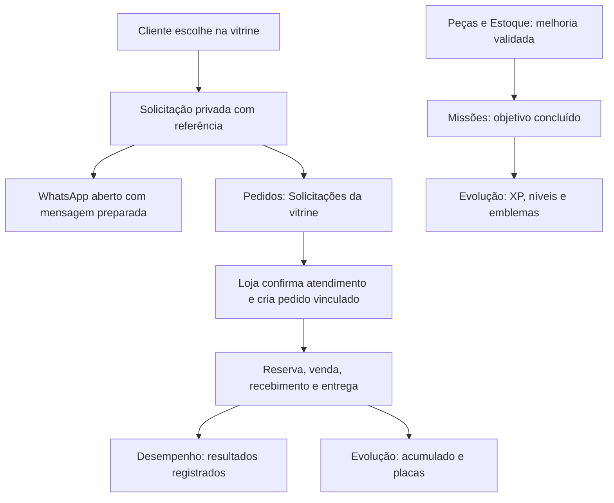

# Plano de unificação — molde, Performance e placas

**Plano vigente (19/10/2026, tarde):** [A gamificação que roda](PLANO-MESTRE-MOLDE-PERFORMANCE-GAMIFICACAO-PLACAS.md). Ele descarta os recebimentos estruturados e o motor de XP deste histórico; as placas passam a ser medidas pelo central, e as de vendas dependem do Vendi com valor, condicionado à validação com as lojistas.

**Estúdio Rafael Razeira · 19/10/2026 · Plano para implementação**

**Revisão de experiência — 19/10/2026:** o [plano de simplificação do painel](plano-simplificacao-painel.md) define a apresentação atual: cinco destinos principais, melhorias no Início e conquistas dentro de Resultados. Esta revisão preserva a base técnica e as regras deste documento.

[Apresentação HTML anterior, com o desenho inicial da navegação](plano-unificacao-vitrine-performance-placas.html).

Unificar a vitrine e o painel do lojista em um percurso: **preparar a loja → receber interesse → atender → registrar recebimentos → acompanhar resultados e conquistas**.

O molde mantém a experiência da cliente e o painel operacional. O Performance incorpora missões, leitura de resultados e evolução ao mesmo painel. As placas reconhecem os recebimentos registrados pela loja, mesmo sem checkout.

Este documento consolida a direção discutida e passa a prevalecer, para esta integração, sobre os pontos divergentes dos planos anteriores. É um planejamento; não significa que o experimento foi incorporado ao molde, que bancos de clientes foram migrados ou que lojas foram publicadas.

## 1. Decisões de produto

1. **Um painel por loja.** Usar a navegação, a autenticação e os cadastros do molde. O aplicativo experimental permanece como referência e ambiente de cenários.
2. **Uma operação, um registro.** A solicitação origina um pedido vinculado; o recebimento desse pedido alimenta o resultado e as placas. Não pedir que a loja registre a venda novamente no Performance.
3. **Dois reconhecimentos.** Cuidados validados concedem XP e níveis; recebimentos registrados podem conceder placas. Venda, pagamento, entrega, clique e acesso não geram XP.
4. **Confirmação financeira pela loja.** A primeira versão funciona sem checkout e sem leitura automática de mensagens. A interface explicita a origem manual do recebimento.
5. **Seis placas na primeira coleção.** R$ 10 mil, R$ 20 mil, R$ 50 mil, R$ 100 mil, R$ 300 mil e R$ 500 mil, com o texto **“em vendas registradas”**.
6. **Operação disponível durante falhas da gamificação.** Catálogo, estoque e pedidos continuam utilizáveis se o reconhecimento estiver desligado ou aguardando atualização.

## 2. Base conferida e lacunas reais

Inspeção de arquivos locais em 19/10/2026. O molde está em `C:/Users/Rafael/Desktop/vitrines/_molde`; o código compartilhado está em `C:/Users/Rafael/Desktop/vitrines/_plataforma`. O experimento está neste workspace, em `experimentos/painel-gamificado`.

O `package.json` do molde aponta para `@vitrine/plataforma#v1.7.2`, e o pacote instalado declara 1.7.2. Antes de implementar, comparar o checkout compartilhado com o pacote efetivamente consumido e fixar o commit da base. Documentos antigos citam versões anteriores e não comprovam o estado das lojas publicadas.

| Frente | O que foi encontrado | O que integrar ou completar |
| --- | --- | --- |
| Sacola | Revisão de preço/disponibilidade e abertura do WhatsApp | Conectar a experiência de solicitação à fila do painel |
| Referência | `comReferencia` chama `/api/solicitacao`; código aleatório, validade de sete dias e retorno direto sem código em caso de falha | Preservar a mesma chave ao repetir uma tentativa; evitar duplicação de interesse |
| Solicitações | Armazenamento privado e consulta autenticada por código | Listagem paginada, classificação, encerramento e vínculo visível com pedido |
| Pedidos | Atendimento, reserva, pagamento manual, envio/retirada, cancelamento, devolução e reembolso | Aproveitar essa operação como fonte do Performance e das placas |
| Estoque | Documento de gestão, saldos, versão e RPC transacional | Conectar missões às operações existentes, sem criar outro controle de saldo |
| Desempenho | Área real do painel e leitura de resultados de pedidos | Harmonizar fontes, cobertura e métricas com o novo acumulado |
| Gamificação | Motor de missões, XP, níveis, emblemas, grupos e cenários no experimento | Adaptador real, persistência por loja e integração dos componentes |
| Placas | Plano e HTMLs demonstrativos | Motor de concessão, persistência, coleção e exportação reais |

**Lacunas importantes no modelo atual:** pagamento é um estado do pedido, sem um registro estruturado de recebimentos parciais. O resultado atual de gestão soma o total do pedido, que inclui frete, filtra pedidos pelo estado atual e por uma janela. Essa função não pode ser reutilizada como acumulado das placas sem adaptação. Reembolsos também precisam discriminar produtos e frete.

O CRM financeiro do estúdio e seus recebimentos não são os recebimentos das lojas. Não usar `crm_recebimentos`, tokens de relatório ou chaves de rastreamento como atalho para os dados e permissões do lojista.

## 3. Arquitetura da experiência

O diagrama indica relações de produto. Abrir o WhatsApp não comprova que a mensagem foi enviada. Criar uma solicitação não altera estoque nem confirma venda. O recebimento e a entrega permanecem estados distintos.

### Navegação do painel unificado

| Destino | Conteúdo e responsabilidade |
| --- | --- |
| **Início** | Pendências operacionais e uma melhoria sugerida; progressão fica fora do destaque inicial |
| **Peças, Banners e Textos** | Cadastro e apresentação da vitrine, usando os editores existentes |
| **Estoque** | Contagens, entradas, reservas, disponibilidade e movimentações |
| **Pedidos** | Novos interesses da vitrine, atendimentos confirmados, recebimentos e entrega |
| **Resultados** | Valores e origem dos registros; detalhes de interesse e Minhas conquistas sob demanda |
| **Mais** | Clientes, personalização da vitrine, configurações e ajuda, conforme as opções habilitadas |

Manter `/painel/desempenho`, com o rótulo Resultados. Missões e Evolução passam a ser Melhorias sugeridas no Início e Minhas conquistas dentro de Resultados, sem itens principais independentes. `/painel` continua sendo o único Início. A organização detalhada e as visualizações internas estão no plano de simplificação, que prevalece nos itens de apresentação deste documento.

No celular, preservar o padrão de navegação existente e indicar a seção atual. Missões abrem o editor da peça ou a operação de estoque apropriada, com contexto e retorno para a missão. Pedidos permanece a área de atendimento: não distribuir seus botões financeiros por outras telas.

## 4. Solicitação automática e atendimento

### Entrada pela vitrine

1. A cliente seleciona peças, variações e quantidades.
2. A sacola revalida disponibilidade e valores no servidor.
3. Uma tentativa identificada cria uma solicitação privada e retorna sua referência.
4. A mensagem preparada inclui a referência e os itens; o WhatsApp é aberto.
5. A solicitação aparece em **Pedidos → Solicitações da vitrine**, com origem e situação próprias.

A chave de tentativa precisa ser reaproveitada em falhas e repetições da mesma tentativa. Hoje o helper gera um UUID novo em cada chamada; a proteção do servidor contra repetição da mesma chave não resolve sozinha dois cliques com chaves diferentes. Uma seleção alterada pode iniciar outra tentativa.

Preservar o fluxo direto quando a geração da referência falhar. Nesse caso, informar que a conversa pode continuar, mas a captura para o painel não foi confirmada. Nunca bloquear o contato para garantir uma métrica.

### Fila de solicitações

Estados propostos: **Nova**, **Em atendimento**, **Encerrada sem venda**, **Vinculada a pedido** e **Expirada**. “Em atendimento” significa confirmação da loja, não leitura automática do WhatsApp.

- Mostrar código, data, itens, valor inicial conhecido e situação. Nome e telefone permanecem ausentes até serem informados ou recebidos por integração autorizada.
- Separar solicitações anônimas da lista principal de pedidos, inclusive nas contagens do Início.
- Permitir iniciar atendimento, encerrar sem venda, vincular a um pedido existente ou criar um pedido com os itens preenchidos.
- Criar pedido e registrar o vínculo na mesma operação autorizada. A mesma solicitação não pode produzir dois pedidos por uma corrida entre abas.
- Consultar uma referência já vinculada abre o pedido existente. Consultar uma referência não reserva unidades.
- Preservar a validade pública de sete dias. Ao expirar, retirar a possibilidade de recuperar o conteúdo anonimamente e manter na fila privada apenas o histórico necessário à operação, com política de retenção definida na primeira etapa. Pedido já criado conserva seus próprios itens e histórico.

Na primeira entrega, a captura automática cobre a **sacola**, onde a referência já existe. Cliques diretos em uma peça devem continuar funcionando; adaptar esses botões para a mesma solicitação é uma entrega posterior explícita. Conversas iniciadas fora da vitrine não entram automaticamente nessa fila.

### Resultado do atendimento

“Vendeu” leva à conferência de itens, valores e recebimento. A solicitação vira um pedido vinculado, aproveitando o formulário atual. O operador pode registrar uma venda com pagamento pendente ou confirmar o recebimento na mesma sequência, mediante confirmação explícita.

Separação, pagamento, envio/retirada, devolução e reembolso seguem o modelo operacional existente. O MVP pode encerrar solicitações sem venda com motivo opcional; não exigir questionários para limpar a fila.

## 5. Gamificação conectada ao trabalho real

Reaproveitar os nove modelos e a fórmula de progressão existentes. O motor identifica o cuidado; a operação real do catálogo ou da gestão decide se ele foi concluído. Concluir uma ação pelo editor comum também precisa concluir a missão correspondente, quando elegível.

| Ação confirmada | Origem da conclusão | Reconhecimento |
| --- | --- | --- |
| Primeira foto de capa ou detalhe | Salvamento no editor de Peças | XP original da missão, uma vez por objetivo |
| Informações ou composição válidas | Salvamento do campo e regra de elegibilidade | XP original, sem premiar apagar e preencher novamente |
| Primeira contagem | Operação real de Estoque, por variação estável | XP original, incluindo contagem zero válida |
| Revisão de divergência | Nova ocorrência comprovada e conferência salva | XP original da ocorrência; sem revisão artificial periódica |
| Decisão sobre esgotado, busca ou campanha | Registro validado com fonte e janela próprias | XP original, reconhecendo uma decisão registrada |
| Solicitação, venda, recebimento ou entrega | Operação em Pedidos | Histórico e indicadores; sem XP |
| Marco de recebimentos | Cálculo autorizado das placas | Placa; sem XP adicional |

Grupos mantêm objetivos fixos, adiamento não muda o total, excedente de XP é preservado e reabertura não premia de novo. Não mudar níveis ou recompensas para acomodar vendas.

Na interface de produção, o editor existente é a ação principal. Aproveitar a confirmação para apresentar o XP após o salvamento. Não copiar o editor simplificado do experimento por cima do cadastro real. Intelligence permanece contextual e não escreve estoque, pedidos, XP ou concessões.

Cadastros e cuidados concluídos antes da ativação não geram XP retroativo por inferência. Começar a progressão real no nível 1, mostrar os cuidados atualmente elegíveis e nunca transportar XP fictício. As rotinas de negócio funcionam independentemente do nível.

## 6. Placas com recebimentos registrados pela loja

### Critério e apresentação

**Nome visível da coleção:** Placas de vendas registradas. Cada placa mostra valor do marco, nome da loja, data, marca Performance e **“em vendas registradas”**. A explicação curta é: “Considera recebimentos de produtos confirmados pela loja, após descontos e reembolsos registrados.”

| Marco | Direção visual |
| --- | --- |
| R$ 10 mil | Verde profundo e moldura fina |
| R$ 20 mil | Verde e contorno metálico |
| R$ 50 mil | Bronze e moldura facetada |
| R$ 100 mil | Metal acetinado |
| R$ 300 mil | Prata e moldura mais presente |
| R$ 500 mil | Dourado e composição de maior presença |

O acumulado cobre **todos os canais registrados no painel**, inclusive presencial e WhatsApp direto, com identificação da origem. Desempenho pode filtrar a origem; as placas usam uma regra única por loja. Filtrar o relatório não muda a coleção. Vendas da vitrine só podem ser atribuídas a ela quando houver vínculo com a solicitação ou outra evidência definida.

### Cálculo

Acumulado elegível = **recebimentos alocados aos produtos, após descontos − reembolsos de produtos efetivamente registrados**. Usar centavos e BRL. Frete fica separado; taxas do processador não são deduzidas desse indicador. Não apresentar lucro ou saldo bancário.

- Só somar valores conhecidos e recebidos. Pedido marcado como pago com valores desconhecidos aparece como pendência de informação, sem valor inventado.
- Recebimento parcial entra pela parcela dos produtos efetivamente recebida. A separação entre produtos e frete é explícita no registro, com validação contra o valor negociado; não presumir que toda entrada é de produtos.
- Recebimentos registrados não podem ultrapassar o valor devido. Não aceitar reembolso maior que o recebido ou descontar duas vezes o mesmo ajuste.
- Cancelar atendimento não cria reembolso financeiro. Se já houve recebimento, preservar esse movimento e registrar o estorno quando realizado. Devolução de estoque também não devolve dinheiro automaticamente.
- Guardar valor negociado e movimento financeiro como fatos históricos. Editar o preço do catálogo não altera vendas passadas.
- Excluir cenários de teste, dados fictícios e importações não conferidas.
- Mostrar período de cobertura e origem manual. Cobertura incompleta ou falha de leitura tem estado próprio; não equivale a zero.

Na primeira ativação, importar pedidos antigos apenas se valores, frete, recebimento e ajustes forem reconciliáveis. Caso contrário, iniciar cobertura na ativação e manter o histórico antigo consultável fora do acumulado até revisão. Importação gera um resumo das placas já obtidas, sem uma sequência de celebrações antigas.

### Concessão e ajustes

Conceder cada marco uma vez por loja, preservando a primeira data em que o histórico válido atingiu a meta. Registrar data financeira e data de lançamento para tratar atrasos. O progresso não reinicia a cada mês.

Um estorno posterior reduz o acumulado, preservando a placa legitimamente alcançada. Correção de erro ou duplicidade que invalide o marco exige retificação auditável e bloqueio de novas exportações daquela concessão. Reprocessar o histórico não repete conquistas nem celebrações. A data apresentada deve poder ser corrigida quando um evento atrasado alterar a primeira passagem válida pelo marco.

Em Evolução, mostrar última placa válida, coleção e próxima meta ainda não conquistada. Se o saldo cair abaixo de um marco já conquistado por um estorno legítimo, manter esse marco obtido e calcular o valor restante para a próxima placa não obtida. Após R$ 500 mil, apresentar coleção completa.

Arte de stories: 1080 × 1920, com marca, loja, marco e data. Download voluntário, sem publicação automática e sem dados de clientes ou total exato atual. A apresentação da conquista respeita teclado e redução de movimento e não bloqueia a conclusão da operação.

## 7. Dados e fronteiras técnicas

Manter catálogo e gestão como autoridades operacionais. Cada loja usa seu projeto Supabase; o documento de gestão existente é a base do primeiro piloto. Não transformar esse documento em um singleton compartilhado entre lojas.

| Registro | Papel e garantias a implementar |
| --- | --- |
| Solicitação | Itens iniciais, origem, chave da tentativa, estado, datas, validade e vínculo único com pedido |
| Pedido | Itens e valores negociados, contato quando fornecido, referência, operação e histórico existentes |
| Recebimento e ajuste | Identidade estável, pedido, valor de produtos/frete, natureza, momento financeiro, lançamento e correção vinculada |
| Objetivo e recompensa | Loja, produto/variação estável, ocorrência, versão de regra, evento confirmado e XP |
| Concessão de placa | Loja, marco, versão do critério, data atingida, evidência, situação e retificações |
| Apresentação da conquista | Identidade da concessão e confirmação de apresentação, sem depender só do cache do navegador |

Os nomes finais das tabelas e migrações serão definidos após revisar as migrações já existentes; não reservar números de migração sem conferir a sequência atual.

Reutilizar autenticação e autorização de donos do painel. Resolver no servidor a loja do catálogo e sua eventual associação à coleta central; não aceitar `storeId`, XP, valor acumulado ou data de concessão como autoridade do navegador. API pública de solicitação não concede acesso de leitura aos contatos, pedidos ou finanças.

Expandir a transação de gestão ou o contrato de gravação para que a mutação operacional e seu evento confirmado sejam persistidos juntos. Quando os registros estiverem no mesmo banco, gravar a recompensa ou a concessão de forma atômica sempre que viável. Para projeções em outro processo/banco, usar uma fila persistida na transação de origem e consumo que ignore eventos já processados.

Se a operação foi salva e o reconhecimento ainda estiver em processamento, confirmar a operação e indicar que o progresso será atualizado. O consumidor deve recuperar o atraso sem exigir que o lojista repita a venda. Não declarar duas chamadas HTTP como uma transação única.

Separar a leitura monetária por período do histórico de recebimentos e do acumulado das placas. Atualizar ou explicar os indicadores atuais de gestão para que não pareçam o mesmo total quando incluírem frete ou usarem pedidos pagos no período com seu estado atual.

## 8. Mapa de implementação

| Camada | Base a aproveitar | Trabalho previsto |
| --- | --- | --- |
| Molde público | `_molde/components/ListaEscolhas.tsx`, `referenciaWhatsApp.ts` e rota `/api/solicitacao` | Tentativa estável, feedback de captura e preservação do contato direto |
| Gestão compartilhada | `_plataforma/lib/gestao.ts`, `gestao-repositorio.ts`, `acoes-gestao.ts`, `solicitacao-rota.ts` | Fila privada, vínculo transacional e eventos financeiros estruturados |
| UI operacional | `_plataforma/painel/PainelGestao.tsx`, `Navegacao.tsx`, `PendenciasGestao.tsx` | Solicitações, integração de recebimentos e navegação unificada |
| Performance do lojista | `_plataforma/estudio/rotas/desempenho` e componentes da área | Leitura dos resultados e fontes, com links para a operação correta |
| Motor experimental | `experimentos/painel-gamificado/domain` e `integration/authenticated-service.mjs` | Adaptar motor e contrato ao catálogo/gestão reais, preservando regras |
| Componentes experimentais | Missões, Evolução, XP, emblemas e reconhecimento | Portar para o pacote compartilhado com estilos isolados e identidade do painel |
| Placas | Planos e demonstrações locais | Criar domínio de marcos, concessão persistida, coleção e exportação reais |
| Distribuição | Pacote `@vitrine/plataforma` e wrappers de rotas do molde | Versão fixada, migrações compatíveis e ativação por loja |

Não copiar o servidor Next, o SQLite, cookies experimentais, endpoints de reset, fixtures ou cache do protótipo para o painel de produção. Reaproveitar as regras e componentes com contratos reais. Confirmar exportações do pacote e compatibilidade com o molde antes de atualizar sua referência.

## 9. Entregas, dependências e critérios

| Etapa | Entrega concreta | Condição para avançar |
| --- | --- | --- |
| **0 — Fixar a base** | Inventário de pacote, migrações, auth, IDs, fontes e diferenças entre checkout/instalação; desenho das telas e política de retenção | Contrato por loja definido e ambiente de teste com dados fictícios disponível |
| **1 — Unificar solicitações e pedidos** | Captura já existente ligada à fila autenticada, classificação e conversão em pedido | Mesma solicitação não duplica pedido; falha de captura mantém WhatsApp; estado e estoque corretos |
| **2 — Estruturar recebimentos** | Movimentos em centavos, produtos/frete separados, parciais, ajustes e origem manual; migração dos casos conferíveis | Totais reconciliados com os registros e sem dupla contagem de pagamentos/reembolsos |
| **3 — Conectar missões e XP** | Melhorias no Início, evolução dentro de Minhas conquistas, adaptador autorizado e reconhecimento de salvamentos feitos pelos editores reais | Mesma melhoria concede XP uma vez; falha não cria conclusão falsa; regressões do catálogo e estoque passam |
| **4 — Integrar placas e resultados** | Seis placas, acumulado derivado da etapa 2, coleção, resumo no Início e exportação | Seis limites corretos, histórico reprocessável, concessão única e fontes explicadas |
| **5 — Validar o percurso completo** | Revisão com lojistas, correção das confusões e piloto em uma loja autorizada | Percurso entendido, valores conciliados e nenhuma falha crítica de isolamento, estoque ou duplicação |
| **6 — Distribuir gradualmente** | Pacote versionado, atualização do molde, migrações e ativação controlada nas lojas elegíveis | Cada ativação tem verificação de versão, banco, recuperação e conferência de saldos/conquistas |

As etapas 1 e 2 sustentam a operação comercial e as placas. A etapa 3 depende da base autorizada da etapa 0 e pode ser desenvolvida separadamente, preservando os editores reais. A etapa 4 só concede placas reais depois da etapa 2. Uma demonstração unificada com dados fictícios pode antecipar a avaliação visual das etapas 3 e 4.

Não atrelar esta entrega à API oficial do WhatsApp, checkout, IA generativa, ERP, logística integrada ou placas físicas. Essas frentes podem consumir os mesmos pedidos e eventos depois. Não alterar condições comerciais dos planos neste trabalho.

## 10. Validação do percurso e testes de aceite

### Percurso principal

1. Loja fictícia começa com R$ 9.750 elegíveis e uma peça com foto ausente.
2. O operador adiciona a foto pelo editor de Peças; o servidor salva e concede o XP original uma vez. A missão aparece concluída.
3. A cliente monta uma sacola de R$ 280 e abre o WhatsApp. Uma solicitação aparece; estoque e placas permanecem iguais.
4. A loja confirma atendimento e transforma a seleção em pedido. Alterações na negociação ficam no pedido, com histórico.
5. A loja registra o recebimento de R$ 280 dos produtos. O acumulado chega a R$ 10.030 e a placa de R$ 10 mil é concedida; a próxima meta é R$ 20 mil. Esse recebimento não gera XP.
6. A retirada/envio conclui a saída física de acordo com a gestão, sem novo recebimento e sem outra baixa da mesma unidade disponível.
7. Recarregar ou abrir outra aba preserva pedido, XP e placa, sem repetir as operações ou celebrações.

### Variações obrigatórias

| Cenário | Resultado esperado |
| --- | --- |
| Cliente abre WhatsApp e não envia | Solicitação de interesse; sem atendimento ou venda presumidos |
| Loja encerra sem venda | Solicitação encerrada e sem efeito monetário |
| Pagamento pendente | Pedido salvo; nenhum valor não recebido entra na placa |
| Parcial e frete | Só parcela dos produtos recebida entra; soma final confere |
| Valor desconhecido | Pendência explícita, sem transformar ausência em zero |
| Última unidade disputada | Reserva/pagamento respeita a transação de estoque existente |
| Requisição ou recebimento repetido | Sem duplicação de solicitação, pedido, saída, XP ou acumulado |
| Reserva expira durante pagamento | Revalidar saldo; nenhum sucesso falso |
| Cancelamento e devolução | Estoque e dinheiro têm registros próprios; reembolso só ajusta quando registrado |
| Reembolso após uma placa legítima | Acumulado reduzido; conquista histórica preservada |
| Correção invalida o marco | Retificação auditável e exportação bloqueada |
| Valores imediatamente abaixo e em cada marco | Concessão nos seis limites corretos, sem arredondamento indevido |
| Importação ultrapassa várias metas | Um resumo com as placas obtidas; sem vários diálogos |
| Foto removida e recolocada | Sem novo XP pelo mesmo objetivo |
| Melhoria feita fora da tela Missões | Conclusão reconhecida pela mesma regra |
| Outra loja ou visitante anônimo | Sem leitura ou operação em dados privados |
| Reconhecimento atrasado ou desligado | Pedido salvo e operação utilizável, com recuperação posterior |

Executar testes das regras puras, integração SQL/RPC e concorrência em banco descartável; conferir o pacote compartilhado e compilar o molde com a versão candidata. Validar o navegador de 320 a 1440 px, teclado, retorno de foco, nomes longos, redução de movimento e exportação da arte. Não executar testes de escrita em bancos de clientes.

Os cenários técnicos não substituem observação com lojistas. Adaptar as cinco sessões propostas no plano 1.5 para incluir atendimento e placas. Observar se distinguem clique, atendimento, pagamento manual, entrega, XP e valor registrado; se concluem o percurso sem redigitar; e se a conquista tem significado. Abertura do painel e elogio ao desenho não comprovam utilidade comercial.

## 11. Ativação e recuperação

Ativar recursos por loja e por capacidade: gestão compatível, fila de solicitações, missões/XP e placas. Sem tabelas ou permissões necessárias, apresentar limitação específica e manter as áreas já operacionais.

Antes do piloto: fixar a versão do pacote, conferir migrações aplicadas, preparar backup e ensaiar importação/reconciliação em staging. Não reexecutar seeds nem substituir documentos de gestão existentes silenciosamente. A mudança de esquema deve permitir que a operação continue durante a implantação gradual.

Se surgir um problema, suspender reconhecimento e apresentação das conquistas enquanto se preservam os eventos e pedidos. Após migração de gestão, não voltar cegamente ao código de estoque anterior: revalidar saldos e compatibilidade. Retomar o consumidor a partir dos eventos persistidos e conferir resultados antes de religar a apresentação.

Na expansão, verificar cada loja; atualizar o molde não atualiza automaticamente as vitrines já entregues. Confirmar a versão e o banco de cada instalação antes de ativar recursos.

## 12. Próxima entrega recomendada

Preparar uma **prévia unificada do próprio painel**, com navegação real, solicitações em Pedidos, uma missão ligada ao editor, um recebimento fictício e a primeira placa na área de Evolução. Essa prévia serve para revisar o percurso completo em um lugar só, mantendo o ambiente de clientes separado.

Depois, executar a base autorizada e a integração por etapas. O objetivo final é o lojista registrar a operação uma vez e ver o mesmo fato refletido em pedidos, disponibilidade, resultados e conquistas, com cada indicador preservando seu significado.

## Referências de trabalho

- [Estoque e pedidos para a vitrine WhatsApp](plano-estoque-pedidos-whatsapp.md).
- [Plano Performance 1.5 — utilidade comercial](../experimentos/painel-gamificado/documentacao/PLANO-1.5-UTILIDADE-COMERCIAL.md).
- [Contrato de integração do experimento](../experimentos/painel-gamificado/integration/README.md).
- [Plano visual inicial das placas](../experimentos/painel-gamificado/documentacao/PLANO-PLACAS-DE-FATURAMENTO.html), preservado como histórico do conceito anterior à confirmação manual.
- [Demonstração da adaptação ao WhatsApp](../experimentos/painel-gamificado/documentacao/FLUXO-VITRINE-WHATSAPP-PLACAS.html).
- Implementação operacional local: `C:/Users/Rafael/Desktop/vitrines/_molde/docs/estoque-pedidos.md` e arquivos listados no mapa de implementação.
