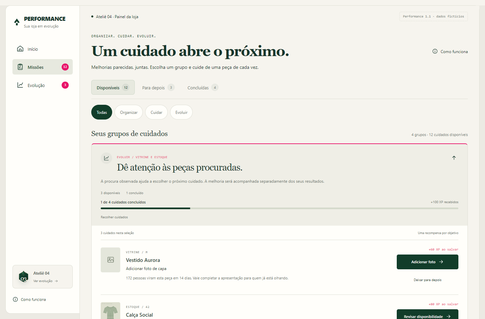

# Performance 1.1 — Missões e progressão

Documento da atualização de produto, interface e regras de apresentação.

**Estúdio Rafael Razeira · Versão 1.1 · 12 de outubro de 2026**

A versão 1.1 aplica a avaliação enviada por Rafael depois de revisar o documento completo: cuidados semelhantes aparecem juntos, a recomendação explica seu contexto e o progresso de cada conjunto fica visível. A atualização continua na pasta experimental, com dados fictícios e sem ativação em clientes.

O documento completo da versão 1.0 permanece como registro da entrega anterior. Este documento descreve as mudanças efetivamente implementadas e prevalece sobre aquela versão nos pontos alterados.

## 1. A mudança principal

Antes, a área Missões apresentava 12 pendências em 12 cartões. Agora, a simulação reúne seus 19 objetivos em quatro grupos: fotos, informações da apresentação, disponibilidade e oportunidades com procura observada.

O objetivo individual continua existindo. Cada peça possui sua própria ação, validação e recompensa. O grupo organiza esses objetivos e mostra o que já foi realizado, sem criar uma nova moeda ou alterar a matemática do nível.

| Camada | Funcionamento |
| --- | --- |
| Modelo interno | Foto, detalhe, descrição, contagem, divergência ou composição |
| Área da melhoria | Vitrine ou Estoque |
| Frente apresentada | Organizar, Cuidar ou Evoluir |
| Grupo | Conjunto fixo de objetivos semelhantes |
| Recompensa | XP individual após salvar a melhoria |

Composição foi reclassificada como Vitrine. Quando aparece por uma referência de procura válida, integra a frente Evoluir. O nome Conversão fica reservado à análise de indicadores; não é apresentado como categoria de preenchimento de tecido.

## 2. Organizar, Cuidar e Evoluir

| Frente | Valor apresentado | Exemplos |
| --- | --- | --- |
| Organizar | Completar a apresentação para ajudar na escolha | Primeira foto, acabamento e informações da peça |
| Cuidar | Conferir registros para atender com mais segurança | Primeira contagem e divergência de disponibilidade |
| Evoluir | Dar atenção a uma peça com procura observada | Foto ausente em peça procurada, disponibilidade com interesse ou composição ausente |

Evoluir é uma forma de apresentar o contexto da recomendação. Não concede mais XP para o mesmo modelo e não declara que a melhoria aumentará as vendas.

Uma oportunidade com procura pode envolver Vitrine ou Estoque. A linha de cada peça mostra sua área, enquanto o cabeçalho explica a frente e o motivo do conjunto.

## 3. A nova página de Missões

O cabeçalho apresenta a proposta da tela e mantém os filtros de situação: Disponíveis, Para depois e Concluídas. O segundo filtro permite escolher Todas, Organizar, Cuidar ou Evoluir.

Cada grupo contém título, contexto, contagens, progresso e XP já recebido. O primeiro grupo da seleção começa aberto; os demais ficam recolhidos. É possível expandir ou recolher pelo mouse e pelo teclado.

Dentro do grupo, as peças aparecem em linhas de ação: imagem ou ilustração, nome, tamanho, cuidado necessário, motivo, XP após salvar e botão específico. Isso evita repetir um grande cartão de descrição para cada produto.

Concluídas apresenta comprovantes agrupados, com data e evidência. Um conjunto finalizado também informa o total de XP já recebido pelas suas melhorias, sem bônus adicional.

Os filtros de frente e situação ficam no endereço. Por exemplo, `#missoes?frente=Evoluir` abre as oportunidades com contexto, e `#missoes?status=adiadas&frente=Cuidar` abre os cuidados operacionais deixados para depois. Atualizar mantém a seleção. Valores inválidos retornam à seleção padrão.

As contagens superiores representam objetivos, não quantidade de grupos. O texto da seleção informa ambos: por exemplo, quatro grupos e 12 cuidados disponíveis.

## 4. Progresso com um total fixo

O servidor registra a lista de identidades que pertence a cada conjunto. Se um grupo começou com quatro objetivos, o total permanece quatro ao salvar, adiar ou retomar. Uma nova necessidade entra em outro conjunto, sem aumentar o denominador daquele que já começou.

| Situação | Efeito no progresso do grupo |
| --- | --- |
| Salvar uma melhoria elegível | Incrementa concluídos e soma o XP individual recebido |
| Deixar para depois | Muda a situação do objetivo, preservando o total e o XP |
| Retomar | Abre a ação, preservando o total e o XP |
| Entrar uma nova peça ou necessidade | Cria outro conjunto, sem alterar a composição anterior |
| Objetivo deixar de ser elegível | Permanece no total como indisponível, sem virar uma conclusão |
| Todos os objetivos serem concluídos | Mostra Grupo finalizado e o XP já recebido |

Um grupo parcialmente resolvido não é marcado como finalizado apenas porque alguma necessidade desapareceu. A interface explica os itens indisponíveis. Isso mantém o progresso rastreável e evita premiar mudanças que não foram salvas como melhoria.

A confirmação do editor também apresenta o progresso do grupo. Se houver mudança de nível, esse progresso acompanha a apresentação de conquista. O histórico registra a finalização do conjunto como um marco visual, derivado dos objetivos individuais, sem outra concessão de XP.

## 5. A simulação de 19 objetivos

O cenário continua com 12 disponíveis, três para depois e quatro concluídos. As conclusões iniciais somam 280 XP e colocam a loja no nível 3, com 30 de 200 XP.

| Grupo | Frente | Total fixo | Disponíveis | Para depois | Concluídos | XP recebido inicialmente |
| --- | --- | ---: | ---: | ---: | ---: | ---: |
| Fotos de capa e detalhe | Organizar | 7 | 4 | 1 | 2 | 100 |
| Informações da apresentação | Organizar | 3 | 2 | 1 | 0 | 0 |
| Disponibilidade | Cuidar | 5 | 3 | 1 | 1 | 80 |
| Oportunidades com procura | Evoluir | 4 | 3 | 0 | 1 | 100 |

As novas referências fictícias são: Vestido Aurora com 172 pessoas e oito cliques, Calça Social com 84 pessoas e seis cliques, e Conjunto Natural com 148 pessoas e nove cliques. As janelas têm 14 dias. A composição da Blusa de Malha já foi concluída no cenário e completa o quarto objetivo do conjunto de oportunidades.

O fluxo de navegador confirmou o avanço do grupo Evoluir:

| Momento | Progresso do grupo | XP total da loja |
| --- | --- | ---: |
| Estado inicial | 1 de 4 | 280 |
| Foto do Vestido Aurora salva | 2 de 4 | 340 |
| Disponibilidade da Calça Social conferida | 3 de 4 | 420 |
| Composição do Conjunto Natural informada | 4 de 4 | 520 |

O grupo finalizado totaliza 340 XP: 100 da conclusão inicial, mais 60, 80 e 100 das novas ações. A loja chega a 520 XP, nível 4, com 70 de 250 XP. Não existe um bônus pelo quarto objetivo.

Sessões antigas mantêm os dados e recompensas já salvos. Seus conjuntos são organizados a partir dos objetivos existentes; podem ter composição diferente da tabela acima se a sessão foi criada na versão anterior. Para revisar exatamente o cenário inicial da 1.1, usar Reiniciar este cenário nas opções da demonstração.

## 6. Prioridade com regras explícitas

Uma referência de procura precisa possuir pelo menos 50 pessoas, duração de pelo menos 14 dias e contagens válidas de pessoas e cliques. Contatos não podem superar pessoas. Na ausência de referência válida, a ordem usa somente as necessidades operacionais disponíveis.

| Ordem | Necessidade |
| --- | --- |
| 1 | Peça sem foto com procura observada |
| 2 | Contagem ou divergência de uma peça com procura observada |
| 3 | Foto ausente sem uma referência de procura válida |
| 4 | Disponibilidade que precisa de conferência, sem referência de procura válida |
| 5 | Outros cuidados de apresentação elegíveis |

Peças explicitamente marcadas como não publicadas não entram nas recomendações desta versão. Na integração real, a identidade de publicação e as fontes analíticas ainda precisam ser mapeadas.

Cada tarefa com contexto explica a referência que motivou sua posição. A priorização não usa IA, faturamento ou margem. A amostra e a duração são hipóteses do protótipo; não constituem prova estatística nem previsão de venda.

## 7. Início com hierarquia editorial

O Início apresenta Sua loja está evoluindo, nome da loja e progresso compacto. A missão principal aparece numa superfície branca, com produto, motivo e O que fazer. Ela continua sendo a única ação prioritária.

Outras oportunidades apresenta resumos por frente, como peças para conferir ou com procura observada. Os botões levam diretamente à frente escolhida na área de Missões.

O resumo de resultados fica recolhido, com expansão voluntária. Os indicadores continuam separados do XP e permanecem fictícios. A decisão reduz a competição visual entre dados, progresso e ação principal.

As superfícies possuem funções diferentes: creme e tipografia editorial para contexto, branco para execução e verde profundo para conquista. O rosa permanece nos acentos de evolução, foco e recompensa.

## 8. Evolução e reconhecimento

Evolução ganhou um emblema maior, nível e barra no topo, além de uma visão do progresso dos conjuntos. A linha do tempo mantém ações e níveis e inclui os grupos efetivamente finalizados.

As conquistas especiais 5 e 10 continuam disponíveis. A retrospectiva também aparece nas outras subidas de nível, sempre calculada a partir do histórico. Nenhum número de melhorias, peças ou conferências é inserido como uma conquista fictícia para decorar a interface.

| Antes | Depois |
| --- | --- |
| Emblema com entrada por opacidade e escala | Contorno vetorial com desenho de 220 ms e uma segunda linha 40 ms depois |
| Retrospectiva nas conquistas especiais | Retrospectiva em cada subida de nível confirmada |
| Reconhecimento centrado na recompensa individual | Reconhecimento inclui o avanço do grupo e sua finalização |

Foi mantida a sequência já existente de XP, excedente preservado e apresentação de nível. Fechar e Escape funcionam depois que a gravação termina, inclusive durante a apresentação. Recarregar não repete a celebração.

Movimento reduzido apresenta o resultado estático e o contorno completo. Não foram acrescentados som, partículas ou brilho permanente. As expansões de grupos são diretas; o movimento da barra é curto e pode ser desativado pela preferência de acessibilidade.

## 9. Integridade e arquivos novos

Os grupos possuem identidade própria e composição persistida no estado da sessão. A pontuação continua vindo do histórico de recompensas individuais, com as mesmas restrições de duplicidade e transação.

| Arquivo | Responsabilidade |
| --- | --- |
| `domain/journeys.mjs` | Composição dos conjuntos, frentes, progresso e finalização |
| `domain/engine.mjs` | Contexto de procura, prioridade e categoria de composição |
| `components/Missions.jsx` | Grupos expansíveis e linhas de execução |
| `components/JourneyProgress.jsx` | Barra e contagens derivadas do conjunto |
| `components/Home.jsx` | Ação principal e resumos por frente |
| `components/Evolution.jsx` | Emblema, progresso dos conjuntos e trajetória |
| `domain/presentation.mjs` | Marco visual de grupo, sem conceder XP |
| `server/repository.mjs` | Persistência do conjunto junto da melhoria confirmada |
| `tests/journeys.test.mjs` | Total fixo, ausência de bônus, elegibilidade e sessões anteriores |
| `tests/browser-journeys.cjs` | Fluxo completo do grupo, confirmação e navegação |

O navegador não pode enviar progresso, composição de grupo ou XP como autoridade. A API continua validando a ação no servidor. A fronteira de integração real também preserva os conjuntos no estado salvo, mas segue sem conexão com clientes.

## 10. Validação e próximos passos

A compilação e 31 testes de regras e servidor passaram. Os quatro fluxos de navegador exercitaram a experiência original, os marcos, os filtros e a nova progressão agrupada, com zero erros JavaScript nos fluxos verificados.

A verificação específica da 1.1 cobriu quatro grupos com 12 pendências, expansão por teclado, telas de 320 a 1.440 pixels, filtro preservado ao atualizar, evolução de 1/4 a 4/4, XP total sem bônus e marco do grupo na trajetória.

O registro dessa verificação fica em `.tmp/painel-gamificado/verificacao-journeys.json`. Capturas da versão usam o prefixo `performance-11-` na mesma pasta.

Continuam pendentes: revisão de entendimento com lojistas, calibração de amostra e prioridades, fotos reais em uma integração autorizada, mapeamento de usuários e dados comerciais, validação em ambiente de testes e ativação gradual.

Ainda não há novas moedas, ranking, personagens, árvore de habilidades, análise editorial por IA ou dezenas de novos modelos de tarefa. A fórmula de XP e os seis valores de recompensa foram preservados.

## 11. Como abrir e revisar

- [Abrir a simulação de várias missões](http://localhost:3405/?cenario=varias-missoes#missoes)
- [Ver apenas Evoluir](http://localhost:3405/#missoes?frente=Evoluir)
- [Abrir o Início](http://localhost:3405/#inicio)
- [Consultar Evolução](http://localhost:3405/#evolucao)

Os links exigem o servidor local em execução. A demonstração preserva as melhorias da sessão; para começar do estado da tabela, reiniciar somente o cenário experimental pelo controle existente.

Roteiro de revisão: escolher um grupo, entender por que ele aparece, concluir um cuidado, reconhecer o avanço da barra, adiar outro, retomar e verificar o comprovante. Depois, encontrar a conclusão do grupo em Evolução e explicar o que o nível representa. A pesquisa com lojistas continua necessária para avaliar se essa organização torna o trabalho mais útil e simples.
