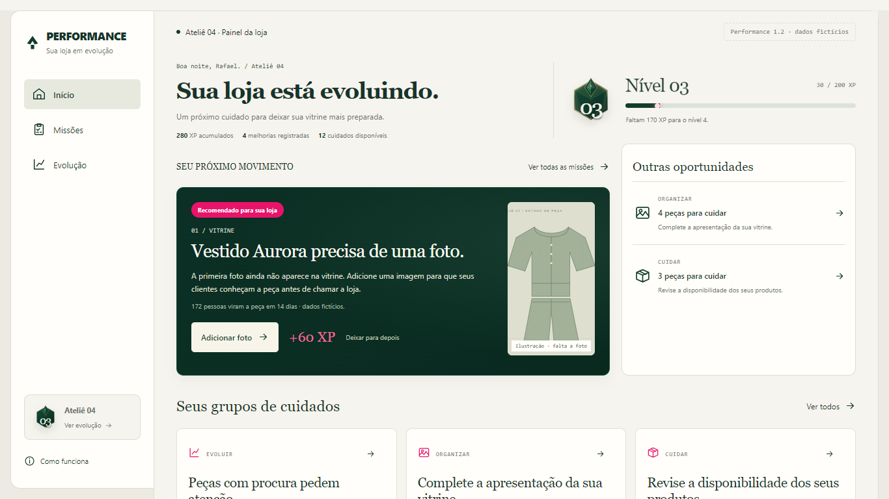
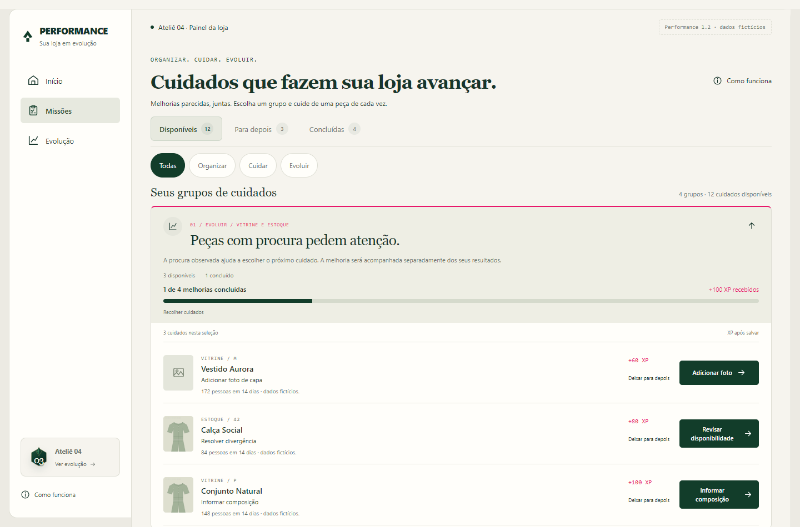
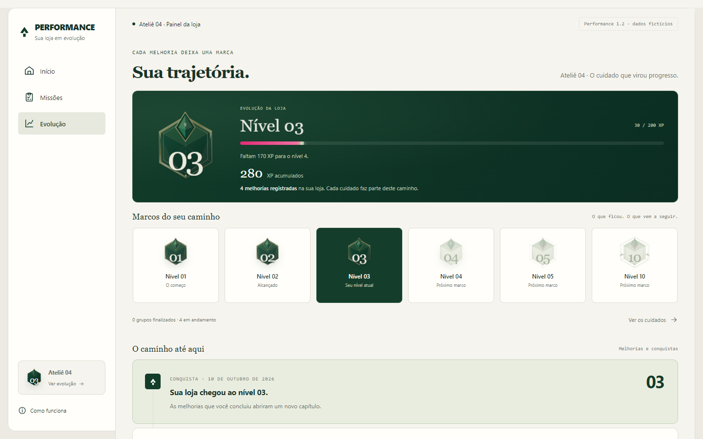

# Performance 1.2 — Refinamento da experiência

Atualização de hierarquia visual, ritmo de navegação e reconhecimento do progresso.

**Estúdio Rafael Razeira · Versão 1.2 · 12 de outubro de 2026**

Esta versão aplica a avaliação enviada por Rafael após observar as telas da Performance 1.1. O trabalho concentra-se no Início, nos cabeçalhos e linhas de Missões e na composição de Evolução. O aplicativo continua separado do painel principal, com dados fictícios e execução local.

As regras de elegibilidade, prioridades, identidades, recompensa única, composição fixa dos grupos e matemática dos níveis são as da versão 1.1. A 1.2 modifica sua apresentação e os pontos de acesso às ações existentes.

## 1. O problema resolvido

A versão anterior dedicava uma faixa extensa à apresentação e ao nível antes da missão. Em um desktop comum, o botão principal podia exigir rolagem. Os grupos também repetiam textos genéricos nas linhas, e Evolução mostrava o nível novamente em um conjunto de indicadores.

A atualização organiza a primeira área visível em torno do próximo cuidado. O nome da peça e o que falta aparecem diretamente no título; a ação tem maior contraste; o nível ocupa uma composição compacta; os indicadores numéricos permanecem dentro das páginas.

| Área | Mudança da 1.2 |
| --- | --- |
| Início | Cabeçalho compacto, nível ao lado e missão em destaque na primeira área visível |
| Missões | Objetivos maiores no cabeçalho e linhas menores com ações concretas |
| Evolução | Nível, XP e melhorias em uma composição única, seguida de coleção e histórico |
| Menu | Retirada dos números em bolinhas rosas de Missões e Evolução |
| Progresso | Valores preservados, com maior destaque visual para grupos e conquistas |

## 2. Início: o próximo cuidado vem primeiro

O cabeçalho apresenta saudação, nome da loja, mensagem curta e contagens reais do cenário. O indicador de nível, emblema e barra fica ao lado no desktop e se adapta a uma faixa compacta no celular.

A missão principal usa uma superfície verde profunda, sinal de recomendação em rosa e botão claro. O título identifica a peça e a necessidade: Vestido Aurora precisa de uma foto, por exemplo. A descrição explica a ação em termos concretos.

Uma referência de procura aparece somente quando existe no objetivo. Na demonstração, o Vestido Aurora possui 172 pessoas em 14 dias. Esses números são fictícios e seguem identificados como tal.

A recompensa mostra o XP individual que será recebido depois de salvar. Deixar para depois continua disponível como ação secundária. A necessidade e o saldo de experiência não são alterados pela nova composição.

Outras oportunidades aparece ao lado da missão no desktop, com contagens dos grupos disponíveis e acesso à frente correspondente. Em telas menores, passa para depois do bloco principal. Os cartões inferiores mostram uma prévia dos conjuntos e de suas peças, usando o progresso já calculado pela versão 1.1.

O resumo de resultados continua recolhido, com expansão voluntária. A imagem de capa ausente não é preenchida automaticamente: a missão mostra uma ilustração demonstrativa identificada, enquanto o produto permanece sem foto até que a pessoa salve uma imagem.

Não foram acrescentados busca fictícia, notificações sem fonte, login ou itens de menu sem destino. O menu do protótipo mantém Início, Missões e Evolução.

## 3. Verificação da primeira área visível

As medidas abaixo foram obtidas no Chrome local, com o cenário inicial de várias missões e rolagem no topo. Os valores são arredondados para facilitar a leitura.

| Tela | Início da missão | Final do bloco | Final do botão | Resultado |
| --- | ---: | ---: | ---: | --- |
| 1280 × 720 | 288 px | 597 px | 574 px | Missão e botão inteiros |
| 1366 × 768 | 288 px | 578 px | 542 px | Missão e botão inteiros |
| 1440 × 900 | 288 px | 578 px | 542 px | Missão e botão inteiros |

A verificação exige que o bloco e seu botão estejam dentro da área visível, sem rolagem, nessas resoluções de desktop. Ela valida o conteúdo da demonstração, não garante a mesma altura para qualquer nome ou texto futuro. Conteúdos maiores continuam podendo ocupar mais espaço.

No celular, a interface mantém a sequência de apresentação, missão e demais oportunidades, com controles acessíveis e sem transbordamento horizontal. O compromisso de caber a missão inteira sem rolagem foi medido especificamente nas três telas de desktop da tabela.

## 4. Missões: objetivo maior, linhas menores

O grupo passa a usar uma referência numérica e um título que comunica o objetivo maior, como Complete a apresentação da sua vitrine ou Revise a disponibilidade dos seus produtos. A justificativa fica no cabeçalho do conjunto.

O progresso mostra quantas melhorias foram concluídas sobre o total fixo, com barra e XP já recebido. As contagens de disponíveis, para depois e concluídos continuam diferenciadas.

Cada linha apresenta imagem ou indicação de foto ausente, nome da peça, tamanho, ação necessária, recompensa individual e botão. Quando existe uma referência relevante, mostra dados específicos: procura em um período ou quantidade atualmente registrada numa divergência.

Foi retirado o texto genérico de benefício repetido em todas as peças. A explicação geral é apresentada uma vez no grupo, e as linhas são reservadas para decisões e ações concretas.

No cenário de 12 pendências, todas as linhas mediram 110 pixels no desktop. Os controles de ação mantiveram altura mínima de 44 pixels. A altura pode crescer quando o conteúdo precisar; o layout não corta nomes nem instruções para forçar uma medida fixa.

Organizar, Cuidar e Evoluir continuam sendo as três frentes. Composição permanece uma melhoria de Vitrine. Os filtros de frente e situação, a retomada direta e os comprovantes de conclusão seguem funcionais.

## 5. Evolução: coleção e trajetória

O topo reúne emblema, nível atual, barra, experiência total e quantidade de melhorias registradas. Foi removida a faixa separada que repetia o nível ao lado dos indicadores.

A coleção apresenta o começo, os níveis recentes, o nível atual, o próximo e os marcos especiais 5 e 10, evitando uma fila ilimitada de cartões. Os demais momentos continuam registrados na linha do tempo.

| Tratamento | Significado |
| --- | --- |
| Emblema alcançado | O nível já foi atingido pelo XP do histórico |
| Superfície verde profunda | Destaca o nível atual |
| Emblema discreto | Nível ainda não alcançado |
| Rever conquista | Consulta um marco especial 5 ou 10 já registrado |

Os itens futuros não possuem botões que prometam uma ação inexistente. A coleção se adapta com rolagem horizontal no celular e pode receber foco para navegação nativa. Os marcos especiais já alcançados mantêm a consulta à retrospectiva original.

O resumo extenso dos grupos foi substituído por uma indicação curta de conjuntos finalizados e em andamento, com acesso às missões. Isso aproxima a coleção e a linha do tempo do topo.

Os grupos efetivamente finalizados ganham um tratamento verde profundo com acentos rosas. A finalização continua derivada das recompensas individuais, sem um bônus adicional e sem alterar o histórico.

## 6. Gestão, ação e conquista

Foram reforçadas três funções visuais:

- Gestão usa creme, informações objetivas e controles claros.
- Ação usa produtos, títulos concretos e contraste na missão recomendada.
- Conquista usa emblemas, verde profundo e rosa para reconhecer o progresso confirmado.

A personalidade vem da hierarquia, dos símbolos e da composição, sem acrescentar moedas, rankings, personagens ou efeitos permanentes. O selo de recomendação não é uma notificação pendente; a navegação deixou de usar contagens com esse significado visual.

Os exemplos de produtos continuam fictícios, com ilustrações e imagens usadas na própria demonstração. Não houve importação de fotos privadas de clientes.

## 7. O que foi preservado

| Regra | Estado na 1.2 |
| --- | --- |
| Seis modelos de objetivo | Preservados |
| Recompensa individual | Preservada, com os mesmos valores de XP |
| Fórmula de níveis | Preservada |
| Objetivos fixos por conjunto | Preservados |
| Adiar e retomar | Mantêm experiência e denominador |
| Recompensa única | Preservada na API e no banco local |
| Falha de salvamento | Mantém o formulário e não concede XP |
| Identidade e permissões | Mesmo isolamento local do experimento |
| Sequência de subida de nível | Preservada, inclusive dispensa após salvar e movimento reduzido |
| Integração real | Continua preparada, sem ativação em clientes |

A versão não modifica o motor de missões nem o banco para produzir uma sensação artificial de progresso. Os componentes usam os mesmos dados e valores que sustentavam a 1.1.

## 8. Verificações realizadas

A compilação e os 31 testes automatizados de regras e servidor passaram. Cinco fluxos de navegador cobrem o comportamento original, marcos, filtros, grupos e a verificação específica de UX da 1.2.

| Verificação específica | Evidência |
| --- | --- |
| Primeira área visível | Bloco e botão dentro das três telas de desktop medidas |
| Densidade das tarefas | 12 linhas com 110 px no cenário de demonstração |
| Ações tocáveis | Controles de ação com pelo menos 44 px |
| Navegação | Ausência de bolinhas numéricas no menu |
| Coleção | Níveis anteriores, atual e futuros com estados distintos |
| Dados preservados | Navegar entre as telas mantém histórico e composição dos grupos |
| Responsividade | Telas de 320, 375, 768 e 1440 px sem transbordamento horizontal |
| Regressões | Salvamento, falha, recompensa única, marcos e consultas continuam funcionais |

Os registros ficam em `.tmp/painel-gamificado/`. A verificação nova usa `verificacao-ux12.json`, e as capturas da versão possuem o prefixo `performance-12-`.

Essas evidências verificam a implementação nos cenários exercitados. A revisão de entendimento, preferência visual e utilidade com lojistas continua necessária. Não existe resultado de pesquisa de conversão ou vendas associado à atualização visual.

## 9. Arquivos e revisão

| Arquivo | Mudança |
| --- | --- |
| `components/Home.jsx` | Novo topo, missão em destaque e acesso a grupos |
| `components/StoreOverview.jsx` | Separação do indicador de evolução e do resumo de resultados |
| `components/mission-copy.mjs` | Títulos e descrições de interface com peça e necessidade |
| `components/Missions.jsx` | Cabeçalhos numerados e linhas sem repetição genérica |
| `components/JourneyProgress.jsx` | Texto e destaque de progresso do conjunto |
| `components/Evolution.jsx` | Composição única do nível e aproximação do histórico |
| `components/Achievements.jsx` | Coleção de marcos com estados e consultas válidas |
| `components/Experience.jsx` | Retirada das contagens em bolinhas do menu |
| `performance.css` | Densidade, hierarquia e adaptação das superfícies |
| `tests/browser-ux12.cjs` | Medidas de primeira área visível, tarefas e coleção |

Para revisar:

- [Abrir o Início da simulação](http://localhost:3405/?cenario=varias-missoes#inicio)
- [Abrir Missões](http://localhost:3405/#missoes)
- [Abrir Evolução](http://localhost:3405/#evolucao)

Os links exigem o servidor local em execução. As melhorias da sessão são preservadas; para conferir exatamente o estado inicial de 280 XP e 19 objetivos, reiniciar o cenário pelas opções existentes.

Os documentos das versões 1.0 e 1.1 foram mantidos como registros anteriores. Esta versão prevalece nos pontos de interface e hierarquia alterados; as regras de produto e integridade descritas na 1.1 continuam valendo.
