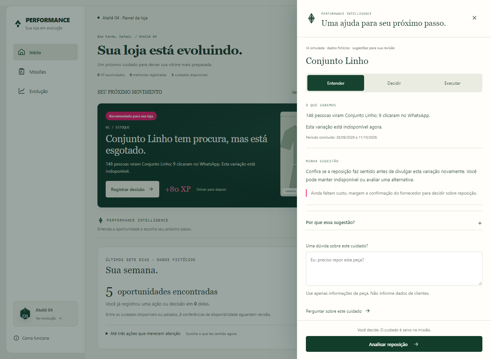
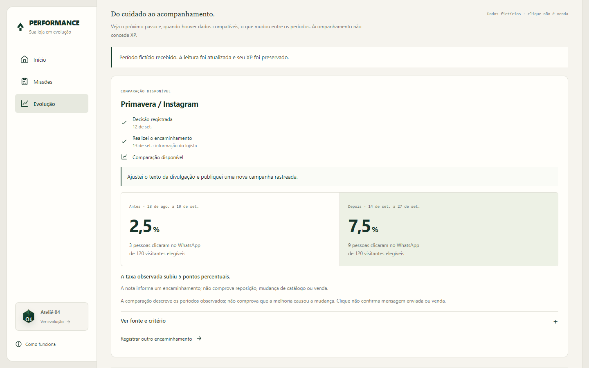

# Performance 1.3 — Entrega 3: acompanhamento comercial

Documento de produto e implementação de 13/10/2026. Experimento independente em `experimentos/painel-gamificado`, com loja, fontes e métricas fictícias. As entregas anteriores foram preservadas. A inteligência continua simulada; nenhuma API generativa, dado de cliente ou serviço pago foi ativado.

## 1. O que esta entrega resolve

Uma decisão merece reconhecimento sem ser confundida com um resultado. Analisar um produto indisponível não significa repor a peça. Registrar o encaminhamento do lojista não comprova que houve uma entrada de estoque. Ler uma diferença entre períodos não comprova que a ação causou uma venda.

A Entrega 3 completa esse caminho dentro das páginas existentes: uma oportunidade leva à decisão; o lojista informa o próximo passo; o acompanhamento aguarda evidências; uma comparação aparece quando os períodos são compatíveis; outra ocorrência pode gerar uma nova oportunidade. Cada etapa tem sua confirmação, sua fonte e seu limite.

As páginas continuam sendo Início, Missões e Evolução. Continuam os nove modelos de missão, as frentes Organizar, Cuidar e Evoluir, os grupos com objetivos fixos, os brasões, os marcos e as recompensas únicas. Não foram acrescentadas missões artificiais para manter a loja ocupada.

## 2. Intelligence: primeiro a orientação prática

O painel lateral começa por uma evidência breve e uma sugestão. Em um produto procurado e esgotado, mostra o interesse no período concluído, informa a indisponibilidade atual e orienta a conferir se reposição faz sentido antes de divulgar novamente. A ressalva sobre custo, margem e fornecedor permanece visível.

“Por que essa sugestão?” abre a explicação completa e os dados que ainda faltam. A primeira leitura exige menos esforço, enquanto a justificativa continua acessível. Os modos Entender, Decidir e Executar foram preservados. A ação principal usa o contexto, como “Analisar reposição”, e retorna ao formulário de decisão.

As visitas pertencem a uma janela encerrada, exibida com datas. Elas não são apresentadas como procura medida em tempo real. A indisponibilidade é o estado atual da variação; não sabemos quantas pessoas a encontraram indisponível durante todo o período anterior.

As opções sugeridas preenchem o formulário para revisão. A descrição assistida usa características informadas pelo lojista e composição já cadastrada. Gerar, consultar, escolher ou transferir um rascunho não salva a peça nem concede XP. A publicação continua dependendo de salvamento explícito.

O provedor usa respostas preparadas. Perguntas flexíveis sobre investimento, simulação de retorno ou estilos generativos de marca continuam sendo parte da preparação da 1.4. O protótipo não anuncia essas capacidades como já disponíveis.

## 3. Uma decisão tem um próximo passo

Na Evolução, cada acompanhamento apresenta a decisão ou melhoria de origem, sua data e o estado atual. Uma decisão sem encaminhamento mostra “Falta registrar o próximo passo”. A ação “Registrar próximo passo” abre um painel lateral com uma escolha e uma nota.

| Escolha | Significado | Efeito na operação |
| --- | --- | --- |
| Realizei o encaminhamento | O lojista declara o que fez depois de analisar | Salva a nota e a data do servidor; não altera catálogo ou estoque |
| Decidi não realizar agora | O lojista registra que não pretende agir neste momento | Mantém a escolha no acompanhamento; não atribui resultado comercial |

A nota exige de 20 a 600 caracteres e fica registrada. A confirmação “Encaminhamento registrado” explica que não houve alteração de estoque, confirmação de vendas ou XP extra. Se o salvamento falhar, a escolha e o texto permanecem disponíveis para nova tentativa.

Uma consulta ao fornecedor pode ser um encaminhamento válido sem significar reposição. Uma entrada de estoque precisará de uma operação de estoque própria. Da mesma forma, uma nota sobre divulgação não comprova que o anúncio foi publicado ou que trouxe vendas.

Outro encaminhamento pode ser registrado depois. O histórico das declarações é acrescentado, não reescrito; a interface usa o encaminhamento mais recente. Se a nova ação acontecer depois de uma janela já recebida, aqueles dados deixam de ser posteriores à ação e a comparação não é válida para o novo encaminhamento.

## 4. Acompanhamento sem confundir ausência de dados com desempenho ruim

A área “Do cuidado ao acompanhamento” permanece dentro da Evolução e pode ser acessada diretamente pelo Início. Os três registros mais recentes aparecem primeiro; os anteriores continuam acessíveis em uma seção recolhida. Nenhuma observação é descartada apenas para simplificar a tela.

| Estado | Leitura oferecida |
| --- | --- |
| Falta registrar o próximo passo | A decisão existe; ainda não há ação informada |
| Sem ação neste momento | O lojista decidiu não agir; não há resultado atribuído |
| Aguardando o período seguinte | A ação ou melhoria tem registro, mas não há janela posterior concluída |
| Sem período anterior | Não existe uma referência anterior comparável |
| Poucos visitantes para comparar | As contagens existem, mas ficam abaixo do mínimo definido para a leitura |
| Dados incompatíveis | As janelas, fontes ou critérios não medem a mesma coisa |
| Comparação disponível | Os períodos passaram pelas verificações e podem ser descritos lado a lado |

Dados insuficientes não fazem a loja perder experiência e não criam uma tarefa obrigatória. Abrir um resultado, receber uma fonte posterior ou simplesmente esperar também não gera XP.

## 5. Quando os períodos podem ser comparados

A leitura compara pessoas com clique no WhatsApp divididas pelos visitantes elegíveis da mesma entidade em cada janela. Não usa total bruto de cliques, quantidade de pedidos ou receita. As pessoas são consideradas dentro de cada janela; não há afirmação de que o mesmo grupo de pessoas voltou nos dois períodos.

Exigir janelas concluídas, sem sobreposição, de mesma duração e com pelo menos 14 dias. A janela anterior termina antes da ação; a posterior começa depois dela. Cada janela precisa ter ao menos 100 visitantes elegíveis e contagens inteiras coerentes, com pessoas que clicaram não excedendo visitantes.

O mínimo de 100 é um critério inicial de apresentação do produto, não uma demonstração de significância estatística. A interface não exibe grau de certeza, teste causal ou previsão de crescimento.

Nas observações novas, a proveniência identifica loja, entidade, população, métrica, versão da medição e fonte. Os dois períodos precisam coincidir nesses critérios, usando fontes distintas. Visitantes de uma campanha não são comparados com visitantes da loja inteira. Uma busca sem resultado não é convertida em visitas de produto para calcular uma suposta conversão.

Os cenários históricos anteriores conservam suas comparações explícitas sem proveniência completa, apenas como demonstração legada. Essa compatibilidade não representa autorização para importar dados reais sem identificação de fonte. Uma futura integração deverá exigir proveniência completa desde a coleta.

A diferença aparece em pontos percentuais, acompanhada dos denominadores e datas. A ressalva permanece na própria leitura: a comparação descreve os períodos; não comprova que a ação causou a mudança. Clique não confirma mensagem enviada ou venda.

## 6. O ciclo completo na simulação

O cenário “Ciclo comercial completo” permite explorar um acompanhamento histórico sem adiantar o relógio ou fabricar dados depois de uma ação feita hoje.

1. Uma campanha anterior foi analisada em 12 de setembro, com decisão legítima de 80 XP registrada pelo mesmo motor de missões.
2. O cenário contém um encaminhamento declarado em 13 de setembro: ajustar o texto e publicar uma nova divulgação rastreada.
3. A comparação aguarda a fonte posterior. “Carregar dados fictícios” recebe um conjunto preparado no servidor, limitado a esse cenário e à ação histórica.
4. O período anterior contém 120 visitantes e 3 pessoas com clique, resultando em 2,5%. O posterior contém 120 visitantes e 9 pessoas com clique, resultando em 7,5%.
5. A diferença observada é de 5 pontos percentuais. O recebimento e a leitura preservam os 80 XP anteriores.
6. Uma ocorrência separada da campanha, de 28 de setembro a 11 de outubro, fornece outra janela concluída e uma nova fonte. Ela pode gerar uma nova missão de análise.
7. Somente salvar a análise dessa nova ocorrência concede sua recompensa de 80 XP, levando o histórico a 160 XP.

A nova missão nasce da ocorrência independente, não da diferença percentual e não da vontade de conceder outra recompensa. Se o lojista apenas abrir o relatório ou carregar a fonte novamente, o XP permanece igual.

Uma decisão tomada agora precisa de um encaminhamento real posterior e de uma nova janela encerrada. O experimento não transforma a espera em resultado e não gera um período futuro automaticamente.

## 7. Cenários e proteção do registro

Agora são 23 cenários fictícios: os 19 anteriores foram preservados e quatro foram adicionados para acompanhamento.

| Cenário novo | O que permite verificar |
| --- | --- |
| Ciclo comercial completo | Receber fonte posterior, ler a comparação e reconhecer outra ocorrência |
| Decisão aguardando ação | Registrar encaminhamento ou decidir não agir; estoque continua indisponível |
| Comparação com pouca amostra | Mostrar contagens e recusar a leitura percentual comparativa |
| Fontes incompatíveis | Recusar comparação entre populações diferentes |

A API continua exclusiva do servidor local e usa sessão com cookie HttpOnly, origem verificada e geração do cenário. Encaminhamento e importação aceitam apenas os campos previstos; métricas, data, estoque e XP enviados livremente pelo cliente são recusados.

Cada registro tem uma identificação de operação. Repetir a mesma operação e o mesmo preenchimento retorna o resultado existente; reutilizar o identificador com outros dados é recusado. Os dados e a identificação são gravados juntos em transação. Uma sessão não pode receber o conjunto fictício de outra sessão nem usar uma geração anterior após reiniciar o cenário.

O botão de importação é uma ferramenta da demonstração histórica. Não é integração de analytics, entrada manual de métricas ou automação de coleta. Na futura operação real, esse conjunto deverá vir de eventos autorizados e verificáveis da vitrine.

## 8. Evidência técnica e pesquisa ainda necessária

A validação inclui 56 testes automatizados de domínio e servidor. As regras novas verificam etapas distintas, ausência de XP adicional, estoque preservado, fonte e população compatíveis, ação posterior à decisão, idempotência, isolamento e rejeição de dados adulterados. O build de produção do aplicativo independente foi verificado.

Os testes de navegador abrangem os fluxos anteriores e o acompanhamento novo: assistente com justificativa recolhida; formulário com falha e nova tentativa; comparação; nova ocorrência; persistência; pouca amostra; escolha de não agir; celular; teclado; Escape; restauração de foco e movimento reduzido. As capturas e registros ficam na pasta local de verificação, fora do site publicado.

Isso comprova funcionamento nos cenários testados, não utilidade comercial nem aumento de conversão. A pesquisa com comerciantes está preparada em `VALIDACAO-COM-LOJISTAS.md` e ainda precisa ser realizada. O roteiro busca descobrir se o lojista identifica a ação sem ajuda, distingue decisão de reposição e interpreta corretamente os resultados.

## 9. Próxima etapa: avaliar a inteligência real

A preparação da 1.4 está em `PREPARACAO-1.4.md`. Preserva a separação entre contexto, provedor, validação e interface, mas exige contrato próprio para respostas generativas. O validador atual é deliberadamente restrito à simulação e às descrições canônicas.

A comparação futura de modelos usará casos sintéticos comuns, critérios de fidelidade, clareza, ação útil e reconhecimento de lacunas. Informação fabricada, vazamento, promessa de retorno, causalidade indevida e tentativa de executar operações serão reprovações críticas. Custo, tokens e latência precisarão ser medidos antes do piloto; não foram estimados nesta entrega.

Estilos Direto, Elegante, Comercial e Técnico ficam previstos para rascunhos futuros, sem modificar fatos conhecidos. Perguntas sobre orçamento exigirão contexto comercial suficiente e respostas condicionais, não projeções inventadas. A entrada inicial deverá ser somente leitura e revisão explícita, com limites de custo e autorização por loja.

A proposta comercial a validar é: “Sua loja tem dados. O Performance mostra o que fazer com eles.” Gestão organiza a operação; evolução reconhece cuidados; inteligência ajuda a escolher o próximo passo. Esta entrega não altera assinatura, preço ou a landing page principal.

## 10. Arquivos e revisão de movimento

| Área | Implementação |
| --- | --- |
| Etapas e declarações | `domain/followup.mjs` |
| Comparações e proveniência | `domain/impact.mjs`, `domain/engine.mjs` |
| Cenários e fonte controlada | `fixtures/followup.mjs`, `fixtures/stores.mjs` |
| Transações e repetição | `server/repository.mjs` |
| Acompanhamento e formulário | `components/ImpactPanel.jsx`, `components/FollowupDialog.jsx` |
| Assistente e navegação | `components/IntelligencePanel.jsx`, `components/Experience.jsx` |
| Verificação | `tests/followup.test.mjs`, `tests/browser-followup.cjs` e regressões existentes |

| Elemento | Antes | Depois |
| --- | --- | --- |
| Assistente | Quatro blocos expandidos; entrada de 200 ms | Sugestão primeiro; justificativa nativa recolhida; mesma entrada |
| Encaminhamento | Ausente | Painel lateral de 200 ms; teclado, Escape, foco e movimento reduzido |
| Recebimento de dados | Ausente | Confirmação textual persistente; sem celebração e sem XP |
| XP e níveis | Celebração após salvamento válido | Preservada; leitura e encaminhamento não a acionam |

A entrega permanece na pasta independente. Não houve publicação, migração de banco real, conexão com API paga ou alteração do painel de clientes.