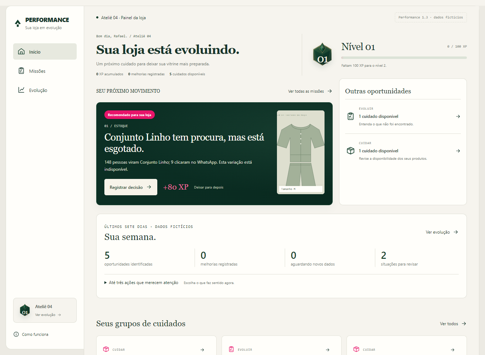
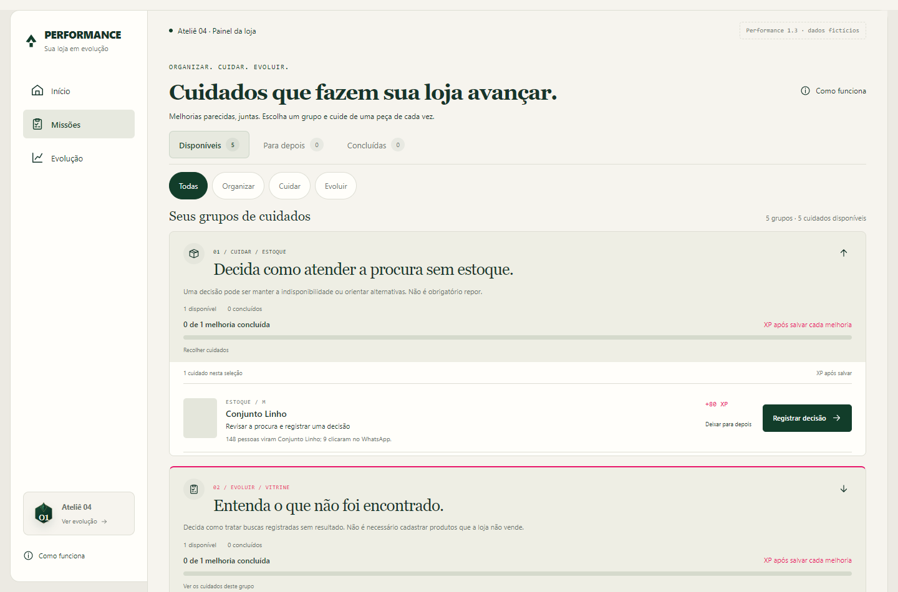

# Performance 1.3 — Entrega 1: evolução contínua

Documento de implementação e revisão. 13/10/2026. Aplicativo experimental separado, com dados fictícios. As Entregas 2 e 3 aguardam revisão de Rafael.

## 1. O que foi entregue

O Performance mantém Início, Missões e Evolução, identidade creme/verde/rosa, emblemas, coleção, níveis e confirmação de salvamento. Uma camada determinística agora identifica novas situações comerciais nos eventos fictícios disponíveis. Ela explica a evidência, apresenta uma ação permitida e registra a decisão ou melhoria antes de conceder experiência.

Foram acrescentados três modelos de decisão: produto procurado e esgotado, buscas sem resultado e campanha concluída. A oportunidade de apresentação reutiliza as missões originais. Uma nova divergência reutiliza revisão de disponibilidade. Assim, existem nove modelos de execução, sem duplicar prêmio pela apresentação ou pelo reconhecimento de uma oportunidade.

“Sua semana” resume oportunidades identificadas, melhorias salvas, situações para revisar e registros aguardando dados. Fica abaixo da recomendação principal, com até três prioridades opcionais em uma lista recolhida. O painel não impõe três tarefas nem reinicia objetivos a cada semana.

Uma loja sem ações elegíveis mostra “Sua loja está em dia”, mantém XP e histórico, e permite consultar evolução, acompanhamento e oportunidades adiadas. A interface informa que uma nova ocorrência precisa ser carregada no experimento: não promete monitoramento real da loja.

## 2. Arquitetura reaproveitada

O plano técnico foi registrado antes da implementação em `PLANO-1.3.md`. Foram inspecionados motor, componentes, fixtures, banco, API, contrato de autenticação, testes e documentos anteriores. A aplicação foi estendida; não houve reconstrução ou alteração do aplicativo principal.

| Camada existente | Reaproveitamento |
| --- | --- |
| Motor de missões | Seis modelos, identidade pontual e autoridade sobre XP |
| Grupos de cuidados | Objetivos congelados; uma nova ocorrência cria outro conjunto |
| SQLite e API | Sessão isolada, transação, recompensa única, operação idempotente |
| Editor e diálogo | Validação, falha com preenchimento preservado, teclado e confirmação |
| Evolução | Histórico, emblemas, coleção, marcos e animação original |
| Leitura de impacto | Estados de referência ausente, espera, amostra pequena e comparação descritiva |

O fluxo da primeira entrega é: eventos fictícios da loja → regras → objetivo elegível → ação registrada pelo lojista → validação no servidor → alteração/decisão e recompensa na mesma transação → registro aguardando dados.

O motor não lê uma fonte externa. A origem é um evento salvo no estado do servidor local. O cliente envia apenas o comando permitido; não envia loja, evidência, período, XP ou data da recompensa.

## 3. Regras e evidências

Cada oportunidade contém identidade, loja, entidade/produto, tipo, motivo, evidência, período, ação, critério, XP, estado, data de identificação e evento de origem. A revisão de estoque usa uma ocorrência pontual de conferência, com data, quantidades divergentes e origem, em vez de uma janela de visitantes.

| Situação | Elegibilidade inicial | Ação verificada | XP |
| --- | --- | --- | ---: |
| Procurado e esgotado | Peça publicada, quantidade zero, 50 visitantes em pelo menos 14 dias concluídos | Decisão permitida e análise registrada | 80 |
| Buscas sem resultado | Termo sem correspondência, 10 visitantes em pelo menos 7 dias concluídos | Decisão sobre a procura e próximo passo | 60 |
| Campanha concluída | Origem rastreada, 50 visitantes em pelo menos 7 dias concluídos | Conclusão ou próximo passo registrado | 80 |
| Apresentação procurada | Procura válida e informação específica ausente | Salvar foto, detalhe, descrição ou composição que falta | 60 / 40 / 60 / 100 |
| Nova divergência | Evento novo, registrado e observado diferentes, identificado após a revisão anterior | Conferir quantidade e registrar como conferiu | 80 |

Os limites estão em `opportunityDefaults`, com configuração validada por loja no estado do servidor. São hipóteses para organizar sugestões; precisam de validação comercial. Não são um teste de significância estatística.

As contagens precisam ser inteiras e coerentes. Contatos não podem exceder visitantes. Períodos precisam ter início/fim válidos, duração mínima e fim anterior à identificação. Uma origem de outra loja ou um evento futuro não é elegível. Campanhas sem rastreamento ficam fora do modelo.

Não existe diagnóstico automático de baixa conversão. A campanha apresenta contagens, sem declarar que foi boa ou ruim. As comparações já existentes exigem períodos equivalentes e amostras adequadas, separadamente da recompensa.

As decisões oferecem opções concretas. Para esgotado, manter indisponível, avaliar reposição ou orientar alternativa. Para buscas, revisar nomes/categorias, avaliar procura ou não trabalhar com o item. Para campanha, manter abordagem, ajustar divulgação ou observar outro período. Exige-se justificativa/próximo passo de 20 a 600 caracteres. Esse registro comprova que a análise foi salva, não a qualidade da decisão ou um resultado comercial.

Decidir não repor é válido. O formulário de decisão não muda quantidade, cria produtos, registra pedidos ou confirma vendas. A revisão de estoque aceita zero e exige conferência. Uma melhora na apresentação mantém a identidade original do campo e não recebe prêmio adicional.

## 4. Recorrência e integridade

Cada ocorrência comercial possui evento de origem estável. Uma nova análise por entidade exige outra fonte e janela iniciada após a decisão anterior, sem reutilizar ou sobrepor o período já reconhecido. Apenas a passagem do tempo não cria um evento.

Trocar o ID do evento ou da missão não libera XP para a mesma origem ou janela. Uma conferência de estoque rebatizada sem nova identificação também fica bloqueada. Para apresentação, apagar o campo salvo ou trazer outra janela não reabre o objetivo pontual já premiado.

O salvamento lê o estado atualizado dentro de `BEGIN IMMEDIATE`. Recompensa e decisão/alteração são persistidas juntas. A restrição única por sessão/objetivo e a impressão digital da operação permanecem. Duas tentativas com a mesma operação e preenchimento retornam uma única recompensa. Outra operação para um objetivo já concluído é rejeitada. Reutilizar uma operação com preenchimento diferente também é rejeitado.

O navegador não define origem, período, progresso do grupo, identidade de loja, histórico ou XP. Reiniciar um cenário troca sua geração; uma aba antiga não pode salvar na geração reiniciada. As sessões possuem estados separados, mesmo quando representam a mesma loja fictícia Ateliê 04.

As ocorrências antigas continuam no histórico. O grupo anterior mantém seu denominador e progresso; uma nova necessidade entra em um novo conjunto. Não há prêmio adicional por completar o conjunto.

## 5. Ciclo e acompanhamento inicial

“Sua semana” usa sete dias móveis. Conta oportunidades identificadas no intervalo, inclusive as já concluídas, para evitar que o registro desapareça ao salvar. Melhorias vêm do histórico confirmado e excluem o registro genérico de preparação dos cenários anteriores. Situações para revisar incluem divergências e procura indisponível elegíveis, mesmo quando adiadas.

Até três ações usam a mesma prioridade do motor. Há uma recomendação principal no topo. As demais ficam acessíveis em Missões e na lista recolhida do ciclo. Adiar conserva identidade, XP e composição dos grupos. Retomar abre o formulário correspondente.

Ao salvar uma oportunidade, registra-se entidade/produto, tipo, data, início do acompanhamento e referência disponível. O período posterior começa vazio. Uma análise de estoque pode não possuir referência de visitantes; essa ausência é explícita.

O campo “aguardando novos dados” reúne registros sem leitura comparável pronta. Inclui espera, referência ausente ou insuficiente. O detalhe em Evolução distingue esses casos. Não há coleta real nem preenchimento automático de novas visitas, mensagens ou vendas.

A comparação de impacto da versão anterior foi preservada. A Entrega 3 aprofundará estados, acompanhamento e histórico comercial. A Entrega 1 registra a base e usa os componentes existentes; não antecipa um novo sistema de comparação.

## 6. Como revisar cada cenário

Abrir o servidor em [localhost:3405](http://localhost:3405/?cenario=continua#inicio). O parâmetro carrega o cenário uma vez. Atualizar ou reabrir o mesmo cenário conserva as melhorias. Para retornar ao estado inicial, abrir **Opções da demonstração → Reiniciar este cenário**. O seletor permite trocar a simulação; a confirmação afeta apenas essa sessão fictícia.

| Cenário no seletor | Passo para testar | Resultado esperado |
| --- | --- | --- |
| 1.3 · Loja organizada, novas oportunidades | Concluir os cinco cuidados em Missões | 360 XP, três decisões, cinco confirmações e nenhum dado posterior fabricado |
| 1.3 · Procurado e esgotado | Selecionar manter indisponível e justificar | +80 XP; quantidade continua zero |
| 1.3 · Buscas sem resultados | Analisar “vestido de linho” e registrar decisão | +60 XP; termo e análise ficam no recibo |
| 1.3 · Campanha para analisar | Consultar contagens e salvar conclusão | +80 XP; abrir o formulário e sair não dá pontos |
| 1.3 · Apresentação com procura | Salvar caimento/acabamento da peça | +60 XP da missão original; referência de 148 visitantes; depois vazio |
| 1.3 · Outra divergência legítima | Conferir a segunda ocorrência e salvar quantidade, inclusive zero | 80 XP anteriores + 80 XP novos; duas revisões distintas |
| 1.3 · Melhoria aguardando dados | Abrir evolução e acompanhamento | Melhoria já salva, referência anterior e estado de espera |
| 1.3 · Loja em dia, sem novas tarefas | Consultar Início e Evolução | Nenhuma tarefa inventada, nenhum XP perdido |
| 1.3 · Dados insuficientes | Consultar ciclo | Mensagem de informações insuficientes, sem diagnóstico ruim ou missão artificial |

Os nove cenários da 1.2 continuam no seletor: várias missões, oportunidades, loja nova, poucos dados, loja em dia, novas missões, marcos 5/10 e impacto. O cenário com assistente explicando a oportunidade pertence à Entrega 2 e ainda não foi criado.

Para testar falha, marcar **Simular falha no próximo salvamento**, preencher uma análise e salvar. O erro mantém o preenchimento, não concede XP e permite tentar novamente. Para adiar, usar **Deixar para depois** e retomar em **Missões → Para depois**.

## 7. Arquivos da primeira entrega

Todos os caminhos abaixo são relativos a `experimentos/painel-gamificado`.

| Arquivos | Alteração |
| --- | --- |
| `domain/opportunities.mjs` | Regras, evidências, configuração, identidade, recorrência e decisões |
| `domain/cycles.mjs` | Projeção dos sete dias e prioridades |
| `domain/engine.mjs` | Integração das ocorrências, comandos de decisão e registro inicial de observação |
| `domain/journeys.mjs` e `domain/mission-board.mjs` | Entidades, novos grupos e recibos dos três modelos |
| `server/repository.mjs` e `integration/authenticated-service.mjs` | Campos de decisão permitidos; mesma transação e autoridade |
| `fixtures/continuous.mjs` e `fixtures/stores.mjs` | Nove novos cenários, preservando os anteriores |
| `components/WeeklyCycle.jsx` | Resumo compacto e prioridades opcionais |
| `components/OpportunityEvidence.jsx` | Evidência e período concluído no formulário |
| `components/Home.jsx` e `components/mission-copy.mjs` | Recomendação por entidade, loja em dia e linguagem específica |
| `components/Editor.jsx` e `components/MissionComplete.jsx` | Decisão, justificativa, validação, confirmação e feedback |
| `components/Missions.jsx`, `components/ImpactPanel.jsx`, `components/Experience.jsx` | Evidências, nomes de entidades e identificação da versão |
| `performance.css` | Ciclo, evidência, controles e adaptação ao celular |
| `tests/continuous.test.mjs` e `tests/browser-continuous.cjs` | Regras e execução dos novos fluxos |
| `tests/browser-helpers.cjs` e três testes anteriores de navegação | Busca de botão restrita ao diálogo quando aberto, evitando botões inertes no fundo |
| `scripts/export-document.cjs` | Exportação da 1.3 com data, contagens e capturas próprias |
| Documentação, README e revisão de UX | Plano, relatório, instruções, limites e próximos passos |

Os documentos 1.0, 1.1 e 1.2 foram preservados como registros históricos. A aplicação principal e seus dados não foram modificados por esta entrega.

## 8. Testes e limites da validação

A suíte contém 40 testes de domínio, servidor e concorrência: os 31 anteriores e nove novos. Cobrem elegibilidade, configuração, decisão inválida, ausência de dados, origem de outra loja, recorrência legítima/indevida, reaproveitamento dos modelos, grupos fixos, ciclo, adiamento, duplicidade, rollback e sessões isoladas.

O fluxo novo no Chrome exercita as cinco missões, falha e tentativa posterior, recarga, recibos, loja em dia, insuficiência, acompanhamento, segunda divergência e requisições simultâneas. Verifica teclado, Escape e movimento reduzido. Início, Missões e Evolução são exercitados em 320, 375, 768 e 1440 px.

Os cinco scripts anteriores continuam verificando fluxos originais, filtros, marcos, cache adulterado, origem, isolamento, sincronização entre abas, grupos e densidade de interface. A busca de botões nos testes foi corrigida para respeitar o diálogo nativo: elementos inertes do fundo não são alvos válidos.

| Verificação executada | Resultado |
| --- | --- |
| `npm test` | 40 testes passaram, incluindo os 31 anteriores |
| `npm run build` | Compilação de produção concluída |
| `node tests/browser-react.cjs` | Fluxo original, confirmação, falha, teclado e conquista passaram |
| `node tests/browser-expanded.cjs` | Marcos, impacto, API, isolamento e sincronização passaram |
| `node tests/browser-missions.cjs` | Filtros, adiamento, recibos e persistência passaram |
| `node tests/browser-journeys.cjs` | Grupos, denominador fixo e recompensas passaram |
| `node tests/browser-ux12.cjs` | Primeira área visível, densidade e coleção preservadas |
| `node tests/browser-continuous.cjs` | Novas oportunidades, decisões, recorrência, falha e concorrência passaram |

Os testes de respostas simuladas ou inválidas de IA pertencem à Entrega 2 e ainda não foram executados. Nenhum assistente foi implementado nesta entrega.

Na recomendação de esgotado, o botão ficou a aproximadamente 550 px em 1280×720 e 530 px em 1440×900. A primeira área visível foi preservada; o ciclo aparece depois da ação principal. A medição anterior das 12 tarefas e sua altura de 110 px permanece no cenário original.

Evidências locais ficam em `.tmp/painel-gamificado/verificacao-continuous.json` e nas capturas `performance-13-*`. Esses registros validam os casos exercitados. Não demonstram aumento de vendas, preferência de lojistas ou qualidade das decisões. A revisão humana continua necessária.

## 9. Simulação, integração real e entregas seguintes

Produtos, eventos, visitantes, buscas, campanhas, divergências e referências são fictícios. As datas dos cenários são fixas para a revisão de outubro de 2026; a contagem móvel muda com o tempo, sem apagar histórico. Para uma fonte real será necessário substituir fixtures por eventos agregados e confiáveis, com origem estável, critérios de elegibilidade e isolamento por loja.

Antes de integração: autenticação do lojista, mapeamento dos dados por loja, permissões, restrições únicas de origem/objetivo, persistência autorizada e transacional, staging, revisão de privacidade e validação dos limites comerciais. Se os bancos forem diferentes, usar eventos confirmados/outbox idempotente. O contrato de integração continua desconectado; não é um adaptador real instalado em clientes.

Entrega 2: interface contextual Performance Intelligence, respostas simuladas validadas, explicações e descrições baseadas apenas em fatos fornecidos. Ela interpretará oportunidades do motor e não concederá XP ou executará ações administrativas. Nenhuma chamada paga está ativada.

Entrega 3: acompanhamento comercial aprofundado, estados, comparações descritivas e revisão do histórico de oportunidades. Não afirmar causalidade entre uma melhoria e mudanças observadas.

**Ponto de revisão:** a Entrega 1 deve ser avaliada por Rafael antes de iniciar as Entregas 2 e 3. Não foram alterados preços, planos, documentos pessoais ou dados de clientes.
