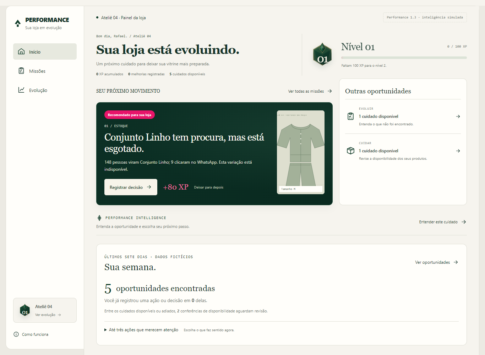
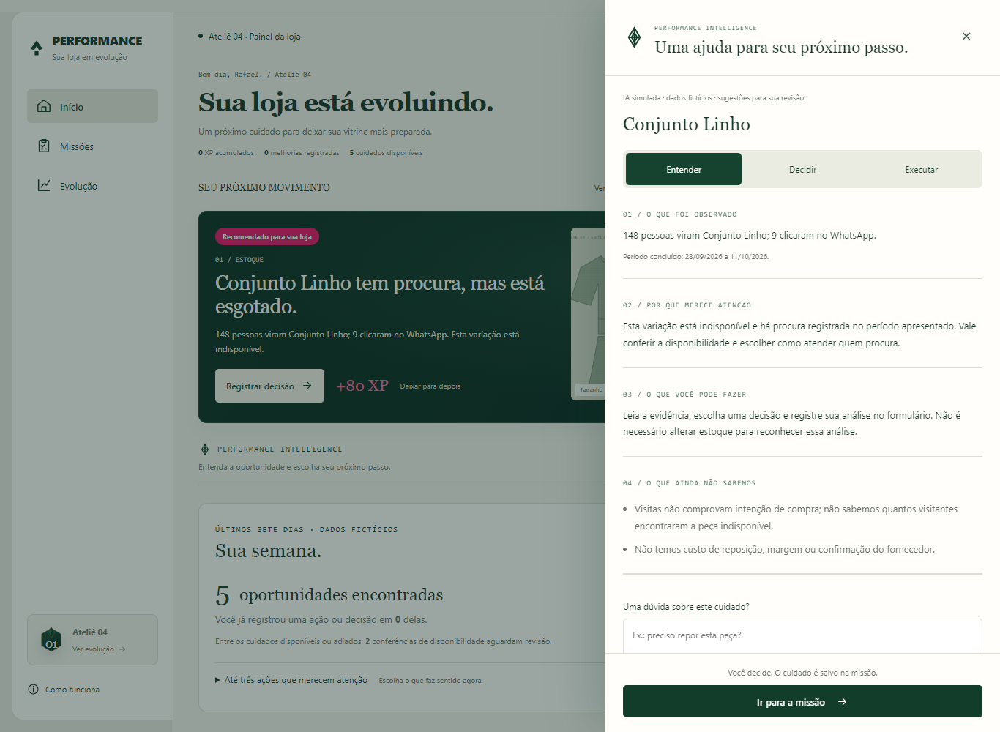

# Performance 1.3 — Entrega 2: inteligência assistida

13/10/2026. Consolidação da revisão da Entrega 1 e implementação do Performance Intelligence no aplicativo experimental. Todos os eventos e produtos continuam fictícios. Não existe API paga ou fonte real conectada.

## 1. O que mudou após a revisão

A revisão trouxe uma distinção fundamental: analisar uma oportunidade não comprova que o problema comercial foi resolvido. O Performance agora reconhece explicitamente **decisões registradas**, **melhorias realizadas** e **resultados em acompanhamento**.

Os mesmos tipos de missão, IDs, critérios e valores de XP continuam valendo. Nenhuma recompensa já conquistada foi retirada. A mudança alcança confirmação, recibo, progresso do conjunto, retrospectiva da conquista e histórico. Uma análise salva não aparece como peça aprimorada ou alteração de estoque.

Exemplo: manter o Conjunto Linho indisponível e registrar a justificativa concede os 80 XP da análise. A quantidade permanece zero. O recibo mostra “Decisão registrada” e “Resultado em acompanhamento”, explicando que a análise não confirma reposição. Não há venda ou resultado novo produzido pelo assistente.

No cenário combinado, concluir todos os cinco cuidados mantém 360 XP. O reconhecimento correto é: cinco registros, três decisões e duas melhorias efetivamente realizadas — uma revisão de estoque e uma descrição adicionada.

## 2. Sua semana com um denominador claro

O ciclo mantém a recomendação principal acima do resumo. Os quatro indicadores paralelos foram substituídos por uma leitura curta:

- Oportunidades encontradas no intervalo.
- Quantas dessas mesmas ocorrências já possuem uma ação ou decisão registrada.
- Uma explicação sobre conferências de disponibilidade pendentes, quando existem.
- Acesso às oportunidades, prioridades opcionais e acompanhamento.

O numerador usa identidades de origem do mesmo conjunto encontrado. Uma melhoria estrutural sem oportunidade identificada não entra nessa contagem. A origem continua contada depois de ser registrada, evitando que a oportunidade desapareça do denominador ao salvar.

As conferências são apresentadas como subconjunto de cuidados disponíveis ou adiados, sem convidar o lojista a somar categorias sobrepostas. As prioridades continuam limitadas a três e recolhidas; não viraram metas obrigatórias.

O detalhamento de melhorias, decisões, espera e resultados permanece nas missões e na evolução. A loja em dia preserva nível e histórico. Nenhum período, consulta ou clique concede experiência.

## 3. Intelligence dentro do cuidado

O assistente aparece pelo acesso discreto no Início ou por **Analisar com IA** no formulário. Não cria uma nova página de chat ou uma quarta área de navegação.

O painel lateral mantém verde profundo, creme, tipografia editorial e um símbolo geométrico próprio. Ele possui três modos:

| Modo | Ajuda oferecida |
| --- | --- |
| Entender | Explicar a evidência da oportunidade |
| Decidir | Apresentar escolhas válidas e considerações para cada uma |
| Executar | Orientar o cuidado e preparar uma descrição quando cabível |

As respostas se organizam em quatro blocos: o observado, por que merece atenção, o que pode ser feito e o que ainda não sabemos. A pergunta complementar é curta e fica nesse mesmo contexto. A simulação usa regras e textos preparados; não é um modelo generativo real, nem um chat capaz de conversar sobre qualquer assunto.

Em esgotado, o painel apresenta as três decisões existentes. Selecionar uma opção preenche o campo da missão, deixando a justificativa para o lojista. Não compra mercadoria nem altera quantidade. Outros itens da mesma categoria podem aparecer como referência, sem afirmar equivalência. Peças com divergência de disponibilidade pendente ficam fora dessas alternativas.

O texto não afirma que todos os visitantes viram a peça indisponível. Sabemos a procura no período e a indisponibilidade atual; não há histórico de disponibilidade por visita. Também faltam custo, margem, fornecedor e confirmação de vendas. Essas ausências aparecem na análise.

## 4. Descrição assistida com revisão

Na missão de descrição, o modo Executar pede informações que o lojista conhece: modelagem e, opcionalmente, acabamento, cor e uso. A composição cadastrada é exibida como fonte adicional. Não se deduz tecido, tamanho, marca ou características pela ilustração.

O adaptador simulado monta o texto com essas características. A resposta só é aceita quando corresponde à composição determinística das fontes autorizadas. Assim, uma descrição inventada de seda ou outro atributo não informado é rejeitada no protótipo.

A sequência é explícita: informar características → preparar sugestão → revisar rascunho → levar ao formulário → editar ou desfazer → salvar a missão. Gerar, transferir ou desfazer uma sugestão não salva a peça e não concede XP.

O rascunho anterior do editor é preservado. **Desfazer sugestão** recupera esse texto. Se as características forem alteradas depois da geração, a sugestão precisa ser preparada novamente antes de ser transferida. Erro e tentativa posterior conservam os campos.

Somente o salvamento final passa pela validação transacional já existente: descrição de 20 a 800 caracteres, objetivo elegível e operação idempotente. A foto, composição e contagem continuam sendo confirmadas nos formulários próprios.

## 5. Arquitetura e fronteira de confiança

A implementação usa o fluxo já preparado: sessão local autorizada → motor de missões → contexto mínimo → adaptador simulado → resposta validada → revisão pelo lojista → comando permitido de salvamento → XP e acompanhamento.

| Módulo | Responsabilidade |
| --- | --- |
| `intelligence/context.mjs` | Construir contexto da missão elegível e validar pergunta/características |
| `intelligence/simulated-provider.mjs` | Produzir orientação simulada e composição factual do texto |
| `intelligence/validate.mjs` | Verificar estrutura, evidência, opções e sugestão |
| `intelligence/service.mjs` | Orquestrar consulta, cache, prazo e descarte de contexto obsoleto |
| `server/repository.mjs` | Guardar metadados de uso e limitar consultas por sessão |
| `components/IntelligencePanel.jsx` | Apresentar ajuda, campos e revisão contextual |

O navegador envia somente geração, missão, tipo de ajuda, pergunta, características permitidas e controle da simulação. Não define XP, loja, evidência, quantidade, período ou dados de visitantes. A API exige a mesma sessão e origem local das operações existentes.

O contexto é construído da missão atualmente elegível, inclusive quando adiada. Ele contém a evidência, período quando disponível, nome, tamanho, composição, quantidade registrada, escolhas permitidas e alternativas limitadas. Não envia histórico integral, operações, imagem, credenciais, sessão ou dados de consumidores.

O provedor recebe uma cópia do contexto. Não pode alterar a fonte usada para validar a resposta. As respostas precisam ter o formato previsto, mesma missão, observação exatamente igual à fonte e opções com identidade/rótulo permitido. Campos de comando ou XP são rejeitados. Projeções numéricas e afirmações de resultado garantido também são rejeitadas nos textos de interpretação da simulação.

Essa validação não é uma garantia universal contra alucinações de um futuro modelo. O adaptador atual é determinístico e conservador. Um provedor real exigirá avaliação própria de fidelidade, qualidade e falhas, sem alterar a autoridade do motor sobre ações e recompensas.

## 6. Uso, falhas, privacidade e movimento

O servidor limita consultas a 30 por minuto por sessão fictícia. A reserva é transacional e inclui pedidos simultâneos e consultas que usam cache. Reiniciar o cenário não reinicia esse limite.

O cache dura até cinco minutos, possui no máximo 200 entradas e é isolado por sessão, geração, revisão, missão, tipo de ajuda, pergunta e características. Uma alteração no contexto invalida o reaproveitamento. Respostas inválidas ou indisponíveis não entram no cache.

A tabela local `intelligence_usage` registra tipo de consulta, resultado, uso de cache, latência e custo em centavos. O custo é sempre zero no protótipo. Perguntas e características não são gravadas nessa auditoria. O cache em memória pode conter a sugestão textual validada até expirar; não é um histórico de conversa.

Há prazo máximo de cinco segundos para obter resposta. Se a loja ou o cenário mudar durante a consulta, a análise atrasada é descartada. Fechar o painel cancela o recebimento na interface e impede apresentação tardia. O formulário permanece disponível quando a ajuda falha.

Campos de entrada recusam formatos comuns de email, telefone e CPF. Essa proteção é heurística, não comprova conformidade completa com a LGPD. O MVP não coleta documentos, dados pessoais de clientes ou consulta sistemas governamentais.

| Antes | Depois |
| --- | --- |
| Sem painel de ajuda | Entrada lateral de 200 ms, com transformação e opacidade |
| Formulário sem ajuda contextual | Diálogo reutilizado, foco no título e retorno ao controle anterior |
| Sem resposta simulada | Carregamento, falha, resposta inválida, tentativa posterior e fechamento durante a espera |
| Movimento da conquista existente | Preservado; assistente respeita movimento reduzido e não acrescenta uma animação de recompensa |

O painel se adapta ao celular com corpo rolável e ação final acessível. Os botões têm áreas de toque de pelo menos 44 px. Escape fecha primeiro a ajuda e depois a missão, quando ambos estão abertos.

## 7. Como testar e reiniciar

Abrir [Intelligence no protótipo](http://localhost:3405/?cenario=intelligence#inicio). O cenário mostra os cinco cuidados da loja organizada com os acessos à ajuda. Os 18 cenários anteriores continuam no seletor; agora existem 19 cenários e os mesmos nove modelos de missão.

| Fluxo | Passos | O que conferir |
| --- | --- | --- |
| Explicação | Entender este cuidado no Início | Evidência e quatro blocos; nenhum XP |
| Decisão | Decidir → Escolher no formulário | Opção preenchida, justificativa ainda necessária, estoque intacto |
| Pergunta | Perguntar se precisa repor ou se clique é venda | Resposta curta, sem confirmação de venda ou reposição |
| Descrição | Cenário Apresentação com procura → missão → IA → Executar | Características, sugestão e composição de fonte conhecida |
| Revisão | Levar ao formulário e desfazer | Texto anterior recuperado; nada salvo automaticamente |
| Salvamento | Revisar e salvar a decisão ou melhoria | Confirmação correta e recompensa original, uma vez |
| Falha | Opções da demonstração → Próxima resposta do assistente | Indisponível, inválida ou lenta; a seleção afeta a próxima consulta |
| Resposta lenta | Fechar durante o carregamento | Nenhum painel ou resultado reaparece depois |

Reiniciar pelo seletor ou por **Reiniciar este cenário** nas opções existentes. Apenas a sessão fictícia é afetada. As melhorias persistem ao recarregar; o assistente não reabre automaticamente e não repete conquistas.

## 8. Arquivos e verificações

Os arquivos novos são os quatro módulos em `intelligence/`, `domain/recognition.mjs`, `components/IntelligencePanel.jsx`, `components/DecisionStatus.jsx`, o plano, este relatório e os testes de Intelligence.

Os arquivos alterados são `domain/cycles.mjs`, `domain/achievements.mjs`, os componentes de ciclo, editor, confirmação, grupos, missões, retrospectiva, trajetória e Início, `components/Experience.jsx`, `adapters/api.mjs`, a rota da API, o repositório local, fixtures, estilos e o exportador de documentos. O helper de navegador agora escolhe o diálogo superior quando dois estão abertos.

Não houve alteração no motor de XP, na fórmula dos níveis, nos critérios de recompensa ou nos IDs dos objetivos. Os testes de ciclo foram ajustados para verificar que uma decisão não conta como melhoria realizada. A verificação da interface passou a conferir o denominador comum do ciclo.

| Verificação | Evidência |
| --- | --- |
| `npm test` | 51 testes de domínio, servidor e concorrência |
| `npm run build` | Compilação de produção concluída |
| Cinco fluxos anteriores | Missões originais, filtros, grupos, marcos 5/10, impacto e densidade preservados |
| `browser-continuous.cjs` | Cinco cuidados, recorrência, decisões, persistência e recompensa única |
| `browser-intelligence.cjs` | Pergunta contextual, escolha, revisão, desfazer, falha, resposta inválida, cancelamento e autenticação |
| Interface | Telas de 320, 375, 768 e 1440 px; teclado, Escape, movimento reduzido e footer acessível |

Os 11 testes novos cobrem reconhecimento, denominador, minimização do contexto, respostas simuladas, fidelidade da descrição, comandos proibidos, perguntas, cache, sessões, falhas, limite concorrente, contexto obsoleto e prazo máximo. Consultas não alteram o estado comercial; auditoria permanece separada de recompensas.

As evidências ficam em `.tmp/painel-gamificado/verificacao-intelligence.json`, nos demais relatórios existentes e nas capturas `performance-13e2-*`. Não são resultado de pesquisa com lojistas ou de aumento de conversão.

## 9. O que permanece para depois

O assistente não usa uma API de linguagem real. Não há chave, SDK externo ou chamada paga ativada. O contrato `respond` e a validação existem para uma futura adaptação, que dependerá de revisão explícita, autenticação real por loja, limites compartilhados em produção, medição de custo efetivo e avaliação de respostas.

Nenhum evento é coletado da operação real. Fontes confiáveis de busca, visita, disponibilidade, campanha e clique ainda precisam ser mapeadas, agregadas e autorizadas. Antes de clientes reais, realizar a revisão com lojistas sobre análise, ação e resultado, além de staging e validação de permissões/privacidade.

A Entrega 3 aprofundará acompanhamento comercial e comparações descritivas. Nesta entrega foi mantida a leitura existente, sem fabricar visitas posteriores, mensagens ou vendas e sem atribuir causalidade às decisões.

Os documentos e figuras da Entrega 1 foram preservados como histórico. Este relatório prevalece nos pontos de reconhecimento, ciclo e assistente alterados. Preços, planos e o aplicativo principal não foram modificados. A Entrega 2 fica pronta para revisão antes dos próximos passos.
