# Performance — documento completo da experiência atual

**Estúdio Rafael Razeira · Consolidação da versão 1.4, Entregas A/B, com emblemas até 100 · 13 de outubro de 2026**

Este documento reúne a evolução do experimento desde a primeira proposta até a interface atual. Explica produto, experiência, missões, progressão, inteligência assistida, acompanhamento comercial, mapa de produtos, interesse por tamanho, identidade visual, arquitetura, verificações e próximos passos.

A versão ativa fica em `experimentos/painel-gamificado`. É um aplicativo independente com servidor próprio, loja fictícia, API e banco local. O painel compartilhado, as vitrines publicadas e as landing pages não receberam esta experiência gamificada. Os documentos de cada entrega permanecem como histórico; esta consolidação descreve o estado atual nos pontos que evoluíram.

## 1. A proposta do Performance

O Performance responde à pergunta: **qual é o próximo passo útil para minha loja?** Ele organiza cuidados do catálogo e da disponibilidade, apresenta evidências comerciais quando existem e reconhece ações confirmadas com experiência, nível e histórico.

A inspiração em RPG aparece na progressão, nos emblemas e no reconhecimento. O trabalho principal continua sendo cuidar da loja: apresentar uma peça, conferir uma quantidade, interpretar uma procura ou registrar uma decisão. O produto deve tornar esse trabalho mais claro, simples e consistente.

Uma formulação de valor a validar é: **“Sua loja tem dados. O Performance mostra o que fazer com eles.”** No estágio atual, os dados são fictícios e a orientação combina regras determinísticas com respostas assistidas preparadas.

O objetivo comercial é ajudar a vitrine direcionada ao WhatsApp a oferecer uma escolha mais clara e um atendimento mais preparado. Aumento de vendas, de contatos ou de assinatura ainda não foi comprovado. XP reconhece trabalho registrado; indicadores comerciais descrevem evidências separadas.

## 2. O que está entregue e o que está preparado

| Parte | Estado atual |
| --- | --- |
| Aplicativo independente | Implementado em React/Next.js, acessível no localhost |
| Início, Missões e Evolução | Implementados, com navegação e ações locais |
| Grupos de cuidados | Implementados com composição persistida e total fixo |
| Nove modelos de missão | Implementados com validação e recompensa única |
| XP, nível e retrospectiva | Derivados do histórico confirmado pelo servidor |
| Marcos funcionais 5 e 10 | Implementados, com consulta às conquistas alcançadas |
| Emblemas 1–100 | 21 desenhos-base e variações entre as faixas |
| Intelligence contextual | Interface e provedor simulado implementados |
| Próximo passo e acompanhamento | Implementados com notas e comparações condicionais |
| Mapa e diagnóstico comercial | Implementados na 1.4 A/B, com dados fictícios |
| Interesse por tamanho esgotado | Consulta, confirmação e recibo locais implementados |
| Cenários | 32 situações fictícias disponíveis |
| Validação com lojistas | Roteiro e ficha preparados; entrevistas ainda pendentes |
| IA generativa real | Preparação da 1.5; nenhuma API ou chamada paga conectada |
| Dados e contas reais de lojas | Contratos a revisar e integrar; operação real não ativada |
| Pedidos e vendas vinculados ao Performance | Roteiro futuro da 2.0 |

As áreas de estoque e pedidos do painel principal são outro trabalho. Uma conferência de quantidade no experimento não representa integração completa à gestão de estoque ou ao fluxo real de pedidos.

## 3. Como o produto evoluiu

| Etapa | Contribuição que permanece na versão atual |
| --- | --- |
| 1.0 | Pasta separada, três áreas principais, execução de cuidados e progresso verificado |
| 1.1 | Frentes Organizar/Cuidar/Evoluir e grupos com objetivos fixos |
| 1.2 | Hierarquia mais simples, ação principal visível e linhas de missão compactas |
| 1.3 — Entrega 1 | Ocorrências recorrentes e três modelos de decisão comercial |
| 1.3 — Entrega 2 | Intelligence contextual, descrição assistida revisável e distinção entre decisão e melhoria |
| 1.3 — Entrega 3 | Encaminhamento declarado, evidências posteriores e acompanhamento comercial |
| 1.4 — A/B | Mapa, três níveis de leitura, interesse por tamanho e diagnóstico determinístico |
| Refinamento visual atual | Prévia dos níveis 10/25 e coleção de emblemas até 100 |

As versões anteriores documentam a entrega no momento em que foi feita. Referências antigas a seis modelos, nove cenários, 19 cenários ou desenhos apenas até o 25 não descrevem o catálogo atual completo.

## 4. Estrutura da experiência

O aplicativo mantém três destinos principais. O mapa de produtos está dentro de Missões e o acompanhamento dentro de Evolução. Painéis laterais aprofundam uma peça ou uma decisão, mantendo o contexto da tela de origem.

| Destino | Pergunta respondida | Conteúdo principal |
| --- | --- | --- |
| Início | O que merece minha atenção agora? | Uma recomendação, motivo e ação principal |
| Missões | O que posso fazer e o que já concluí? | Grupos, filtros, execução, adiamento e comprovantes |
| Mapa de produtos | O que acontece com cada peça? | Fatos, cuidados, procura por variação e comparações possíveis |
| Evolução | O que mudou no meu trabalho? | Nível, XP, marcos, coleção e linha do tempo |
| Acompanhamento | O que foi encaminhado e o que podemos observar depois? | Declarações, fontes, espera e leitura de períodos |

Um caminho típico é: evidência visível → item correto → ação específica → salvamento validado → confirmação → progresso → acompanhamento quando houver dados. Consultar, navegar ou abrir uma sugestão não conclui automaticamente uma missão.

## 5. Início: uma oportunidade clara

O Início apresenta a identidade da loja, o progresso compacto e um próximo movimento. A hierarquia reduz a competição entre vários gráficos, tarefas e indicadores na primeira área visível.

Nos cenários comerciais da 1.4, o diagnóstico destaca uma situação e explica o próximo cuidado. Exemplo: uma variação esgotada possui declarações de interesse; a orientação é conferir a disponibilidade e avaliar a reposição. A recomendação não determina compra de estoque nem estima vendas perdidas.

“Analisar oportunidade” abre a peça correspondente. “Ver todas no mapa” leva à seção de produtos. Outras oportunidades permanecem secundárias. O diagnóstico desses cenários substitui o destaque anterior, evitando repetir contagens da semana calculadas sobre outras fontes.

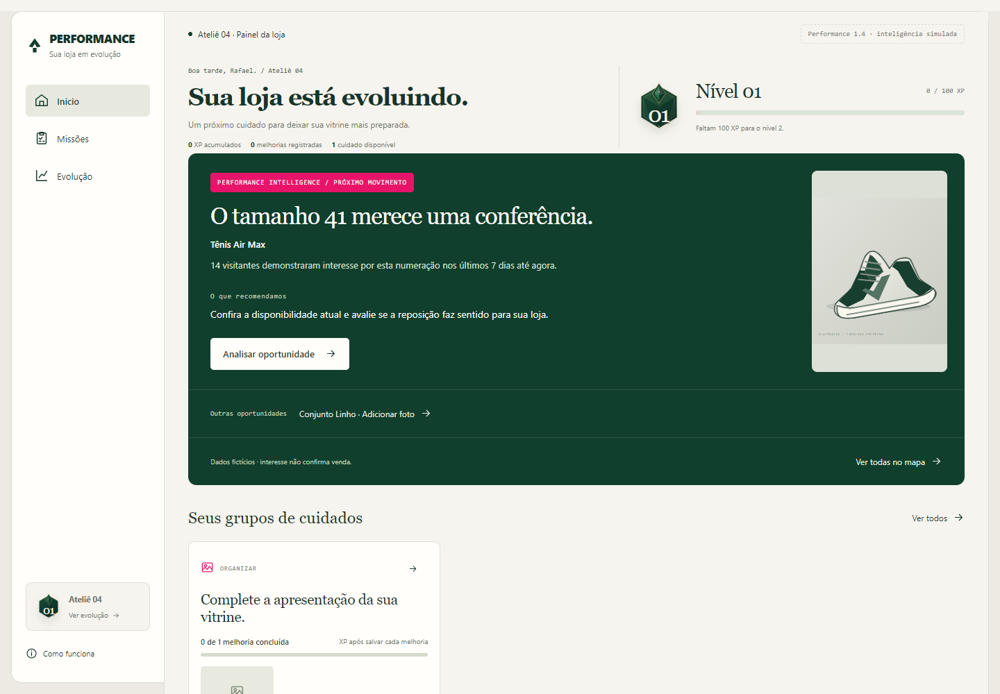

Nos cenários anteriores, permanecem a missão principal e “Sua semana”. O ciclo resume oportunidades identificadas, melhorias salvas, situações para revisar e registros aguardando dados. Até três prioridades opcionais ficam recolhidas. O sistema não impõe três tarefas nem reinicia metas a cada semana.

Quando não existe ação elegível, a loja aparece em dia. Nível e histórico permanecem disponíveis. Ausência de tarefa não é tratada como fracasso e não causa perda de pontos. O experimento precisa carregar ocorrências fictícias para demonstrar novas necessidades; não monitora uma loja real.

## 6. Missões: uma área dedicada à execução

Missões separa Disponíveis, Para depois e Concluídas. As frentes Todas, Organizar, Cuidar e Evoluir ajudam a escolher o tipo de trabalho. Os filtros são preservados no endereço e aceitam recarregamento e navegação de retorno.

Cuidados semelhantes aparecem em grupos expansíveis. Cada grupo explica contexto, total, itens concluídos, progresso e XP recebido. Dentro dele, linhas compactas mostram produto, cuidado, motivo, recompensa e CTA específico. O primeiro grupo da seleção começa aberto.

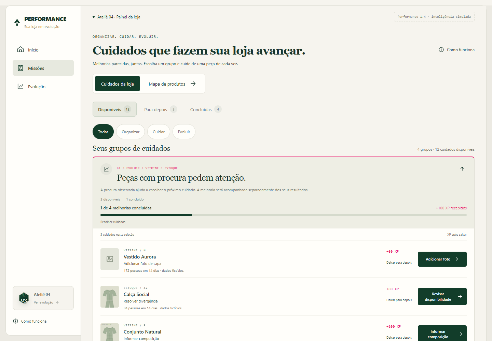

| Frente | Propósito | Exemplos |
| --- | --- | --- |
| Organizar | Completar a apresentação para ajudar a escolher | Foto de capa, detalhe e informações da peça |
| Cuidar | Conferir registros para atender melhor | Primeira contagem e revisão de divergência |
| Evoluir | Investigar ou cuidar de uma situação com evidência | Produto procurado, buscas sem resultado e campanha encerrada |

As áreas internas são Vitrine e Estoque. Composição pertence a Vitrine. Evoluir descreve o contexto da oportunidade; não é uma categoria que premia mais a mesma ação. Conversão não é usada como etiqueta para preencher tecido ou acabamento.

Um objetivo prioritário por entidade evita apresentar vários cuidados simultâneos sobre a mesma peça. Uma necessidade seguinte pode ficar disponível após a anterior, conforme o estado salvo. A lista completa não se limita aos três itens apresentados como resumo.

## 7. Grupos com progresso confiável

O servidor persiste os identificadores que pertencem a cada conjunto. Um grupo que começou com quatro objetivos mantém esse total ao salvar, adiar ou retomar. Novas ocorrências entram em outro conjunto, preservando a leitura do grupo anterior.

| Acontecimento | Consequência |
| --- | --- |
| Melhoria elegível salva | Soma uma conclusão e seu XP individual |
| Objetivo adiado | Muda a situação, preserva total e experiência |
| Objetivo retomado | Volta à execução, sem recompensa pela retomada |
| Nova necessidade | Entra em outro conjunto |
| Necessidade deixa de ser elegível | Aparece indisponível; não vira conclusão artificial |
| Todos os objetivos concluídos | Grupo finalizado e registro visual na trajetória |

Finalizar o grupo não acrescenta um bônus de XP. A confirmação do editor mostra o avanço daquele conjunto, conectando a ação individual ao progresso maior.

O cenário de várias missões reúne 19 objetivos em quatro grupos: 12 disponíveis, três para depois e quatro concluídos. As conclusões iniciais somam 280 XP: nível 3, com 30 de 200 XP. Essas contagens descrevem esse cenário específico, não uma meta obrigatória para cada loja.

## 8. Os nove modelos de missão

| Modelo | O que o lojista faz | Regra principal | XP |
| --- | --- | --- | ---: |
| Foto de capa | Adiciona a primeira imagem da peça | Imagem válida salva em produto sem capa | 60 |
| Foto de detalhe | Mostra acabamento ou detalhe necessário | Imagem válida salva na necessidade de detalhe | 40 |
| Informações da peça | Explica caimento ou acabamento | Texto de 20 a 800 caracteres salvo na necessidade | 60 |
| Primeira contagem | Confere a quantidade física | Inteiro de 0 a 9.999 e justificativa de conferência | 80 |
| Revisão de disponibilidade | Resolve uma divergência pontual | Quantidade válida e explicação; ocorrência elegível | 80 |
| Composição com procura | Informa a composição da etiqueta | Procura válida e composição de 8 a 160 caracteres | 100 |
| Procurado e esgotado | Registra análise e decisão permitida | Evidência elegível e justificativa | 80 |
| Buscas sem resultado | Decide como investigar a procura | Termo sem correspondência e próximo passo registrado | 60 |
| Campanha concluída | Analisa a campanha e registra conclusão | Origem rastreada, janela encerrada e decisão válida | 80 |

Salvar é suficiente para concluir a missão quando a regra é satisfeita. Não existe um segundo botão obrigatório de “Concluir”. O servidor decide elegibilidade, evidência e recompensa. O navegador não escolhe a quantidade de XP.

Quantidade zero é um resultado válido de conferência. A utilidade está em registrar a disponibilidade correta, não em aumentar o estoque. Abrir o editor, gerar uma sugestão, repetir a mesma operação ou modificar o cache local não concede experiência.

## 9. Evidências, prioridade e recorrência

As oportunidades possuem identidade, loja, entidade, tipo, motivo, origem, período, ação, critério, situação e data de identificação. Uma referência confiável explica por que a tarefa aparece. Peças explicitamente não publicadas ficam fora das recomendações de catálogo.

| Situação | Critério inicial do protótipo |
| --- | --- |
| Procura associada a produto | Pelo menos 50 visitantes e janela concluída de ao menos 14 dias |
| Produto procurado e esgotado | Publicado, quantidade zero e procura elegível |
| Busca sem resultado | Termo sem correspondência, dez visitantes e sete dias concluídos |
| Campanha encerrada | Origem rastreada, 50 visitantes e sete dias concluídos |
| Nova divergência de estoque | Novo evento de conferência posterior à revisão anterior |

Contagens e datas precisam ser coerentes. Uma origem de outra loja, um evento futuro ou uma janela rebatizada não geram uma nova recompensa. Reutilizar o mesmo evento concluído não cria outra missão premiada.

A prioridade favorece foto ausente com procura, depois disponibilidade com procura, depois cuidados operacionais sem referência comercial. Outros cuidados de apresentação seguem quando elegíveis. A ordem é determinística; não usa IA, faturamento ou margem.

Esses limites são hipóteses de organização a calibrar. Não são evidência estatística ou previsão de venda. Um cuidado estrutural, como adicionar foto, pode continuar útil sem atingir 50 visitantes; a 1.4 torna esse cuidado acessível pelo mapa mesmo com pouco tráfego.

## 10. Editor, salvamento e confirmação

O editor abre no produto ou na variação correta e explica a necessidade. O formulário valida a entrada; o servidor revalida a elegibilidade atual. Melhoria e recompensa são salvas na mesma transação.

Depois da confirmação, o primeiro retorno informa a operação realizada: foto adicionada, quantidade conferida ou decisão registrada. A recompensa aparece associada a esse comprovante. Quando o ganho cruza um nível, o mesmo fluxo apresenta a conquista e o excedente.

| Estado | Comportamento |
| --- | --- |
| Entrada incompleta ou inválida | Mensagem específica, preenchimento preservado, nenhum XP |
| Falha de conexão simulada | Nova tentativa disponível, conteúdo preservado |
| Gravação confirmada | Operação, evidência, grupo e recompensa visíveis |
| Repetição da operação | Não duplica alteração ou XP |
| Fechamento durante a apresentação | Cancela a animação e mantém o que já foi salvo |
| Recarregamento | Recupera o estado; não repete a celebração |

Deixar para depois produz confirmação e preserva a experiência. Retomar abre a execução quando ainda elegível. Se o cuidado mudou, a lista informa o novo estado em vez de abrir uma ação impossível.

## 11. Experience points: significado e matemática

XP reconhece uma melhoria ou decisão elegível registrada. O nível geral organiza essa trajetória. Ele não mede receita, qualidade absoluta da loja, reputação de clientes ou probabilidade de venda.

O total vem exclusivamente do histórico confirmado. Para sair do nível L, o custo é `100 + 50 × (L − 1)` XP. O excedente atravessa a mudança de nível. O total necessário para chegar ao nível N é `100 × (N − 1) + 25 × (N − 1) × (N − 2)`.

| Nível alcançado | XP acumulado mínimo | XP para o nível seguinte |
| --- | ---: | ---: |
| 1 | 0 | 100 |
| 2 | 100 | 150 |
| 3 | 250 | 200 |
| 5 | 700 | 300 |
| 10 | 2.700 | 550 |
| 25 | 16.200 | 1.300 |
| 50 | 63.700 | 2.550 |
| 75 | 142.450 | 3.800 |
| 100 | 252.450 | 5.050 |

Exemplo: loja nova, 0 XP; primeira foto, +60; primeira contagem, +80. O total chega a 140 e o nível 2 começa com 40 de 150 XP. Não se descarta o excedente.

Adiar, esperar, ficar sem tarefas, consultar métricas ou registrar interesse não reduz nem aumenta o XP. Não há moeda, ranking, punição por ausência ou barras independentes por área. A fórmula atual não tem teto configurado; os desenhos personalizados desta entrega vão até 100. A duração comercial dessa progressão ainda precisa ser avaliada com uso real.

## 12. Evolução, trajetória e conquistas

Evolução reúne emblema, nível, barra, melhorias e decisões. A linha do tempo identifica ação, peça ou entidade, data e evidência. Mostra oito registros inicialmente e permite consultar os demais.

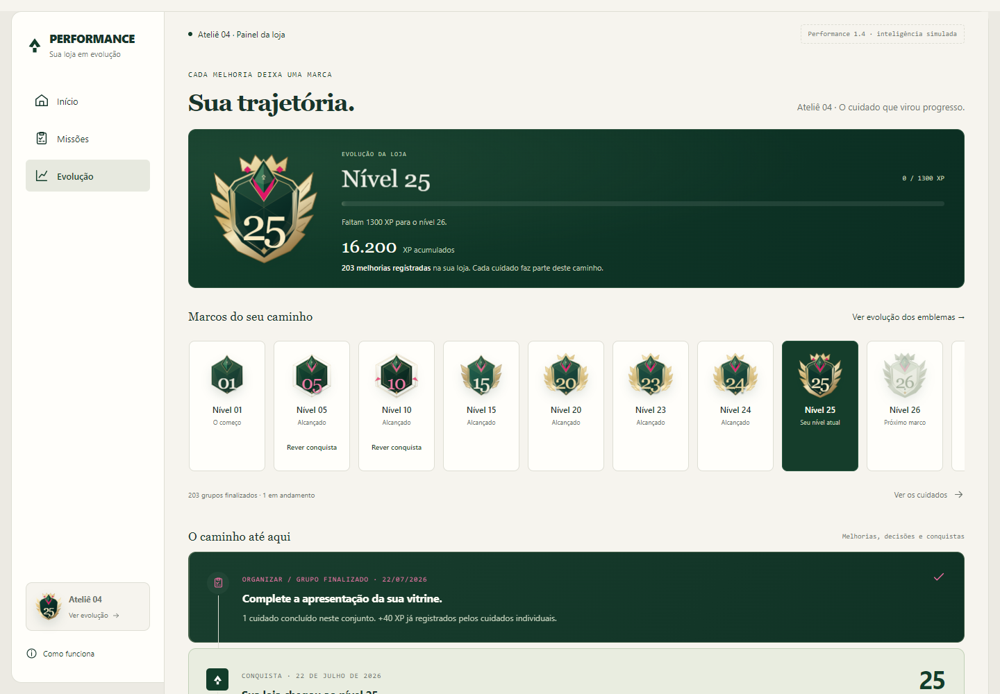

Decisão registrada e melhoria realizada são contadas separadamente. Analisar reposição não significa repor estoque. A retrospectiva usa somente ações documentadas, evitando decorar conquistas com números inventados.

Os marcos funcionais especiais continuam 5 e 10. São derivados do histórico, têm retrospectiva e podem ser revistos quando alcançados. As outras mudanças de nível também são reconhecidas; a ampliação visual até 100 não cria automaticamente 20 novas recompensas funcionais.

A coleção da página mostra níveis anteriores, atual e faixas futuras próximas. Os futuros têm acabamento neutro e não oferecem uma conquista ainda não alcançada. A galeria separada permite comparar todos os desenhos sem transformar a tela principal em uma longa lista de níveis distantes.

## 13. Identidade visual e princípios de design

Creme organiza o contexto; superfícies claras abrigam o trabalho; verde profundo sustenta destaques e reconhecimento; rosa marcante sinaliza evolução e pequenos acentos. Tipografia editorial nos títulos e números dá personalidade, enquanto controles mantêm leitura simples.

O design combina sensação de produto profissional com o cuidado artesanal do estúdio. Ornamentos ficam concentrados nos emblemas. Formulários, textos e análise continuam diretos. A identidade evita transformar a operação em uma tela de jogo que compete com a decisão comercial.

Os princípios aplicados são: uma ação principal por contexto, justificativa perto da recomendação, detalhes aprofundados sob demanda, confirmação explícita, estados vazios com saída e hierarquia consistente entre Início, Missões e Evolução.

O rosa integra o sistema; não existe nesta implementação uma medição automática de “10% de rosa” na composição. As cores e proporções são decisões visuais, sujeitas à leitura e contraste em cada tela.

## 14. Coleção personalizada de emblemas até 100

São **21 desenhos-base**, do nível 1 e depois de cinco em cinco até 100. Entre as faixas, uma a quatro joias na face mostram progresso, junto à numeração individual. Isso gera variações para os 100 níveis. Não são 100 silhuetas desenhadas separadamente.

A seta original da marca permanece dentro da joia central. A evolução muda forma, ornamentos e acabamento metálico. Coroa, asas e moldura circular distinguem o nível 100; sua tipografia tem proporção própria para caber também em 48 px.

| Nível | Identidade | Construção visual |
| --- | --- | --- |
| 1 | Fundação | Escudo essencial |
| 5 | Ascensão | Moldura facetada |
| 10 | Conquista | Insígnia reforçada |
| 15 | Distinção | Aletas e ombreiras |
| 20 | Prestígio | Louros e coroa |
| 25 | Nobreza | Asas e coroa imperial |
| 30 | Bastião | Bastiões e ponte dourada |
| 35 | Guardião | Pináculos e selo alongado |
| 40 | Vanguarda | Armadura de platina |
| 45 | Fortaleza | Muralha em degraus |
| 50 | Excelência | Auréola e joias cardinais |
| 55 | Domínio | Asas ascendentes |
| 60 | Referência | Estrela cristalina |
| 65 | Honra | Estandartes e coroa |
| 70 | Soberania | Manto e coroa soberana |
| 75 | Maestria | Bússola de quatro pontas |
| 80 | Legado | Louros de legado |
| 85 | Lendário | Leque em ouro rosado |
| 90 | Ícone | Dupla órbita e diadema |
| 95 | Supremo | Asas verticais e tríade |
| 100 | Centenário | Coroa, asas e selo mestre |

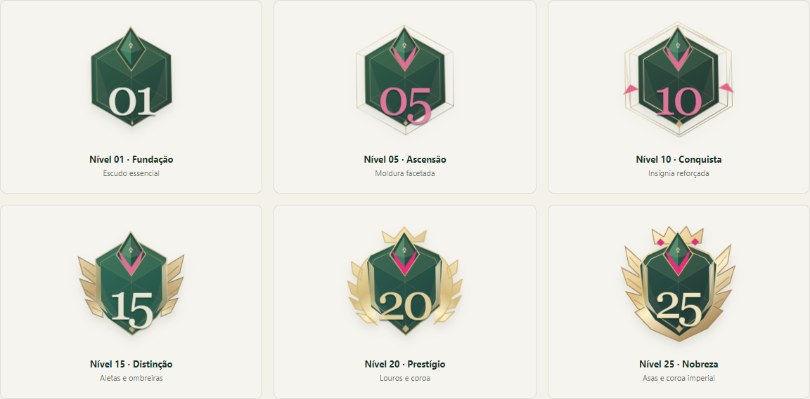

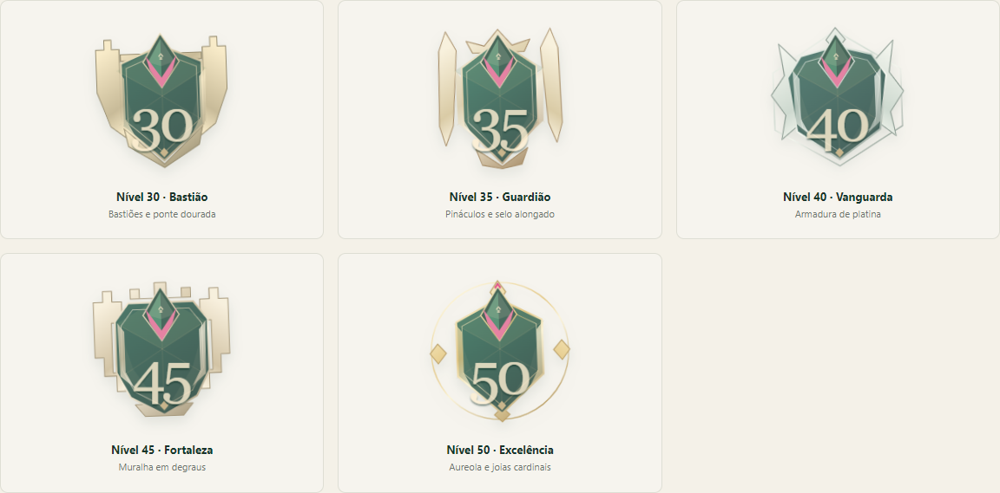

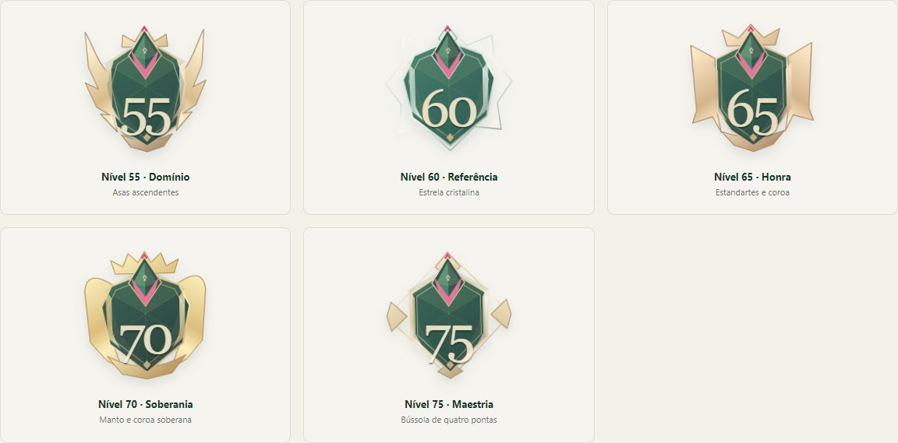

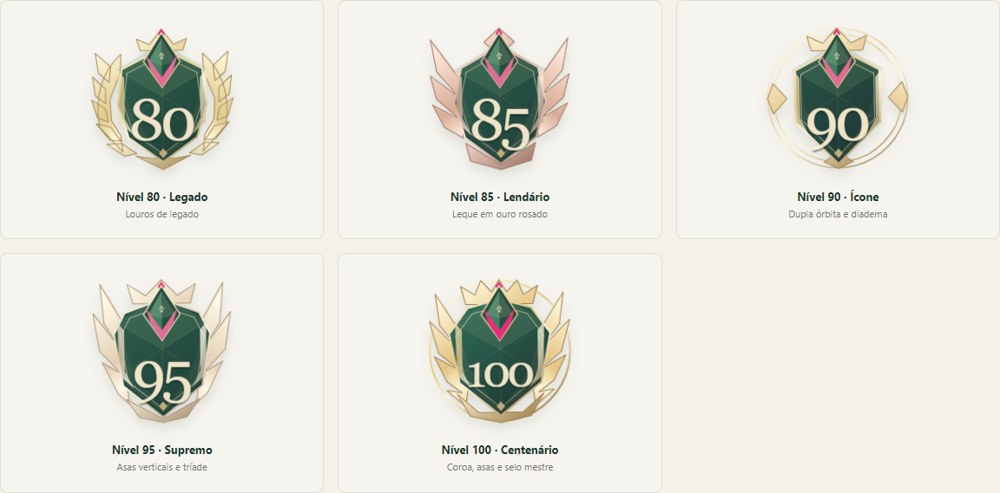

Em **Evolução → Ver evolução dos emblemas**, a galeria começa na prévia 100. O seletor consulta qualquer nível; as opções alternam 21 desenhos-base e todos os 100 níveis. Clicar num escudo atualiza a prévia grande e compacta.

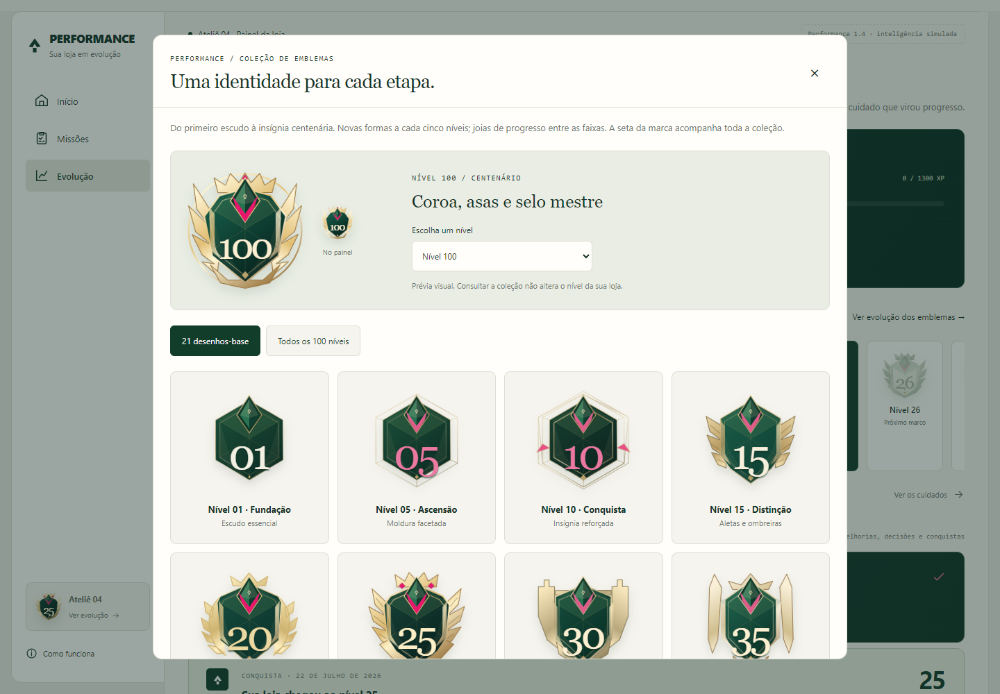

Consultar a coleção não altera o nível da loja, o cenário ou o histórico. Os nomes são identidades visuais, não certificações comerciais. Os desenhos são SVGs nativos compartilhados entre painel, galeria e conquistas, com gradientes identificados por instância.

## 15. Intelligence: entender, decidir e executar

Intelligence oferece ajuda contextual num painel lateral. Seu provedor atual usa respostas preparadas e fontes da loja fictícia. A interface está implementada; raciocínio generativo livre, orçamento de mídia e previsão de retorno não estão ativos.

| Modo | Ajuda oferecida | Limite de autoridade |
| --- | --- | --- |
| Entender | Evidência, explicação e informações ausentes | Não conclui uma missão |
| Decidir | Opções permitidas e sugestão contextual | Preenche uma escolha para revisão |
| Executar | Próximo cuidado ou rascunho com atributos conhecidos | Não publica nem salva automaticamente |

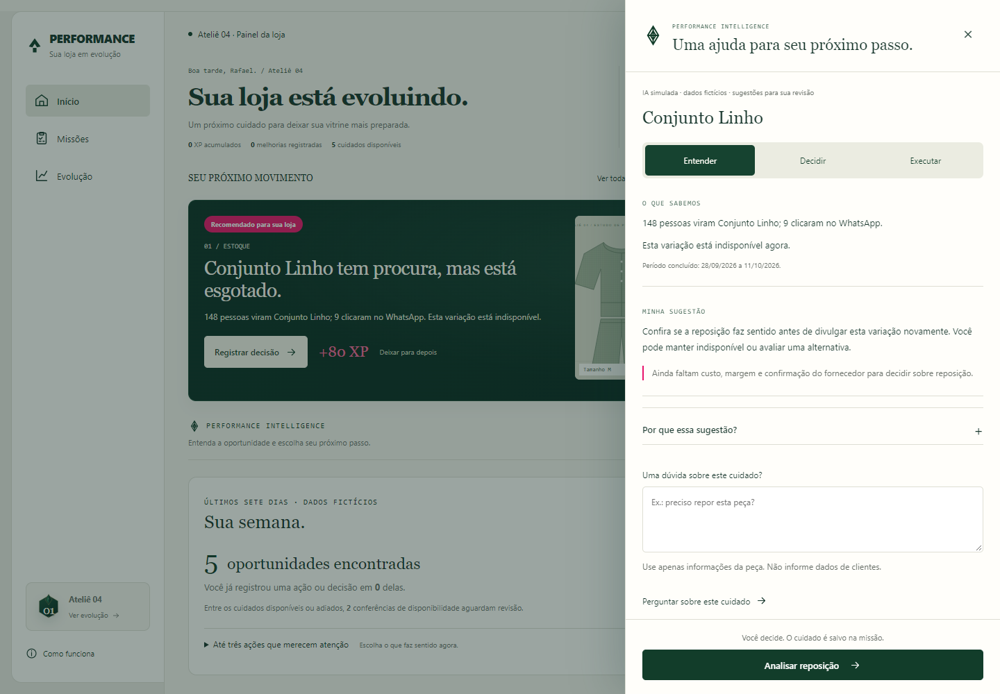

A primeira leitura apresenta evidência breve e sugestão. “Por que essa sugestão?” abre a justificativa completa. Riscos relevantes, como custo e margem ao avaliar reposição, permanecem visíveis.

A descrição assistida utiliza características informadas e composição cadastrada. O lojista gera, leva ao formulário, revisa e salva separadamente. Desfazer recupera o rascunho anterior. Gerar ou transferir texto não concede XP; o cuidado original pode conceder sua recompensa quando for salvo e validado.

O contexto é montado no servidor. A resposta precisa respeitar a fonte, os campos e as opções autorizadas. O validador atual é conservador e exige o contrato da simulação; conectar um modelo real exigirá outro contrato e avaliação própria.

Há limite de 30 consultas por minuto por sessão, cache isolado de até cinco minutos e prazo máximo de cinco segundos. A auditoria local registra metadados, latência e custo zero. Perguntas e características não são gravadas nessa auditoria. Falhas preservam o formulário; fechamento ou mudança de cenário descarta respostas atrasadas.

## 16. Decisão, encaminhamento e acompanhamento

Uma análise registrada pode gerar um acompanhamento. A decisão reconhece o raciocínio elegível, mas não confirma uma operação comercial. O próximo passo é uma declaração separada do lojista.

| Registro | Significado |
| --- | --- |
| Decisão sobre um esgotado | Análise sobre reposição, alternativa ou manutenção da indisponibilidade |
| Realizei o encaminhamento | Nota sobre o que foi feito depois, por exemplo consultar fornecedor |
| Decidi não realizar agora | Escolha explícita de não agir neste momento |
| Evidência posterior | Fonte compatível recebida para observar outro período |

A nota de encaminhamento exige de 20 a 600 caracteres. A confirmação informa que o registro não altera estoque, não comprova vendas e não gera XP adicional. Novos encaminhamentos são acrescentados ao histórico; a leitura usa o mais recente.

O acompanhamento fica em Evolução, com três registros recentes e anteriores acessíveis sob demanda. Pode mostrar falta de próximo passo, ausência de ação, espera por período, ausência de referência anterior, pouca amostra, incompatibilidade ou comparação disponível.

Dados insuficientes não penalizam a loja. Esperar, abrir o resultado ou receber uma fonte também não concede XP. Uma nova ocorrência legítima pode gerar outro objetivo pelo motor; apenas renomear o evento anterior não pode.

## 17. Leitura de períodos e significado dos indicadores

A comparação de atendimento usa pessoas com clique no WhatsApp divididas pelos visitantes elegíveis da mesma entidade. As duas janelas precisam ter população, métrica e versão compatíveis, fontes distintas, datas encerradas, mesma duração mínima de 14 dias e pelo menos 100 visitantes cada.

No acompanhamento de uma ação, a janela anterior termina antes dela e a posterior começa depois dela, sem sobreposição. Um encaminhamento mais recente pode invalidar a leitura anterior como evidência posterior à nova ação.

| Termo | O que representa |
| --- | --- |
| Visitantes | Pessoas elegíveis no período e na entidade definida |
| Pessoas com clique | Pessoas que acionaram o WhatsApp dentro da mesma população |
| Taxa de clique | Pessoas com clique divididas pelos visitantes elegíveis |
| Diferença em pontos percentuais | Mudança entre as taxas dos dois períodos |
| Comparação disponível | Fontes e janelas passaram pelos critérios de apresentação |

Por exemplo, 3% e 7% representam diferença de quatro pontos percentuais, com datas e denominadores apresentados. Essa descrição não comprova que a melhoria causou a mudança. Clique não confirma mensagem enviada, pedido atendido ou venda.

O mínimo de 100 visitantes é uma regra inicial de apresentação, não um teste de significância. Demonstrações históricas legadas têm compatibilidade específica; uma integração real deverá exigir proveniência completa desde a coleta.

## 18. Mapa de produtos e três níveis de leitura

O mapa torna dados úteis mesmo quando uma loja recebe poucas visitas. Mostra ilustração, nome, situação, contagens, período e ação de análise. Busca por nome e filtros permitem focar atenção, procura por tamanho, comparação ou leitura inicial.

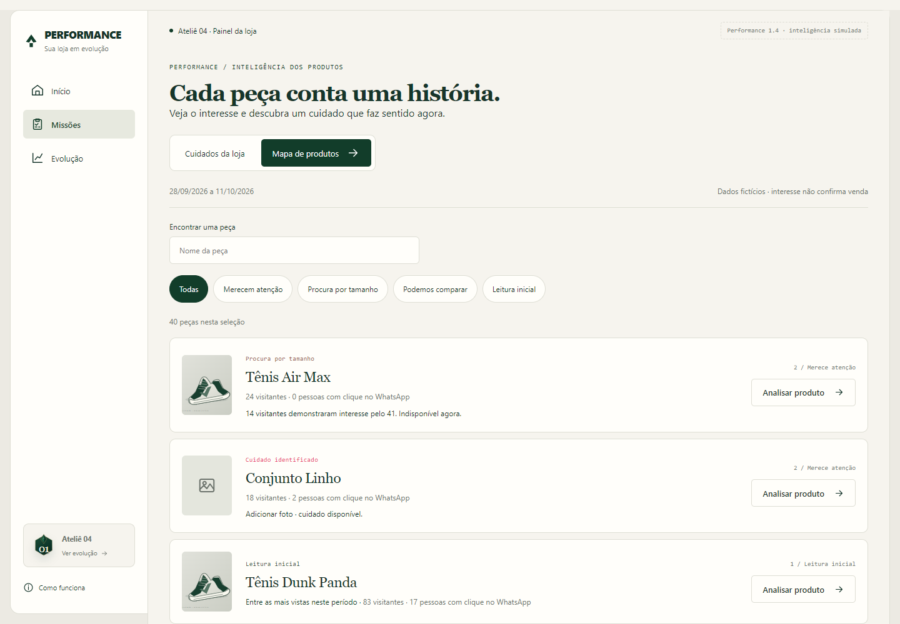

| Nível de leitura | Pergunta | Conteúdo |
| --- | --- | --- |
| 1 — O que aconteceu | Quais fatos temos? | Contagens e datas, ou ausência de fonte válida |
| 2 — O que merece atenção | Existe um cuidado concreto? | Missão existente ou interesse explícito por variação |
| 3 — O que podemos comparar | Existe referência suficiente da própria loja? | Taxa, mediana comparável e período anterior |

Esses níveis são profundidade de leitura dos dados, não nível de XP, classificação de qualidade ou plano pago. Uma peça sem foto continua acionável com 18 visitas. Sete declarações de interesse podem ser mostradas sem virar uma missão recorrente premiada.

Para comparação relativa, são necessários coleta completa, contatos qualificados, janelas encerradas de duração compatível e pelo menos 14 dias, 100 visitantes por janela e cinco produtos comparáveis da própria loja. A referência usa mediana local, sem uma taxa ideal de mercado.

“Muito visto” e “Destaque relativo” são descrições condicionais. “Pouco descoberto” exige também exposição qualificada, aberturas pertencentes à população exposta, tempo de publicação e referência de exposição. Falta de visitas isolada não sustenta esse diagnóstico.

Uma seleção vazia oferece limpar a busca ou voltar às peças. Abrir o mapa, mudar filtros e analisar não gera XP. Um cuidado concluído deixa de ser recomendado após atualização do estado.

## 19. Análise de uma peça e interesse por tamanho

O painel da peça mostra fontes, fatos, cuidados disponíveis e variações. Sua ação abre o formulário original da missão ou a demonstração da mesma peça. Quando o cuidado está adiado, a navegação leva à área correspondente, sem retomada automática.

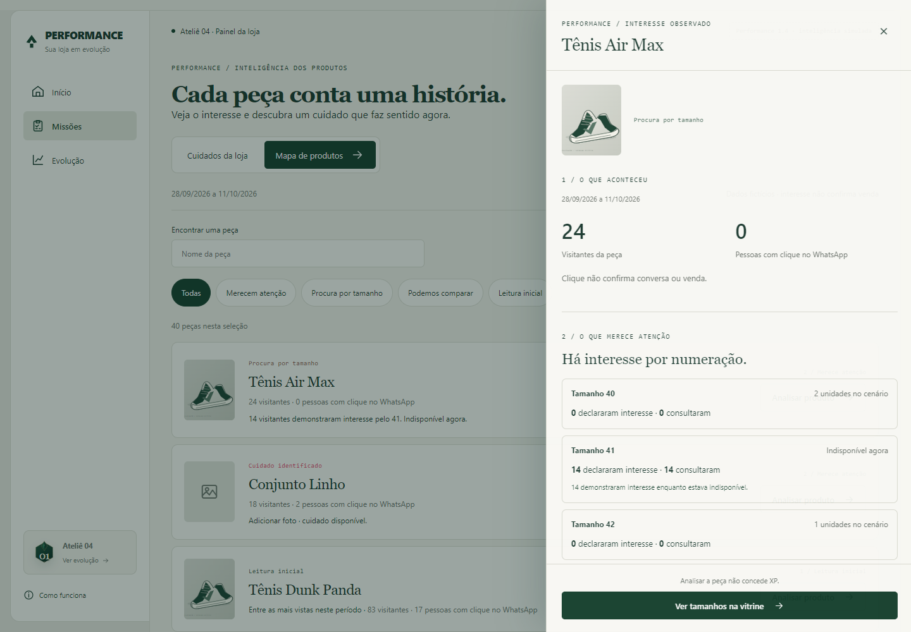

A vitrine demonstrativa permite consultar um tamanho esgotado. O primeiro toque registra uma consulta e explica a indisponibilidade. Uma segunda ação, “Tenho interesse neste tamanho”, registra uma declaração explícita após confirmação do servidor.

Consulta e declaração são contagens separadas de visitantes distintos por variação nos últimos sete dias. A janela está em andamento e não equivale a um período encerrado de comparação. Pessoas podem aparecer em várias variações; não se somam essas contagens como visitantes únicos do catálogo.

Para declarar interesse, é necessária consulta recente, em até 15 minutos, na versão de estoque apresentada. O servidor revalida a disponibilidade. Se a peça estiver disponível ou a quantidade for desconhecida, a interface informa o novo estado e não registra interesse como item esgotado.

Repetir a declaração não multiplica o interessado na janela. A operação possui recibo idempotente, incluindo resultados de disponibilidade alterada. Falha mantém a variação escolhida e permite nova tentativa. Sucesso aparece somente depois da confirmação.

Não há cadastro de telefone, e-mail ou CPF nessa interação. O sinal não reserva, não avisa reposição e não cria pedido. No experimento, o visitante deriva da sessão fictícia local; um fluxo público real precisará de contrato de coleta próprio.

## 20. Experiência no celular, acessibilidade e movimento

O aplicativo foi conferido em larguras de 320, 375, 768 e 1.440 px. A navegação se adapta, formulários mantêm entrada legível e os painéis laterais têm corpo rolável com ação final acessível. Estados e confirmações possuem textos além da cor.

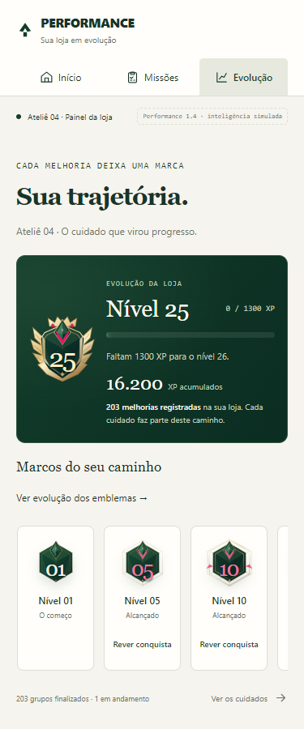

Há acesso ao conteúdo, controles nomeados, foco visível, teclado, Escape e retorno ao controle anterior. Diálogos sobrepostos compartilham o bloqueio de rolagem: fechar o superior não libera indevidamente a página sob outro modal.

| Elemento | Antes da evolução correspondente | Experiência atual |
| --- | --- | --- |
| Grupos de missões | Cartões individuais repetidos | Expansão direta e linhas compactas |
| Análise e ajuda | Sem painel contextual | Entrada lateral de 200 ms |
| Galeria | Comparação até 25 | Consulta estática dos desenhos até 100 |
| Emblemas | Poucas faixas visuais | Mais silhuetas, sem movimento permanente |
| Ganho de XP | Recompensa existente | Sequência preservada, vinculada à operação salva |
| Interesse por tamanho | Sem recibo separado | Confirmação textual, sem animação de conquista |

A sequência de reconhecimento mantém `idle → xp_received → level_up → complete`, preenchimento de XP em 600 ms e apresentação de conquista de aproximadamente 1.600 ms. Ela pode ser dispensada; não há som automático. Com preferência por redução de movimento, o resultado aparece estático e os painéis não usam animação de entrada.

Verificação técnica de acessibilidade não substitui teste com usuários de tecnologias assistivas. A rodada com lojistas deve incluir dispositivos reais e revisar entendimento dos termos e ações.

## 21. Arquitetura, persistência e fronteira de integração

| Camada | Responsabilidade |
| --- | --- |
| `app/` | Aplicação Next.js e API do experimento |
| `components/` | Telas, painéis, confirmação, progresso e emblemas |
| `domain/engine.mjs` | Missões, validação, recompensa e fórmula de nível |
| `domain/journeys.mjs` | Grupos persistidos e progresso com total fixo |
| `domain/opportunities.mjs` | Elegibilidade, evidências e recorrência |
| `domain/commercial.mjs` | Mapa, leitura relativa e diagnóstico |
| `domain/variant-interest.mjs` | Consulta e declaração por variação |
| `domain/followup.mjs` e `domain/impact.mjs` | Encaminhamento e compatibilidade de períodos |
| `intelligence/` | Contexto mínimo, provedor simulado, validação e limites |
| `server/repository.mjs` | Transações, sessões, revisões e recibos |
| `fixtures/` | Cenários e eventos fictícios |
| `adapters/` | Comunicação da interface com a API local |
| `documentacao/` | Relatórios, planos, figuras e esta consolidação |

O aplicativo usa React 19.1, Next.js 15.5.20 e Node.js 22.13 ou superior. O banco exclusivo é `.data/experiment.sqlite`, usando SQLite nativo do Node nesta demonstração. A sessão HttpOnly isola a loja fictícia de cada navegador.

O servidor salva operação e recompensa atomicamente, verifica origem, sessão e geração do cenário, deduplica comandos e revalida a necessidade. Abas antigas não podem gravar em uma geração reiniciada. Revisões e atualização entre abas evitam substituir dados novos por respostas atrasadas.

A chave `experimento-evolucao-atelier04-react-v2` guarda uma cópia local para inspeção. Ela não é autoridade sobre XP. Imagens ficam no servidor/cache local da demonstração; não há envio a serviço externo. A auditoria do assistente não guarda perguntas ou características, e seu custo registrado é zero.

Existe preparação de uma fronteira de autorização e transação para dados reais, coberta por testes. Isso não representa integração ativa, migração, permissões de clientes configuradas ou prontidão integral de produção. Publicação, autenticação real, retenção e coleta precisam de revisão específica.

## 22. Os 32 cenários e roteiro de demonstração

| Família | Cenários disponíveis |
| --- | --- |
| Base — 9 | varias-missoes, oportunidades, nova, poucos-dados, em-dia, novas-missoes, marco-5, marco-10, impacto |
| Evolução contínua e Intelligence — 10 | intelligence, continua, procura-esgotado, buscas-sem-resultados, campanha-concluida, apresentacao-procurada, divergencia-recorrente, acompanhamento-continuo, continua-em-dia, continua-poucos-dados |
| Acompanhamento — 4 | acompanhamento-comercial, decisao-sem-acao, acompanhamento-amostra, acompanhamento-fontes |
| Inteligência comercial e prévias — 9 | mapa-nivel-25, mapa-nivel-10, mapa-comercial, mapa-comparavel, mapa-poucos-dados, mapa-interesse, mapa-reposto, mapa-fontes-incompletas, mapa-toques |

O seletor fica em Opções da demonstração. Reiniciar pede confirmação e afeta apenas a sessão experimental. A melhoria persiste após recarregar. Um link com `cenario` carrega a prévia uma vez; depois a URL é limpa para não reiniciar a sessão a cada atualização.

| O que explorar | Endereço local |
| --- | --- |
| Início comercial | http://localhost:3405/?cenario=mapa-comercial#inicio |
| Muitas missões | http://localhost:3405/?cenario=varias-missoes#missoes |
| Ajuda contextual | http://localhost:3405/?cenario=intelligence#inicio |
| Ciclo de acompanhamento | http://localhost:3405/?cenario=acompanhamento-comercial#evolucao |
| Referência comparável | http://localhost:3405/?cenario=mapa-comparavel#missoes?secao=mapa |
| Poucas visitas | http://localhost:3405/?cenario=mapa-poucos-dados#inicio |
| Prévia no nível 10 | http://localhost:3405/?cenario=mapa-nivel-10#inicio |
| Prévia no nível 25 e galeria até 100 | http://localhost:3405/?cenario=mapa-nivel-25#evolucao |

As prévias 10/25 possuem 2.700/16.200 XP de histórico fictício gerado pelas regras originais. Os produtos usados nesse histórico ficam arquivados, mantendo 40 publicados no mapa. A galeria do 100 é consulta visual; não existe nessa entrega um cenário de loja com nível 100 atribuído.

Um roteiro curto: analisar o destaque; abrir o mapa; salvar a foto do Conjunto Linho; verificar o comprovante e o XP único; consultar a variação 41; declarar interesse explicitamente; visitar Evolução; comparar os escudos. Para decisões e acompanhamento, trocar para os cenários específicos.

## 23. Verificação técnica e evidências

Na consolidação de 13/10/2026, os **64 testes de regras, servidor e concorrência passaram**. O build de produção da entrega visual atual passou. As verificações de navegador cobrem missão, grupos, recompensas, filtros, recorrência, assistente simulado, acompanhamento e dados comerciais.

| Cobertura | O que foi conferido |
| --- | --- |
| Missões e XP | Validação, recompensa única, excedente, repetição e falha |
| Grupos | Composição fixa, adiamento, retomada e finalização sem bônus |
| Servidor | Isolamento, origem, concorrência, cache adulterado e transação |
| Oportunidades | Fonte, janela encerrada, recorrência e rejeição de eventos renomeados |
| Intelligence | Contexto, revisão, desfazer, falha, limite e resposta atrasada |
| Acompanhamento | Declaração distinta da operação e compatibilidade de períodos |
| Mapa e variações | Pouco tráfego, comparação, consulta distinta de interesse e revalidação |
| Emblemas | 100 SVGs sem corte, gradientes únicos e número compacto legível |
| Interface | Larguras 320–1.440 px, teclado, Escape, foco e movimento reduzido |

As nove rotinas de navegador são `browser-react`, `browser-expanded`, `browser-missions`, `browser-journeys`, `browser-ux12`, `browser-continuous`, `browser-intelligence`, `browser-followup` e `browser-commercial`, com extensão `.cjs` em `tests/`. As evidências ficam em `.tmp/painel-gamificado/`, na raiz do repositório.

Na última verificação dos emblemas, as conferências visuais e funcionais passaram. A rotina expanded concluiu suas assertions e escreveu o relatório sem erros; o processo foi encerrado manualmente depois de permanecer aberto na etapa de fechamento do navegador. A rotina React, a de UX e a verificação específica dos 100 emblemas encerraram normalmente.

As 12 figuras desta consolidação foram capturadas da interface atual, em sessão fictícia própria. As quatro pranchas de emblemas foram renderizadas a partir dos componentes atuais. Nenhuma figura histórica das entregas anteriores foi substituída.

As verificações técnicas não demonstram aumento de resultado, utilidade comercial, usabilidade com todos os perfis ou disposição para pagar. Esses objetivos dependem da pesquisa e de uma futura operação com dados autorizados.

## 24. Validação com lojistas e próximos passos

O plano é fazer uma rodada inicial com cinco lojistas e observar tarefas reais de entendimento, em dispositivo apropriado. A pesquisa continua preparada, não realizada. A ficha registra ajuda necessária, primeiro clique, tempo, decisão antes/depois, esforço e frase original.

Os participantes devem conseguir explicar a oportunidade e indicar o próximo passo, diferenciar clique de venda, reconhecer uma decisão como análise e entender que uma nota de encaminhamento não repõe estoque. Na 1.4, deve ser perguntado qual decisão a informação mudaria e por quê.

Uma meta preliminar é quatro dos cinco identificarem uma oportunidade relevante e um próximo passo em menos de um minuto, sem ajuda; ninguém interpretar clique como venda ou nota como entrada de estoque. Isso é critério de projeto, não resultado já medido.

Priorizar ajustes por ação impossível, entendimento comercial errado, esforço desnecessário e acabamento. Validar utilidade e disposição para pagar separadamente. Depois da primeira rodada da 1.4, avaliar os marcos de primeira descoberta já especificados, sem XP extra.

| Próxima fase | Trabalho necessário |
| --- | --- |
| Validar a experiência atual | Executar entrevistas, registrar achados e corrigir confusões |
| Calibrar regras | Rever limites de amostra, recorrência e prioridades com casos reais autorizados |
| Preparar coleta | Mapear eventos, populações, identidade por loja, versões e disponibilidade |
| 1.5 — IA real | Avaliar modelos com casos sintéticos, contrato generativo, custo e latência |
| Piloto integrado | Autenticação real, permissões, staging, observabilidade e implantação gradual |
| 2.0 — operação comercial | Relacionar pedidos e vendas confirmadas com eventos de atendimento |

A preparação da 1.5 propõe avaliação repetida de fidelidade aos fatos, reconhecimento de lacunas, ação prática, clareza e adequação à marca. Informação fabricada, vazamento, promessa de retorno e execução indevida são falhas críticas. Nenhum modelo foi escolhido ou comparado nesta entrega.

O fornecedor de IA futuro não poderá escrever estoque, catálogo, pedidos, histórico ou XP. Descrições continuarão sendo rascunhos revisados. Questões sobre investimento exigirão contexto autorizado de custo, margem, orçamento e objetivo; hoje esse aconselhamento livre não está disponível.

## 25. Como executar e manter a documentação

Executar dentro de `experimentos/painel-gamificado`, com as dependências do workspace disponíveis:

```powershell
npm run build
npm start
```

Abrir `http://localhost:3405`. Para desenvolvimento, usar `npm run dev`. O projeto requer Node.js 22.13 ou superior. Encerrar o servidor pelo terminal com Ctrl+C. Não usar a compilação da raiz do site para executar este experimento.

Verificar regras e servidor com `npm test`. As rotinas de navegador usam `puppeteer-core` e Chrome local. As imagens são ilustrações da loja fictícia Ateliê 04 ou arquivos selecionados na própria máquina.

Esta consolidação existe em Markdown editável, HTML navegável com índice e PDF. Para reexportar sem capturar ou alterar figuras históricas:

```powershell
node scripts/export-document.cjs --document=PERFORMANCE-1.4-DOCUMENTO-CONSOLIDADO
```

Fontes complementares preservadas: [missões e grupos](PERFORMANCE-1.1-MISSOES-E-PROGRESSAO.md), [refinamento de UX](PERFORMANCE-1.2-REFINAMENTO-DA-EXPERIENCIA.md), [evolução contínua](PERFORMANCE-1.3-EVOLUCAO-CONTINUA.md), [inteligência assistida](PERFORMANCE-1.3-INTELIGENCIA-ASSISTIDA.md), [acompanhamento](PERFORMANCE-1.3-ACOMPANHAMENTO-COMERCIAL.md), [inteligência comercial](PERFORMANCE-1.4-INTELIGENCIA-COMERCIAL.md), [emblemas 1–100](EMBLEMAS-EVOLUCAO-100.md), [validação com lojistas](VALIDACAO-COM-LOJISTAS.md) e [preparação da 1.5](PREPARACAO-1.5.md).

Uma futura alteração deve atualizar o estado da entrega, as regras afetadas e as figuras atuais correspondentes, mantendo relatórios anteriores como registro histórico. Integração e publicação continuam sendo etapas próprias, posteriores à validação e à preparação operacional.
