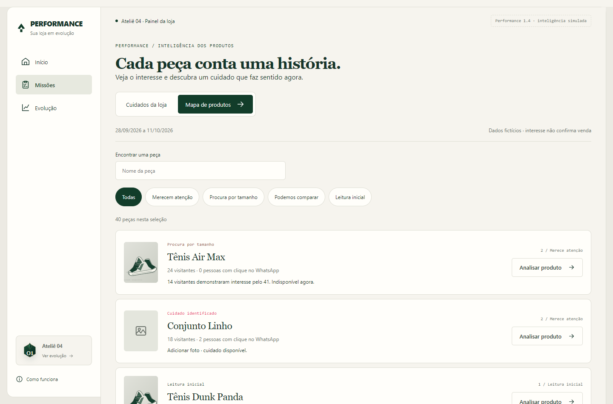
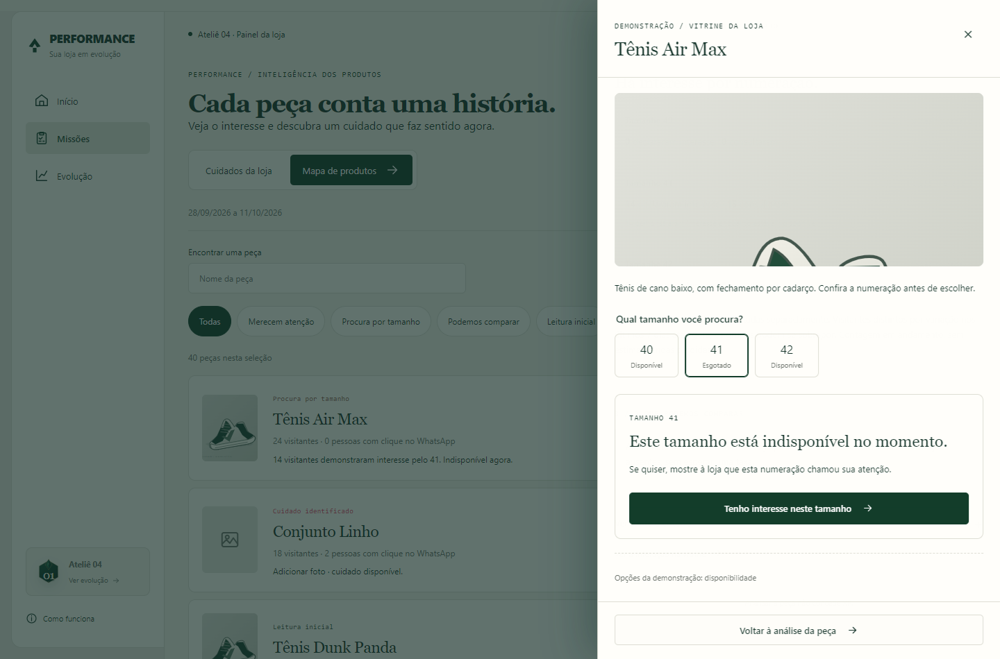

# Performance 1.4 — inteligência comercial

Entregas A e B implementadas no experimento separado em 13/10/2026, após autorização para aplicar o plano revisado. O aplicativo agora possui mapa de produtos, três níveis de leitura, demonstração de interesse por tamanho indisponível e diagnóstico determinístico no Início. Dados e assistente continuam fictícios; nenhuma fonte comercial real ou API generativa foi conectada.

## 1. Uma oportunidade e um próximo cuidado

O Início destaca uma situação, explica a evidência e oferece uma ação principal. No cenário de loja pequena, o tamanho 41 de uma peça tem 14 declarações de interesse. O diagnóstico convida a conferir a disponibilidade e avaliar a reposição, sem estimar vendas perdidas ou obrigar a comprar estoque.

As outras oportunidades ficam secundárias. O botão “Analisar oportunidade” abre a peça correta; “Ver todas no mapa” leva à seção interna de Missões. Os três destinos principais do aplicativo continuam sendo Início, Missões e Evolução.

Nos cenários novos, o diagnóstico substitui o destaque antigo e não repete a contagem de oportunidades da semana da 1.3, que usava outro conjunto de fontes. Os fluxos antigos continuam disponíveis nos cenários anteriores.

## 2. Mapa de produtos

O mapa apresenta ilustração, nome, situação, contagens do período e uma ação de análise. Possui busca por nome e filtros de atenção, procura por tamanho, comparação e leitura inicial. Uma seleção sem resultado oferece voltar às peças, em vez de deixar um estado vazio sem saída.

A peça sem foto continua oferecendo o cuidado existente mesmo com 18 visitas. O produto com 83 visitas e 17 pessoas com clique pode receber uma posição descritiva entre os mais vistos, sem afirmar que sua taxa é superior. Abrir o mapa ou a análise não concede XP.

| Nível | Experiência implementada |
| --- | --- |
| 1 — O que aconteceu | Contagens e datas, ou indicação de ausência de fonte válida |
| 2 — O que merece atenção | Cuidado existente ou interesse declarado por variação; sete interessados já são visíveis |
| 3 — O que podemos comparar | Referência da própria loja, com volume, população, versão e períodos compatíveis |

Os níveis descrevem dados, não planos pagos ou níveis de XP. A falta de comparação não esconde um cuidado concreto e não faz a loja parecer ruim.

## 3. Como funciona o interesse por tamanho

No painel do produto, “Ver a interação na vitrine” abre uma demonstração da peça. Os tamanhos exibem disponibilidade e podem ser consultados por teclado ou toque. O tamanho esgotado permanece acionável para informação, sem ser oferecido como uma compra disponível.

Ao tocar no tamanho indisponível, o servidor registra uma consulta. A mensagem explica a indisponibilidade e apresenta “Tenho interesse neste tamanho”. Só a confirmação dessa segunda ação registra uma declaração. Não há formulário de telefone, e-mail, CPF ou cadastro.

Após confirmação do servidor, “Interesse registrado” esclarece que o sinal não reserva a peça nem gera aviso de reposição. Consulta e declaração são apresentadas separadamente, com visitantes distintos por variação nos últimos sete dias até o instante da leitura. Essa contagem está em andamento; não é uma comparação de períodos encerrados.

Reabrir ou confirmar novamente não multiplica os interessados. A operação possui recibo próprio no banco local; repetir um resultado de disponibilidade alterada continua retornando esse resultado, sem inventar sucesso. A declaração exige uma consulta recente da variação na versão de estoque apresentada.

Se o estoque mudar entre consultar e confirmar, o servidor revalida. Quando a variação está disponível ou sua disponibilidade é desconhecida, não registra uma declaração como procura por item esgotado. A interface mostra a situação atual. Uma falha conserva a variação e permite nova tentativa; sucesso só aparece depois de confirmação.

As opções recolhidas da demonstração permitem alterar a disponibilidade fictícia e explorar esses estados. Elas não são uma operação de entrada de estoque, não geram XP e não modificam lojas reais.

## 4. Fontes e comparações

Cada leitura identifica loja, produto, fonte, período, população e versão. Uma linha de outra loja ou sem contagens válidas não fornece métricas ao mapa. Cliques fora da população de visitantes podem ser apresentados como contagem, mas não formam uma taxa qualificada.

Comparações exigem coleta completa, contatos qualificados, no mínimo 100 visitantes por janela, duas janelas concluídas de duração compatível de pelo menos 14 dias e cinco produtos comparáveis da própria loja. Fontes distintas e identidade de produto e loja também são conferidas.

O painel mostra a taxa da peça, a mediana das peças comparáveis e o período anterior com seus denominadores. A classificação relativa usa os próprios dados da loja, sem taxa ideal de mercado ou prova de significância estatística. Destaque e muito visto são leituras descritivas, sem prometer vendas.

“Pouco descoberto” exige ainda exposição qualificada, abertura pertencente à população exposta, tempo de publicação suficiente e referência de exposição. Sem essas informações, não se conclui que a peça teve pouca descoberta. A exposição pode exigir investigação; não diagnostica automaticamente um problema no produto.

Procura histórica enquanto indisponível e disponibilidade atual ficam separadas. Um cenário apresenta sete declarações anteriores e a peça disponível agora. Os interessados por variação não são somados como pessoas únicas do catálogo; os mesmos grupos podem se sobrepor.

## 5. Recomendações com destino disponível

| Ação | Resultado |
| --- | --- |
| Analisar oportunidade ou produto | Abre o painel da peça, com suas fontes e variações |
| Adicionar foto ou informação | Abre o formulário da missão elegível existente |
| Ver cuidado guardado | Leva aos cuidados adiados, sem retomada automática |
| Ver tamanhos na vitrine | Abre a demonstração da mesma peça e sua disponibilidade |
| Ver todas no mapa | Abre a seção interna do mapa |
| Ver todas as peças | Limpa busca e filtro e retorna ao catálogo do cenário |

Salvar uma foto a partir do mapa usa o mesmo identificador e os 60 XP originais. Quando o cuidado é concluído, a leitura atualizada deixa de recomendá-lo. Não existe recompensa adicional por classificação, consulta, declaração, recebimento de dados ou leitura.

O diagnóstico e o painel são derivados do estado atual. O formulário de missão continua revalidando a elegibilidade no servidor. A coleta e a disponibilidade simuladas têm operação idempotente, sessão, origem e geração verificadas. O cliente não define visitante, data, quantidade de interessados ou recompensa.

O visitante da demonstração é identificado pelo servidor a partir da sessão local do experimento. Isso isola as simulações, mas não constitui uma integração de visitantes públicos com a autenticação do lojista. A operação real precisará de contrato próprio de coleta, autorização por loja e qualidade dos eventos.

## 6. Cenários para explorar

Sete cenários novos foram adicionados, preservando os 23 anteriores: agora há 30 casos no seletor.

| Cenário | O que verificar |
| --- | --- |
| Loja pequena, 40 produtos | Fatos e cuidados úteis sem depender de classificação comparativa |
| Produtos com base comparável | Seis peças elegíveis, taxas e referência da própria loja |
| Poucas visitas, cuidados úteis | Foto ausente acionável com 18 visitantes |
| Sete interessados no tamanho | Interesse explícito visível abaixo de um limite de priorização recorrente |
| Tamanho disponível agora | Indisponibilidade histórica separada do estoque atual |
| Coleta incompleta | Contagens disponíveis e comparação recusada |
| Toques sem interesse declarado | Consultas não convertidas em declarações ou vendas |

As ilustrações são demonstrativas e os produtos fictícios. O catálogo não usa fotos, pedidos, clientes ou margens reais. A vitrine pública original não foi alterada.

## 7. Validação técnica e limites

O build do aplicativo independente passou. A suíte possui 62 testes de regras e servidor, incluindo preservação dos testes anteriores e seis grupos novos para leitura comercial e interesse por variação. A verificação no navegador cobre diagnóstico, filtros, ação da foto, declaração, falha e nova tentativa, repetição, persistência, mudança de estoque, comparabilidade, celular, teclado e movimento reduzido.

As oito verificações de navegador anteriores também são executadas como regressão dos fluxos de missões, evolução, grupos, inteligência simulada e acompanhamento. As capturas e registros ficam na pasta local de verificação.

Isso não comprova utilidade comercial, descoberta em menos de um minuto ou aumento de resultado. A validação com lojistas continua pendente, usando a ficha que pergunta qual decisão mudaria e por quê. A autorização para aplicar permitiu construir a simulação; nenhuma pesquisa foi registrada como realizada.

Marcos de primeira descoberta permanecem especificados para depois da primeira validação da 1.4, sem XP adicional. IA generativa continua na 1.5; ligação de pedidos e vendas reais permanece no roteiro da 2.0.

## 8. Implementação e movimento

| Área | Arquivos principais |
| --- | --- |
| Mapa e diagnóstico determinísticos | domain/commercial.mjs |
| Consulta e interesse explícito | domain/variant-interest.mjs |
| Cenários e disponibilidade fictícia | fixtures/commercial.mjs |
| Transações, identificação e recibos | server/repository.mjs |
| Mapa e análise do produto | components/ProductMap.jsx e components/ProductInsight.jsx |
| Demonstração e diagnóstico | components/VariantPreview.jsx e components/CommercialDiagnosis.jsx |
| Navegação e integração visual | components/Experience.jsx, components/Home.jsx e components/Missions.jsx |

| Elemento | Antes | Depois |
| --- | --- | --- |
| Painel de produto e vitrine | Ausente | Mesmo movimento lateral de 200 ms, com redução de movimento respeitada |
| Busca e filtros | Ausentes no mapa | Atualização direta, sem animação elaborada |
| Confirmação de interesse | Ausente | Recibo textual persistente; sem celebração ou XP |
| Diálogos sobrepostos | Bloqueio de rolagem por instância | Controle compartilhado para restaurar a página ao fechar todos |
| Conquistas de XP | Após ação salva | Preservadas; consulta e leitura não as acionam |

O código permanece em experimentos/painel-gamificado, fora das rotas do painel atual e sem publicação ou migração de dados reais.