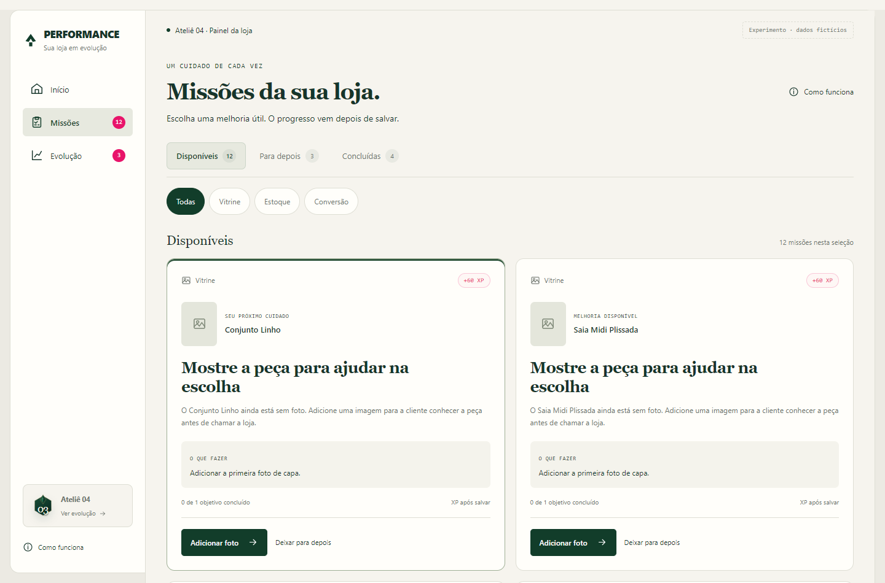
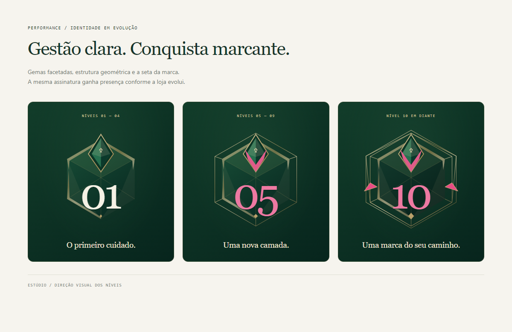

# Performance — Painel em evolução

Documento completo de produto, experiência, design e implementação.

**Estúdio Rafael Razeira · Versão 1.0 · 12 de outubro de 2026**

Este documento consolida a versão experimental do painel gamificado construída até esta data. Descreve o que funciona no protótipo, as decisões de produto, as regras de progressão, a simulação de missões e os requisitos para uma integração futura. O escopo é este experimento; as outras páginas do site e do painel principal não fazem parte desta entrega.

**Estado atual:** aplicativo local independente, com três áreas, seis modelos de missão, nove cenários e dados fictícios. A demonstração com várias missões contém 19 objetivos: 12 disponíveis, três para depois e quatro concluídos.

**Acesso à simulação:** [abrir várias missões](http://localhost:3405/?cenario=varias-missoes#missoes).

## 1. Ideia central e valor para a loja

O painel ajuda o lojista a responder: **qual é o próximo cuidado útil para minha loja?** Ele identifica uma necessidade concreta, abre a peça correspondente e reconhece a melhoria depois que ela é salva.

A inspiração em RPG aparece nas missões, na experiência acumulada, nos níveis e nos emblemas. A rotina continua sendo a de um painel profissional: entender o problema, corrigir a informação e acompanhar o que foi registrado.

O benefício esperado é uma vitrine mais bem apresentada e uma disponibilidade mais confiável para o atendimento pelo WhatsApp. Reduzir dúvidas e ajudar na escolha são objetivos de produto a validar com lojistas. O protótipo ainda não comprova aumento de contatos, conversão ou vendas.

As decisões que orientam a experiência são:

- Um nível geral para a loja. Vitrine, Estoque e Conversão organizam as missões; não possuem níveis independentes.
- Uma ação principal no Início. A lista completa fica na área dedicada de Missões.
- Uma missão prioritária por peça de cada vez, para evitar várias cobranças sobre o mesmo item.
- A recompensa depende da melhoria salva e validada. Abrir uma tela ou clicar num botão não concede XP.
- Cada objetivo concede experiência uma única vez. Repetições e tentativas simultâneas não podem duplicar a recompensa.
- Deixar para depois não diminui a experiência acumulada.
- Uma loja em dia pode ficar sem missões. O sistema não cria trabalho artificial para manter a barra avançando.
- O nível representa melhorias registradas. Os indicadores comerciais têm leitura própria.

## 2. O que está implementado

| Parte | Funcionamento atual |
| --- | --- |
| Início | Saudação, nível, progresso, resumo fictício de resultados e próximo movimento |
| Missões | Lista completa de objetivos elegíveis, filtros, adiamento, retomada e comprovantes de conclusão |
| Evolução | Histórico, níveis derivados das melhorias, conquistas e leitura de impacto |
| Execução | Editor de peça e conferência de quantidade, dentro do protótipo |
| Recompensa | Validação no servidor, XP único, confirmação e apresentação de subida de nível |
| Emblemas | Sistema vetorial compartilhado com três faixas de acabamento |
| Simulações | Nove cenários selecionáveis, incluindo uma loja com 19 missões |
| Persistência | Banco local separado, sessão própria e sincronização entre abas |
| Integração futura | Contrato de autenticação e transação por loja, preparado e testado |

A pasta do experimento é `experimentos/painel-gamificado/`. O aplicativo usa uma porta própria, `3405`, e não foi incluído nas rotas nem nos menus do painel principal.

Pedidos, banners, login real e as telas completas de estoque da plataforma não foram transportados para este experimento. As missões de estoque usam um editor local de quantidade e motivo. Os itens de navegação exibidos no protótipo possuem destinos funcionais.

## 3. Organização das três áreas

| Área | Pergunta que responde | Papel na experiência |
| --- | --- | --- |
| Início | O que merece minha atenção agora? | Apresentar um próximo movimento |
| Missões | O que posso fazer e o que já fiz? | Organizar e executar os objetivos |
| Evolução | Como minha loja vem evoluindo? | Mostrar trajetória, níveis e conquistas |

Essa divisão evita duas páginas com a mesma lista. Em Missões, a pessoa encontra a tarefa e a confirmação da ação. Em Evolução, encontra a história da loja e os momentos de progressão.

### 3.1 Início

A página apresenta a saudação conforme o horário de São Paulo, o nível atual, a barra de experiência e os resultados disponíveis no cenário. Abaixo aparece somente a missão prioritária, com peça, motivo, benefício, recompensa e ação específica.

O botão **Ver todas as missões** abre a área dedicada. Se houver objetivos adiados, **Ver e retomar** abre a situação Para depois. Se não houver trabalho elegível, a página mostra o estado de loja em dia ou informa que as melhorias foram guardadas.

No celular, a sequência visual prioriza o progresso e o próximo movimento antes do resumo de resultados. A pessoa consegue agir sem atravessar uma lista extensa de indicadores.

### 3.2 Missões

A página concentra os objetivos disponíveis. Cada cartão informa categoria, peça, motivo, o que fazer, progresso de zero de um objetivo e XP recebido após salvar. O primeiro objetivo recomendado recebe um destaque discreto na borda.

As ações usam verbos que dizem o que vai acontecer: **Adicionar foto**, **Conferir estoque**, **Informar composição**, **Retomar missão**. Elas abrem o editor da peça ou variação correspondente.

### 3.3 Evolução

A página mostra experiência acumulada, nível atual, melhorias registradas, conquistas e linha do tempo. O histórico identifica a ação, a peça e o momento da melhoria. As mudanças de nível são derivadas das recompensas já existentes; não adicionam outra pontuação.

A linha do tempo começa com oito eventos e permite carregar os seguintes. Um evento pode ser uma melhoria ou uma mudança de nível. Por isso, o número de eventos visíveis pode ser diferente da quantidade de missões concluídas.

## 4. Situações, filtros e cartões de missão



Captura do protótipo com dados fictícios. O cenário possui 12 objetivos disponíveis; a imagem mostra o início da lista.

### 4.1 As três situações

| Situação | O que significa | Ação principal |
| --- | --- | --- |
| Disponíveis | Há uma necessidade elegível para melhorar | Abrir e realizar a melhoria |
| Para depois | O lojista decidiu guardar a tarefa | Retomar diretamente o editor |
| Concluídas | A melhoria foi salva e reconhecida | Consultar o comprovante |

Em Concluídas, o registro mostra ação realizada, peça, data e recompensa. Ao expandir o item, aparece a evidência da melhoria e a confirmação de um de um objetivo concluído.

A preparação inicial de alguns cenários fictícios gera um registro no histórico geral. Esse registro não é tratado como missão concluída na lista de comprovantes.

### 4.2 Categorias

- **Vitrine:** fotos e informações da peça que ajudam a conhecer o produto.
- **Estoque:** primeira contagem e revisão de uma divergência explícita.
- **Conversão:** uma melhoria informacional sugerida a partir da procura observada, atualmente a composição do tecido.

O filtro Todas reúne as categorias. As contagens das situações representam o total de cada situação; o texto abaixo dos filtros informa quantos itens existem na seleção de categoria atual.

### 4.3 Navegação e persistência

Os filtros de situação ficam no endereço: `#missoes`, `#missoes?status=adiadas` e `#missoes?status=concluidas`. Atualizar ou usar Voltar preserva o destino. Uma situação inválida no endereço abre Disponíveis.

O filtro de categoria é uma seleção local da tela. Ele não é gravado no endereço nem altera o progresso da loja.

### 4.4 Adiar, retomar e não encontrar tarefas

Adiar remove o objetivo de Disponíveis e o coloca em Para depois. A quantidade de XP permanece igual. Também não revela uma segunda missão sobre a mesma peça enquanto o objetivo principal estiver adiado.

Retomar remove o adiamento e abre diretamente o editor correto. Depois de salvar, **Ver missão concluída** leva ao comprovante. O botão Continuar fecha a operação e permite explorar a lista.

Os estados vazios diferenciam uma categoria sem itens, ausência de tarefas adiadas, ausência de conclusões e loja sem necessidades elegíveis. Cada um oferece uma ação compatível: trocar a categoria, voltar às disponíveis, abrir as adiadas ou consultar Evolução.

## 5. Os seis modelos de missão

Os valores de XP abaixo são hipóteses usadas no protótipo. Não foram calibrados com lojas reais.

| Modelo | Categoria | Quando aparece | Recompensa |
| --- | --- | --- | ---: |
| Foto de capa | Vitrine | A peça está sem foto de capa | 60 XP |
| Foto de detalhe | Vitrine | Há capa e uma necessidade explícita de mostrar acabamento | 40 XP |
| Informações da peça | Vitrine | A peça foi marcada como precisando de descrição e o campo está vazio | 60 XP |
| Primeira contagem | Estoque | A quantidade física ainda não foi registrada | 80 XP |
| Revisão de disponibilidade | Estoque | Existe uma divergência explícita ainda não resolvida | 80 XP |
| Composição do tecido | Conversão | Falta composição e há procura suficiente na referência da peça | 100 XP |

### 5.1 Foto de capa e foto de detalhe

O editor permite escolher JPG, PNG ou WebP de até 2 MB. A demonstração também oferece uma ilustração de exemplo, armazenada no próprio projeto. A foto escolhida aparece antes do salvamento.

Uma foto de detalhe exige uma capa existente e o indicador de necessidade de detalhe. O sistema não assume que toda peça obrigatoriamente precisa desse campo. A recompensa reconhece a primeira imagem salva para aquele objetivo; não certifica a qualidade da fotografia.

### 5.2 Informações da peça

A descrição deve conter de 20 a 800 caracteres após retirar os espaços nas extremidades. O texto orienta informar caimento, acabamento ou uso, com características reais da peça.

A validação verifica o preenchimento e o tamanho do texto. Não há uma análise editorial ou IA que certifique que a descrição é boa. Apagar e preencher novamente não concede outra recompensa para a primeira descrição já reconhecida.

### 5.3 Primeira contagem

O formulário pede uma quantidade inteira de zero a 9.999 e uma explicação de como foi conferida, entre três e 240 caracteres. **Zero é uma quantidade válida; sem contagem é um estado diferente de zero.**

A recompensa reconhece a conferência registrada. Não incentiva aumentar o estoque nem comprar mercadoria. O sistema não consegue verificar fisicamente a arara: a evidência é a declaração salva pelo lojista.

No protótipo, cada produto carrega uma referência de tamanho. Na integração real, o objetivo deverá ser vinculado à identidade da variação ou SKU correspondente.

### 5.4 Revisão de disponibilidade

Essa missão exige um evento explícito de divergência, com identificação própria. Salvar quantidade e motivo encerra esse evento. Confirmar que o saldo é zero ou que continua igual também pode concluir a conferência.

A tarefa não nasce simplesmente porque passou uma semana. Uma revisão futura de outro evento deve ter identidade própria e não reaproveitar o mesmo objetivo para premiar repetidamente.

### 5.5 Composição do tecido

O motor atual exige composição ausente e uma referência da peça com pelo menos 50 pessoas. O cartão mostra o período e o contexto recebido; nos cenários, a janela é de 14 dias. Não há um diagnóstico automático baseado em uma taxa mínima de conversão.

O preenchimento deve conter de oito a 160 caracteres, seguindo a etiqueta. Depois de salvar, a interface explica que será necessário observar novos dados. A recompensa é pela informação registrada; não depende de contatos ou vendas posteriores.

O limite de 50 pessoas serve à elegibilidade dessa hipótese de missão. O limite de 100 visitantes por período, usado para a leitura de impacto, tem outra finalidade. Ambos precisam de avaliação antes de serem ligados a uma fonte real.

## 6. Prioridade e jornada de execução

O motor atual prioriza foto de capa ausente, depois primeira contagem ou divergência e, em seguida, detalhe, descrição e composição elegíveis. Empates usam a identidade do objetivo para manter uma ordem estável. Ainda não existe um cálculo sofisticado de prioridade por faturamento, margem ou urgência de pedidos.

A área dedicada lista todos os objetivos elegíveis, mantendo uma missão por peça. O Início apresenta somente o próximo. Depois de concluir um objetivo, outra necessidade da mesma peça poderá aparecer, se atender a uma regra ainda não concluída.

A jornada funciona assim:

1. Identificar a necessidade e ler por que ela importa.
2. Abrir a peça correta a partir do cartão.
3. Preencher a melhoria no editor.
4. Salvar e aguardar a validação do servidor.
5. Receber a confirmação da operação e o XP correspondente.
6. Consultar o comprovante ou continuar trabalhando.

Salvar é suficiente para concluir a missão. Não existe um segundo botão obrigatório de Concluir missão.

Se a validação falhar, a interface mostra o motivo e mantém o preenchimento no formulário aberto. Não concede XP. Se a falha simulada de conexão estiver ativa, a pessoa pode tentar novamente com a foto escolhida.

Durante a gravação, o formulário bloqueia novas submissões e o fechamento para evitar interromper a confirmação. Após salvar, a confirmação e a celebração podem ser dispensadas sem esperar a animação. Fechar antes de salvar não grava a edição; o protótipo não possui rascunho persistido de formulários incompletos.

## 7. XP, níveis e recompensas únicas

### 7.1 Matemática

O nível é calculado pela soma das recompensas do histórico. A fórmula é:

```text
XP para sair do nível L = 100 + 50 × (L − 1)
XP total para entrar no nível L = 25 × (L − 1) × (L + 2)
```

| Nível | XP total mínimo | XP necessário dentro do nível para avançar |
| --- | ---: | ---: |
| 1 | 0 | 100 |
| 2 | 100 | 150 |
| 3 | 250 | 200 |
| 4 | 450 | 250 |
| 5 | 700 | 300 |
| 6 | 1.000 | 350 |
| 7 | 1.350 | 400 |
| 8 | 1.750 | 450 |
| 9 | 2.200 | 500 |
| 10 | 2.700 | 550 |

Exemplo de loja nova: a primeira foto gera 60 XP e mantém o nível 1. Uma contagem acrescenta 80 XP, totalizando 140. A loja passa ao nível 2 com 40 de 150 XP e faltam 110 XP para o nível 3. O excedente não é perdido.

Na simulação de várias missões, as quatro melhorias concluídas somam 280 XP. A loja começa no nível 3 com 30 de 200 XP e faltam 170 XP para o nível 4.

### 7.2 O que concede e o que não concede XP

| Ação | Resultado |
| --- | --- |
| Salvar uma melhoria elegível e ainda não concluída | Concede o valor daquele objetivo |
| Abrir uma missão ou trocar um filtro | Mantém o XP |
| Adiar ou retomar | Mantém o XP |
| Rever uma conquista | Mantém o XP |
| Atualizar a página | Carrega o progresso salvo |
| Repetir a mesma operação já confirmada | Retorna o resultado salvo sem nova recompensa |
| Apagar e recolocar uma informação já premiada | Não repete a recompensa do primeiro objetivo |
| Registrar venda, pagamento ou entrega | Não há recompensa dessa natureza no experimento |

### 7.3 Identidade do objetivo

Cada missão é identificada pela loja, pelo modelo, pela peça, pelo critério e pela versão da regra. Primeira contagem usa o tamanho no modelo experimental; revisão usa o identificador da divergência.

O registro da recompensa contém identidade, tipo, categoria, XP, data, evidência, peça, nome da peça, ocorrência e versão da regra. A operação de salvamento também tem uma identidade própria para que uma repetição após erro de rede não produza uma segunda recompensa.

O nível não é uma avaliação de habilidade comercial, porte, faturamento ou qualidade geral da loja. Ele registra o trabalho concluído segundo as regras do sistema.

## 8. Design, personalidade e emblemas

A direção visual combina clareza de gestão com reconhecimento marcante. A referência enviada por Rafael orientou superfícies claras no trabalho diário e uma apresentação mais expressiva quando a loja sobe de nível.

| Elemento | Direção |
| --- | --- |
| Fundo | Creme, `#f6f4ee` |
| Superfície de cartões | Branco quente, `#fffefa` |
| Cor principal | Verde profundo, `#123d2a` |
| Texto | Verde escuro, `#16352b` |
| Reconhecimento | Rosa marcante, `#e8146a`, com variações pontuais nos emblemas |
| Contornos | Neutros discretos, `#deded4` |
| Metal dos emblemas | Tons quentes e acabamento facetado |
| Títulos | Georgia e alternativas serifadas do sistema |
| Interface | Segoe UI e alternativas sem serifa |
| Pequenas referências | Tipografia monoespaçada e rótulos curtos |

A orientação de aproximadamente 10% de rosa é uma direção para os acentos visuais, não uma proporção medida de pixels. Grandes áreas continuam em creme e verde. O rosa destaca recompensas, foco e detalhes de progressão.



### 8.1 Emblemas por faixa

| Faixa | Acabamento |
| --- | --- |
| Níveis 1 a 4 | Gema e estrutura geométrica principal |
| Níveis 5 a 9 | Moldura facetada adicional e detalhes em rosa |
| Nível 10 em diante | Estrutura externa adicional e maior presença visual |

A seta da marca permanece na gema como referência discreta à identidade do Performance. O componente vetorial é compartilhado entre indicador compacto, cartão, conquistas e apresentação de nível. O número acompanha o nível real.

Os marcos ainda não alcançados possuem acabamento neutro. O sistema atual tem três faixas de acabamento e dois marcos especiais, 5 e 10; não há um desenho completamente diferente para cada nível.

## 9. Confirmação, animação e acessibilidade

A confirmação começa pela operação: Foto adicionada, Contagem conferida ou Composição informada. Em seguida, informa a conclusão do objetivo e a experiência recebida. Quando há mudança real de nível, o mesmo diálogo assume a apresentação de conquista.

| Momento | Comportamento |
| --- | --- |
| Imediatamente após confirmar | Exibe a operação salva e o progresso anterior |
| A partir de 300 ms | Começa o movimento da barra, com duração de 600 ms |
| Aos 900 ms | A barra chega ao resultado; se não há subida de nível, a sequência termina |
| Aos 1.200 ms, se houver subida | Apresenta o novo nível e o excedente preservado |
| Aos 1.600 ms | Termina a sequência de subida de nível |

No exemplo 60 + 80 XP, a apresentação passa por 60 de 100, completa 100 de 100 e então mostra nível 2 com 40 de 150. Essa sequência visual não concede XP: usa o resultado já confirmado pelo servidor.

Fechar, Escape e Continuar funcionam após salvar, inclusive durante a apresentação. Dispensar cancela a sequência visual e preserva a operação. Atualizar a página não repete automaticamente a celebração.

Com preferência por redução de movimento, o resultado final aparece de forma estática. Não há som automático. As entradas visuais duram até 280 ms; a barra possui seu tempo próprio de preenchimento.

O editor usa diálogo nativo, foco contido e retorno de foco ao fechar. Confirmações possuem títulos focáveis e anúncios acessíveis. A barra informa nível e valores por texto e atributos de progresso. Os controles de filtro usam estado selecionado explícito, e os comprovantes são expansíveis pelo teclado.

As verificações cobrem larguras de 320, 375, 768 e 1.440 pixels. Os controles de situação têm altura mínima de 44 pixels, e os botões principais dos cartões ocupam a largura disponível no celular.

## 10. Conquistas e retrospectiva

Os marcos especiais implementados são os níveis 5 e 10. Quando alcançados, apresentam um emblema da faixa correspondente e uma retrospectiva baseada nas ações existentes no histórico até aquele momento.

A retrospectiva contabiliza melhorias registradas, peças envolvidas e conferências de estoque. Não contabiliza faturamento, lucro ou clientes conquistados. Também não concede um bônus adicional de XP por alcançar o marco.

A área Evolução permite rever uma conquista alcançada. Essa consulta usa os dados registrados no marco e não reinicia a progressão. A linha do tempo deriva a mudança de nível das recompensas, evitando manter duas fontes independentes de pontuação.

## 11. Dados da vitrine e leitura de impacto

### 11.1 Resumo de resultados

O Início apresenta três indicadores quando o cenário os possui: Pessoas na vitrine, Visitas às peças e Cliques no WhatsApp. O agregado demonstrativo de sete dias contém 324, 112 e 41, respectivamente, e está identificado como fictício.

Esse resumo é separado do contexto de uma peça. Por exemplo, 148 pessoas no Conjunto Natural em 14 dias não são usadas como total de visitantes da loja em sete dias.

Quando não há dados, o resumo mostra informação indisponível. Não transforma ausência de integração em zero nem inventa um percentual de crescimento.

### 11.2 Depois da melhoria

Evolução possui uma área de acompanhamento de melhorias de apresentação. A interface mostra até três observações por vez. A comparação exige períodos válidos e concluídos, com duração igual de pelo menos 14 dias, sem sobreposição e posicionados antes e depois da ação.

Cada período precisa de pelo menos 100 visitantes elegíveis para a leitura percentual inicial. Os cliques usados no numerador devem corresponder a pessoas elegíveis, com o mesmo critério da base de visitantes. Essa definição deverá ser garantida pela fonte real.

| Estado | Leitura apresentada |
| --- | --- |
| Disponível | Contagens, taxas antes e depois e diferença em pontos percentuais |
| Sem referência anterior | Explica que ainda falta um período comparável |
| Em observação | Aguarda dados posteriores ou o encerramento da janela |
| Pouca amostra | Mostra contagens e mantém indisponível a comparação percentual |
| Períodos incompatíveis | Explica que datas, durações ou contagens precisam ser conferidas |

O cenário Impacto inclui um exemplo de três pessoas que clicaram entre 100 visitantes antes da melhoria e sete entre 100 depois. A taxa passa de 3% para 7%, diferença de quatro pontos percentuais.

Essa leitura descreve o observado. Não comprova que a melhoria causou o resultado, nem representa um teste de significância estatística. Os limites de amostra são hipóteses de apresentação do protótipo.

### 11.3 WhatsApp, favoritos e sacola

Clique no WhatsApp não confirma mensagem enviada, atendimento ou venda. Favorito, sacola, exposição do cartão e visita à peça são eventos diferentes. Os percursos são opcionais e podem se sobrepor.

O experimento não está coletando eventos reais de favoritos ou sacola. Esses sinais podem alimentar análises futuras quando houver integração e definição de denominadores. Nesta versão, os dados demonstrativos de impacto já estão preparados nos cenários; o sistema não gera novos resultados comerciais automaticamente depois que a pessoa salva uma melhoria.

## 12. Os nove cenários simulados

Os valores desta tabela são os estados iniciais de cada cenário, antes das alterações feitas por quem está testando.

| Cenário | XP inicial | Nível | Disponíveis | Para depois | Concluídas |
| --- | ---: | ---: | ---: | ---: | ---: |
| Várias missões para explorar | 280 | 3 | 12 | 3 | 4 |
| Loja com oportunidades | 60 | 1 | 3 | 0 | 0 |
| Loja nova | 0 | 1 | 2 | 0 | 0 |
| Poucos dados de desempenho | 60 | 1 | 2 | 0 | 0 |
| Loja em dia | 60 | 1 | 0 | 0 | 0 |
| Detalhes e revisão de estoque | 60 | 1 | 3 | 0 | 0 |
| Um passo para o nível 5 | 640 | 4 | 1 | 0 | 8 |
| Um passo para o nível 10 | 2.640 | 9 | 1 | 0 | 33 |
| Impacto e períodos de observação | 240 | 2 | 0 | 0 | 3 |

Alguns cenários incluem 60 XP de preparação inicial da loja no histórico geral. Essa preparação não aparece na lista de missões concluídas. Por isso, uma loja simulada pode ter experiência acumulada e zero comprovantes de missão.

Loja nova permite testar o primeiro ganho de 60 XP e a primeira mudança de nível. Poucos dados demonstra a ausência de uma oportunidade de Conversão. Loja em dia demonstra um estado sem trabalho artificial.

Detalhes e revisão de estoque reúne divergência, descrição e foto de acabamento. Nos marcos 5 e 10, uma foto de 60 XP completa exatamente o limite de 700 ou 2.700 XP. Impacto demonstra comparação disponível, pouca amostra e período em observação.

O cenário Várias missões para explorar foi criado para visualizar a área dedicada com uma lista maior, todas as categorias e diferentes situações.

## 13. Catálogo das 19 missões da simulação

As peças, quantidades, procura e conclusões desta seção são fictícias. As imagens são ilustrações do projeto, utilizadas como exemplos de apresentação.

### 13.1 Doze disponíveis

| Peça | Tamanho | Objetivo | Categoria | XP ao concluir |
| --- | --- | --- | --- | ---: |
| Vestido Aurora | M | Adicionar foto de capa | Vitrine | 60 |
| Conjunto Linho | P | Adicionar foto de capa | Vitrine | 60 |
| Saia Midi Plissada | G | Adicionar foto de capa | Vitrine | 60 |
| Camisa de Cetim | 40 | Mostrar foto de detalhe | Vitrine | 40 |
| Cardigan Canelado | M | Mostrar foto de detalhe | Vitrine | 40 |
| Vestido Envelope | M | Informar características da peça | Vitrine | 60 |
| Blazer de Alfaiataria | 42 | Informar características da peça | Vitrine | 60 |
| Calça Jeans Reta | 38 | Registrar a primeira contagem | Estoque | 80 |
| Short de Linho | P | Registrar a primeira contagem | Estoque | 80 |
| Camiseta Essencial | M | Conferir divergência de quantidade | Estoque | 80 |
| Calça Social | 42 | Conferir divergência de quantidade | Estoque | 80 |
| Conjunto Natural | P | Informar composição do tecido | Conversão | 100 |

A distribuição inicial é de sete objetivos de Vitrine, quatro de Estoque e um de Conversão. A tabela agrupa os modelos; a ordem na tela segue a prioridade do motor.

O Conjunto Natural tem uma referência simulada de 148 pessoas e nove pessoas que clicaram no WhatsApp em 14 dias. O objetivo é preencher a composição ausente. Os nove cliques não são tratados como vendas.

### 13.2 Três para depois

| Peça | Tamanho | Objetivo guardado | Categoria | XP ao concluir |
| --- | --- | --- | --- | ---: |
| Macacão Urbano | G | Adicionar foto de capa | Vitrine | 60 |
| Saia Evasê | M | Informar características da peça | Vitrine | 60 |
| Jaqueta Jeans | 38 | Conferir divergência de quantidade | Estoque | 80 |

Esses objetivos ainda não concederam experiência. Retomar abre o editor correspondente e mantém o progresso até que uma melhoria seja salva.

### 13.3 Quatro concluídas

| Peça | Melhoria registrada | Data simulada | XP recebido |
| --- | --- | --- | ---: |
| Vestido Floral | Primeira foto de capa adicionada | 07/10/2026 | 60 |
| Camisa Branca | Primeira contagem: seis unidades, tamanho 40 | 08/10/2026 | 80 |
| Conjunto de Algodão | Foto de detalhe adicionada | 09/10/2026 | 40 |
| Blusa de Malha | Composição: 95% algodão, 5% elastano | 10/10/2026 | 100 |

As quatro conclusões foram geradas pelo mesmo motor de validação das ações normais. Elas somam 280 XP, sem um bônus de nível inserido manualmente. Cada registro possui operação, peça e evidência.

### 13.4 Como explorar a demonstração

1. Abrir o link de várias missões e conferir as contagens 12, três e quatro.
2. Filtrar Vitrine, Estoque e Conversão para observar os diferentes cartões.
3. Abrir uma missão disponível e usar uma imagem de exemplo ou preencher a informação solicitada.
4. Salvar, ler a confirmação e abrir Ver missão concluída.
5. Expandir o comprovante para ver a evidência.
6. Abrir Para depois e retomar uma tarefa diretamente.
7. Consultar Evolução para ver a ação no histórico e o novo progresso.
8. Atualizar a página e confirmar que a edição e a experiência permanecem salvas.

O link carrega o cenário quando ele é diferente do atual e remove seu parâmetro depois de carregar. Atualizar ou reabrir o mesmo cenário mantém as melhorias feitas. Para voltar ao estado inicial, usar Reiniciar este cenário em Opções da demonstração.

## 14. Arquitetura e organização dos arquivos

O experimento é um aplicativo independente com React 19.1, Next.js 15.5.20 e Node.js 22.13 ou superior. Os comandos de compilação e execução devem ser usados na pasta experimental.

| Pasta ou arquivo | Responsabilidade |
| --- | --- |
| `app/` | Página do aplicativo, layout e rota da API |
| `components/` | Início, Missões, Evolução, editor, progresso e conquistas |
| `domain/engine.mjs` | Elegibilidade, prioridades, validações, recompensas e cálculo de nível |
| `domain/mission-board.mjs` | Separação entre disponíveis, adiadas e concluídas |
| `domain/presentation.mjs` | Eventos da linha do tempo e estados visuais da recompensa |
| `domain/achievements.mjs` | Marcos e retrospectivas |
| `domain/impact.mjs` | Comparabilidade e estados da leitura de dados |
| `fixtures/` | Lojas e situações fictícias, incluindo as 19 missões |
| `adapters/api.mjs` | Comunicação do navegador com a API local |
| `server/repository.mjs` | Persistência, sessão, transações e deduplicação |
| `integration/` | Contrato preparado para autenticação e armazenamento reais |
| `public/assets/` | Ilustrações locais usadas na demonstração |
| `tests/` | Regras, servidor, concorrência e fluxos de navegador |
| `referencias/html/` | Exploração HTML anterior, preservada como referência |
| `documentacao/` | Este documento, sua exportação e figuras |

O estilo de base fica em `styles.css`; a direção visual atual é complementada por `performance.css`. O componente `EvolutionEmblem` mantém um único sistema vetorial para os emblemas.

### 14.1 Modelo de dados relevante

| Informação | Finalidade |
| --- | --- |
| Loja e sessão | Isolar os dados da demonstração |
| Peças e referência de tamanho | Identificar o item e a quantidade editados |
| Necessidades explícitas | Evitar transformar campos opcionais em tarefas universais |
| Divergência de estoque | Identificar o evento que precisa ser conferido |
| Referência analítica | Sustentar uma oportunidade informacional da peça |
| Histórico de recompensas | Calcular XP, nível e conquistas |
| Objetivos adiados | Preservar a decisão de deixar para depois |
| Operações de salvamento | Reconhecer uma repetição sem premiar novamente |
| Geração do cenário | Impedir gravação de uma aba que usa um cenário reiniciado |
| Revisão do estado | Evitar substituir dados recentes por uma resposta antiga |
| Observações antes e depois | Registrar o acompanhamento separado da recompensa |

## 15. Salvamento, sessão e integridade dos dados

### 15.1 Fonte de verdade

O progresso fica no banco local `.data/experiment.sqlite`, exclusivo do experimento. O navegador guarda uma cópia para inspeção, na chave `experimento-evolucao-atelier04-react-v2`. Essa cópia não autoriza nem calcula recompensas.

Modificar o cache do navegador não concede experiência. Ao carregar, o aplicativo solicita o estado ao servidor. A atualização entre abas da mesma sessão usa notificações de mudança e recarrega o estado confirmado.

A sessão local usa um cookie HttpOnly e SameSite Strict com duração de 30 dias. O identificador aleatório serve à demonstração; não substitui o login de uma loja real.

### 15.2 Transação e recompensa única

No salvamento, o servidor lê o estado atual, valida o objetivo e registra alteração, recompensa e operação dentro de uma transação. Se a operação falhar, as mudanças dessa transação são revertidas.

Existem restrições únicas para objetivo e operação por sessão. Uma repetição com o mesmo identificador e o mesmo conteúdo retorna o estado salvo. Reutilizar a operação com outro conteúdo é rejeitado. Uma segunda tentativa de premiar o mesmo objetivo também é rejeitada.

Operações concorrentes aguardam a transação e leem o estado atualizado. Isso evita que duas abas concedam a mesma recompensa ou percam uma melhoria salva por outra aba.

### 15.3 Reinício e proteção da API local

Reiniciar um cenário incrementa sua geração e substitui somente os dados experimentais da sessão. Uma aba antiga não pode salvar usando a geração anterior. A revisão também impede instalar no navegador um estado mais antigo que o já recebido.

A API está limitada a acesso local, confere a origem das gravações, exige JSON e limita o tamanho do corpo. XP, histórico e datas de recompensa não são aceitos como autoridade do cliente. A data de uma ação normal é definida pelo servidor; datas anteriores são usadas apenas na construção interna dos cenários fictícios.

O SQLite nativo do Node usado nesta versão é experimental. Ele atende à demonstração local; a ativação no ambiente real depende de um repositório adequado às lojas e à operação da plataforma.

## 16. Verificações e limites da validação

As verificações registradas até esta versão incluem compilação do aplicativo, 24 testes automatizados de regras e servidor e três fluxos de navegador. Os registros de navegador apresentam zero erros JavaScript nos fluxos executados.

| Verificação | O que foi exercitado |
| --- | --- |
| Matemática | Limites de nível, excedente e marcos |
| Missões | Necessidade concreta, validação, estoque zero e recompensa única |
| Lista maior | Objetivos além das três sugestões iniciais, todas as categorias e 19 itens simulados |
| Falhas | Foto ausente, preenchimento inválido e falha simulada preservando o formulário |
| Persistência | Atualização da página e retomada de objetivos |
| Concorrência | Operações simultâneas e mudanças em abas diferentes |
| Autoridade | Cache alterado, XP enviado pelo cliente e isolamento de sessões |
| Navegação | Destinos, filtros no endereço, Voltar e acesso pelo link de simulação |
| Confirmação | Evidência, comprovante expansível e XP reconhecido uma vez |
| Movimento | Sequência de progressão, dispensa imediata após salvar e resultado reduzido |
| Acessibilidade | Teclado, Escape, foco, diálogo e anúncio de confirmação |
| Responsividade | Ausência de transbordamento horizontal de 320 a 1.440 pixels |
| Impacto | Referência ausente, espera, pouca amostra e períodos incompatíveis |
| Integração preparada | Autenticação exigida, autorização por loja, duplicidade e reversão de falhas |

Os resultados estão em `.tmp/painel-gamificado/` na raiz do workspace: `verificacao-react.json`, `verificacao-expanded.json` e `verificacao-missoes.json`. As capturas de tela ficam na mesma pasta.

Essas verificações demonstram comportamento técnico nos cenários exercitados. Elas não certificam compreensão por todo lojista, qualidade editorial das descrições, precisão física do estoque, conformidade de todo o produto com uma norma de acessibilidade ou melhora nas vendas.

Uma sessão de uso com Rafael e lojistas continua necessária. O roteiro está em `REVISAO-UX.md`; não existe resultado de pesquisa com usuários registrado como concluído.

## 17. O que falta para integrar ao painel real

A integração tem uma fronteira de código preparada, mas ainda não está ativada. Não foram aplicadas migrações de clientes nem publicadas estas telas no painel compartilhado.

| Etapa | Trabalho necessário | Critério de saída |
| --- | --- | --- |
| Identidade | Mapear o login real e a associação entre usuário e loja | Usuário autorizado acessa apenas sua loja |
| Dados comerciais | Identificar peças, variações, contagens, divergências e pedidos reais | Objetivos apontam para o item correto e mantêm ausências como ausências |
| Persistência | Implementar o repositório autorizado por loja | Alteração e recompensa consistentes, com restrições únicas |
| Sistemas separados | Definir uma fila de alterações confirmadas quando houver bancos diferentes | Consumo repetido não duplica recompensa; falhas são recuperáveis |
| Regras | Validar necessidades por tipo de loja e calibrar XP | Missões úteis, sem exigir informação opcional sem motivo |
| Dados analíticos | Definir eventos, pessoas elegíveis, períodos e agregações | Comparações com denominadores compatíveis e identificação da fonte |
| Interface real | Integrar editor e navegação mantendo confirmação e foco | O usuário realiza a tarefa sem um fluxo paralelo confuso |
| Ambiente de teste | Exercitar sessão, permissões, falha e concorrência com dados de teste | Nenhum acesso entre lojas e nenhuma recompensa duplicada |
| Revisão com lojistas | Observar clareza, esforço e utilidade das sugestões | Problemas de entendimento corrigidos antes da ativação |
| Ativação gradual | Definir grupo piloto, suporte e opção de retorno | Operação acompanhada e possibilidade de corrigir a experiência |

Se os dados comerciais e a pontuação estiverem no mesmo banco, a melhoria e a recompensa devem compartilhar a transação. Se estiverem em sistemas separados, será necessário registrar a alteração confirmada e processá-la de forma idempotente. Duas chamadas HTTP independentes não equivalem a uma transação única.

A associação entre CRM, loja de Performance e usuário do painel precisa ser explícita. Uma chave de rastreamento não deve servir como autenticação do lojista. A fonte de dados reais e as permissões por loja devem ser verificadas antes de ativar qualquer missão analítica.

## 18. Evoluções propostas, ainda não implementadas

Estas possibilidades não fazem parte do funcionamento atual:

- **Não se aplica e preciso de ajuda:** registrar por que uma tarefa não atende à realidade da loja, sem conceder XP de conclusão.
- **Missões de divulgação:** acrescentar a categoria quando houver uma ação concreta, uma fonte confiável e um objetivo útil.
- **Revisões recorrentes:** somente por necessidades ou eventos próprios, com regras contra repetição artificial.
- **Favoritos e sacola:** usar os sinais de interesse com eventos e bases bem definidos, sem assumir um caminho obrigatório de compra.
- **Prioridade mais contextual:** considerar relevância operacional e procura real, mantendo explicação compreensível.
- **Novos marcos:** avaliar outras conquistas depois de validar a leitura dos níveis 5 e 10.
- **Catálogos maiores:** avaliar busca, ordenação e paginação quando a quantidade de objetivos justificar. A lista atual usa filtros e rolagem.
- **Medição do uso:** instrumentar a execução da tarefa, os motivos de adiamento e os erros, sem confundir tempo no painel com sucesso da loja.

Não há moedas, ranking público, recompensas financeiras, pontuação por contratar serviços, avatares, som automático ou IA de avaliação editorial implementados. Também não existe perda de experiência por ausência, adiamento ou por uma loja ficar sem novas tarefas.

## 19. Como avaliar o valor da experiência

A validação humana deve começar pelo entendimento e pela utilidade da tarefa, antes de avaliar a animação. Uma sessão sugerida dura de 10 a 15 minutos e usa dados fictícios.

Pedir à pessoa que encontre uma melhoria, explique por que ela aparece, realize a ação e diga o que foi salvo. Em seguida, pedir que adie e retome outra tarefa e encontre o comprovante da primeira. Observar onde hesita, interpreta um número incorretamente ou precisa de ajuda.

Perguntas úteis: o que o nível representa? Qual tarefa faria primeiro? O que ficou confuso? A apresentação da conquista ajudou ou interrompeu o trabalho?

Em um piloto futuro, pode-se avaliar cinco a dez lojas durante 30 dias. Isso é uma proposta de validação, não uma pesquisa já realizada.

| Dimensão | Pergunta de avaliação |
| --- | --- |
| Compreensão | Entendem que XP reconhece melhorias e não vendas? |
| Ativação | Conseguem concluir uma primeira tarefa relevante? |
| Utilidade | As necessidades sugeridas correspondem à realidade da loja? |
| Esforço | O editor e a confirmação reduzem dúvidas e passos? |
| Gestão | Apresentação e disponibilidade ficam mais bem registradas? |
| Resultado comercial | Existem mudanças observadas com fonte, período e amostra adequados? |

Acumular experiência não é, por si só, um resultado de negócio. Se as pessoas ganham XP mas as tarefas não ajudam, o modelo de missão precisa ser revisto. Vendas dependem também de oferta, preço, atendimento, disponibilidade, demanda e outros fatores.

## 20. Acesso, execução e referências

### 20.1 Links locais

- [Início](http://localhost:3405/#inicio)
- [Missões disponíveis](http://localhost:3405/#missoes)
- [Missões para depois](http://localhost:3405/#missoes?status=adiadas)
- [Missões concluídas](http://localhost:3405/#missoes?status=concluidas)
- [Evolução](http://localhost:3405/#evolucao)
- [Carregar a simulação de várias missões](http://localhost:3405/?cenario=varias-missoes#missoes)

Esses endereços exigem o servidor local em execução no computador onde se abre a demonstração. Os outros cenários podem ser escolhidos em Opções da demonstração.

### 20.2 Executar o protótipo

Na pasta `experimentos/painel-gamificado/`:

```powershell
npm run build
npm start
```

Para desenvolvimento, usar `npm run dev`. Para executar os testes de regras, usar `npm test`. Não usar esses comandos na raiz do site principal para iniciar o experimento.

Os testes de navegador usam Chrome local e `puppeteer-core`, disponíveis no workspace:

```powershell
node tests/browser-react.cjs
node tests/browser-expanded.cjs
node tests/browser-missions.cjs
```

### 20.3 Documentos complementares

- `README.md`: instruções de execução, experiência e verificação.
- `PLANO.md`: direção de produto e planejamento do experimento.
- `REVISAO-UX.md`: roteiro da revisão com lojistas.
- `integration/README.md`: contrato preparado e requisitos de integração real.

Este documento é a consolidação da versão de 12/10/2026. As quantidades dos cenários, as regras de nível e os modelos de missão foram conferidos no código atual. Mudanças futuras devem atualizar esta versão para manter a especificação e a experiência consistentes.

